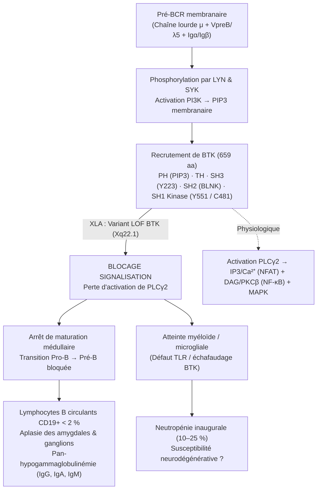
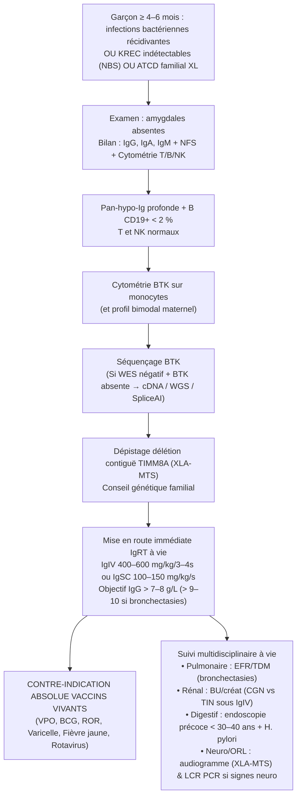

# Fiche #001 — Agammaglobulinémie liée à l'X (XLA / Maladie de Bruton)

> [!IMPORTANT]
> **Protocole Atlas IUIS 2024 — Semaine 1, Jour 1** · Statut : **Synthétisée (Deep Research)** · Indexée dans Notion (« Maladies IUIS 2024 »).

---

## 0. Carte d'identité IUIS 2024

| Propriété | Valeur |
|---|---|
| **Nom officiel** | Agammaglobulinémie liée à l'X (XLA / Maladie de Bruton / *BTK deficiency*) |
| **Table IUIS 2024** | **Table III** — Déficits prédominants de l'immunité humorale (*Predominantly antibody deficiencies*) |
| **Sous-table** | **Table III.1** — Réduction sévère de tous les isotypes d'Ig avec lymphocytes B profondément abaissés ou absents (Agammaglobulinémie) |
| **Gène impliqué** | ***BTK*** (*Bruton Tyrosine Kinase*, 659 aa, famille TEC) |
| **Locus** | `Xq22.1` |
| **Transmission** | **XL** (Récessive liée à l'X, perte de fonction / LOF) |
| **OMIM** | `#300755` (XLA) · `#300300` (*BTK*) |
| **Variants répertoriés** | **> 2 400 variants** dans LOVD (2025) |
| **Rang de priorité** | **#1 / 555** (Semaine 1 — Jour 1) |

---

## 1. TL;DR (Synthèse exécutive)

> [!TIP]
> L'**agammaglobulinémie liée à l'X (XLA)**, due à des variants perte de fonction de ***BTK*** (`Xq22.1`), représente **~85 % des agammaglobulinémies congénitales** et constitue l'IEI princeps (Bruton, 1952). La perte de la tyrosine kinase de Bruton interrompt la signalisation en aval du pré-BCR (`LYN/SYK → PI3K/PIP3 → BTK → PLCγ2 → Ca²⁺/NFAT & NF-κB`), bloquant la lymphopoïèse B médullaire à la **transition pro-B → pré-B**. Il en résulte une quasi-absence de lymphocytes B circulants (**CD19+ < 2 %**), une aplasie/hypoplasie des amygdales et ganglions et une **pan-hypogammaglobulinémie profonde**, avec des lymphocytes T et NK normaux. Dès 4–6 mois (déclin des IgG maternelles), les garçons développent des infections à **bactéries encapsulées** (*H. influenzae*, *S. pneumoniae*) et une vulnérabilité redoutable aux **entérovirus** (méningo-encéphalite chronique), à *Giardia*, *Mycoplasma/Ureaplasma* et aux *Helicobacter* entérohépatiques (*H. cinaedi*). Malgré la substitution à vie par immunoglobulines (IgIV/IgSC) et la contre-indication absolue aux vaccins vivants (VPO++), des défis majeurs persistent : bronchectasies, neurodégénérescence progressive, néphrites (CGN vs TIN sous IgIV) et adénocarcinomes digestifs précoces (< 40 ans). Le dépistage néonatal **KREC + NGS** et l'édition génomique **CRISPR-Cas9/rAAV6** redessinent l'avenir de la maladie.

---

## 2. Contexte historique

- **1952 — Naissance de l'immunologie clinique (Ogden C. Bruton)** : Le pédiatre américain Ogden C. Bruton (Walter Reed Army Hospital) décrit un garçon de 8 ans ayant subi 19 sepsis à pneumocoque depuis l'âge de 4 ans, sans pic des γ-globulines à l'électrophorèse (normale : 10,5–20,3 %). L'administration sous-cutanée de fraction II de Cohn remonte la fraction γ à 4,6 % et interrompt les infections — premier diagnostic biologique et premier traitement substitutif d'une IEI.
- **1993 — Clonage simultané de *BTK*** : Identification indépendante en `Xq21.3–Xq22` par Tsukada et al. (*Cell*, « BPK ») et Vetrie et al. (*Nature*, « ATK »), rebaptisée *BTK* en hommage à Bruton.
- **1996 — Syndrome contigu XLA-MTS** : Description des délétions englobant *BTK* et *TIMM8A* (situé à 770 pb en position centromérique), associant XLA et surdité/dystonie de Mohr-Tranebjaerg.
- **2000–2026 — Ère moderne** : Généralisation des IgSC, dépistage néonatal multiplex TREC/KREC + NGS (2025), 1re enquête internationale d'allogreffe de CSH (n = 22, 89 % d'arrêt des IgRT à 1 an) et validation préclinique de l'édition génomique CRISPR-Cas9/rAAV6 au locus endogène *BTK* (Luthers & Kohn, 2025).

---

## 3. Épidémiologie & Données de registres

- **Incidence** : **1 / 100 000 à 1 / 200 000** naissances vivantes (~85 % des agammaglobulinémies congénitales).
- **Mutations *de novo*** : **30 % à 50 %** des cas (formes sporadiques fréquentes ; l'absence d'antécédent familial n'exclut jamais une XLA).
- **Âge au diagnostic** : **2,59 ans** avec antécédent familial vs **5,37 ans** sans antécédent familial (cohorte US, n = 201).
- **Registres internationaux (USIDNET n = 226 & IPINet Italie)** :
  - **USIDNET** : 77,8 % d'infections ORL, 72,5 % d'infections respiratoires, 16 % d'arthrite inflammatoire/septique, 4 % de maladie de Crohn-like.
  - Avant diagnostic, **60 %** des garçons sporadiques sont reconnus lors d'une infection sévère (pneumonie/empyème, méningite, sepsis).
  - **IPINet (Italie)** : pathogènes prédominants : *H. influenzae* (**53,6 %**) et *S. pneumoniae* (**17,9 %**) dans les expectorations, *Giardia lamblia* (**48,7 %**) dans le tube digestif, et *S. aureus* (**75,8 %**) sur la peau.
  - De rares cas féminins existent (inactivation biaisée du chromosome X, syndrome de Turner `45,X0`) ainsi qu'un cas rapporté avec syndrome de Klinefelter (`47,XXY`).

---

## 4. Physiopathologie, Génétique moléculaire & Schéma 1

### Architecture de BTK & Cascade pré-BCR
La protéine **BTK** (659 aa, famille TEC) comporte **5 domaines conservés** :
1. **PH** (*Pleckstrin Homology*) : liaison membranaire au PIP3 généré par PI3K.
2. **TH** (*Tec Homology*) : motif zinc et région riche en proline.
3. **SH3** : site d'autophosphorylation **Y223**.
4. **SH2** : liaison à l'adaptateur **BLNK / SLP-65**.
5. **SH1 / Kinase** : transphosphorylation **Y551** par SYK/LYN et poche catalytique ATP (**C481**, cible de l'ibrutinib/acalabrutinib).

En plus de son activité enzymatique (activation de **PLCγ2 → IP3/Ca²⁺/NFAT + DAG/PKCβ/NF-κB + MAPK**), BTK possède une **fonction d'échafaudage non catalytique** (TLR9, HCK, ILK) et participe à la signalisation des TLR dans les cellules myéloïdes et la **microglie du SNC**.

### Schéma 1 — Architecture de BTK, cascade pré-BCR et blocage médullaire pro-B → pré-B

### Spectre mutationnel & Syndrome contigu XLA-MTS
- **Spectre mutationnel (LOVD 2025 : > 2 400 variants)** : faux-sens (20–37 %), délétions (17–38 %), non-sens (12–23 %), épissage (0–20 %), insertions (3–8 %), concentrés dans le domaine kinase **SH1 (~50 %)**. Environ **1 %** affectent le promoteur / 5'-UTR (sites **PU.1** et **Sp1**, à rapprocher de l'agammaglobulinémie PU.MA par mutation de *SPI1*) ou des **introns profonds** (`c.840-272G>T`) invisibles au WES → indiquer cytométrie BTK + cDNA/WGS/SpliceAI.
- **Syndrome contigu XLA–Mohr-Tranebjaerg (XLA-MTS)** : délétion englobant *BTK* et *TIMM8A* (à 770 pb, parfois jusqu'à *TAF7L/DRP2*). Sur 23 patients compilés (Kanegane 2025) : **surdité neurosensorielle progressive 78 %** (médiane 3,5 ans), retard de langage 52 % (3 ans), dystonie 22 % (5 ans), troubles visuels 13 % (15 ans), dysgraphie/DI 9 % (17,5 ans).

---

## 5. Présentation clinique, Pathogènes & Phénotype immunologique

### Spectre infectieux & signes cliniques
- **Bactéries encapsulées (dès 4–6 mois)** : *H. influenzae*, *S. pneumoniae*, *S. aureus*, *P. aeruginosa* → OMA, sinusites, pneumonies, empyèmes, sepsis, méningites.
- ***Helicobacter* (gastrique & NHPH)** : *H. pylori* (gastrite atrophique → cancer gastrique) ; *H. cinaedi* / *H. bilis* (NHPH) → cellulites chroniques, ulcères cutanés, *pyoderma gangrenosum* (non prévenus par IgRT ; hémocultures prolongées + PCR 16S + antibiothérapie ≥ 6 sem).
- **Entérovirus & virus émergents** : Echovirus/Coxsackie/Polio → **méningo-encéphalite chronique**, syndrome dermatomyosite-like ; **Aichivirus** (hépatite/colite chronique), **Astrovirus** (encéphalite), Norovirus, SARS-CoV-2 prolongé.
- **Germes atypiques** : *Mycoplasma* / *Ureaplasma* (arthrites septiques à cultures stériles), *Giardia lamblia* (diarrhée/malabsorption).
- **Signes cardinaux** : amygdales absentes/hypoplasiques ; **neutropénie inaugurale (10–25 %)** réversible sous IgRT ; arthrite inflammatoire (16 % USIDNET, VS normale et auto-Ac négatifs).

### Phénotype immunologique & biomarqueurs
- **Lymphocytes B (`CD19+`/`CD20+`)** : **< 2 %** (souvent < 0,1 %).
- **Immunoglobulines** : pan-hypogammaglobulinémie profonde (IgG < 2 g/L après 6 mois, IgA et IgM indétectables) ; isoagglutinines et Ac vaccinaux absents.
- **Lymphocytes T & NK** : normaux en nombre et fonction.
- **Cytométrie BTK (monocytes)** : absente/effondrée (~85–90 %) ; **profil bimodal en mosaïque** chez la mère conductrice.
- **Biomarqueurs modernes** : **KREC** indétectables sur buvard néonatal ; **sBCMA** sérique effondré (marqueur sensible de l'absence de plasmocytes/B).
- **Confirmation** : séquençage *BTK* (+ WGS/cDNA si WES négatif).

---

## 6. Complications à long terme & Défis non résolus (Kanegane & Ochs, 2025)

1. **Bronchectasies & BPCO précoce** : première cause de morbidité adulte malgré les IgRT (absence d'IgA/IgM muqueuses non substituées), pouvant conduire jusqu'à la transplantation pulmonaire.
2. **Neurodégénérescence progressive non infectieuse** : **15 cas rapportés** (début moyen à 10,15 ans ; **létale dans 10/13 cas** malgré IgRT). Pistes : virus occulte du SNC (astrovirus/picornavirus) et/ou dysfonction microgliale BTK-dépendante.
3. **Néphrites XLA : CGN vs TIN** :
   - **CGN** (IgAN/MPGN/GEM) : formes atypiques/*leaky* (B résiduels), bon pronostic sous corticoïdes/IEC.
   - **TIN** (néphrite tubulo-interstitielle) : XLA classique après **> 10 ans d'IgIV** (infiltrat CD8+ + dépôts IgG), risque d'IRC/IRCT → discuter passage aux IgSC.
4. **Cancers digestifs précoces & Hémopathies** : adénocarcinomes gastriques/colorectaux : **13/15 cas avaient < 40 ans (8 ≤ 30 ans !)**, liés à l'inflammation chronique (*H. pylori*). LAL-B/LAM : modèle *two-hit* (blocage BTK + *CDKN2A/TP53*/monosomie 7).

---

## 7. Avenues thérapeutiques

- **Substitution en immunoglobulines (IgRT) à vie** : **IgIV 400–600 mg/kg / 3–4 sem** ou **IgSC 100–150 mg/kg/sem** (ou fSCIG). Objectif : IgG résiduelles **> 7–8 g/L** (**> 9–10 g/L** si bronchectasies), adapté au *biological trough level* clinique.
- **Antibiothérapie & Antiviraux** : traitement curatif prolongé (10–14 j ; **≥ 6 sem** si NHPH *H. cinaedi*) ; prophylaxie (azithromycine/amoxicilline) si bronchectasies. Pour les entérovirus sévères / poliovirus chronique : IgIV fortes doses + **combinaisons antivirales précoces** (remdesivir, pocapavir [40,9 % de résistances en monothérapie], fluoxétine, favipiravir, nitazoxanide).
- **Allogreffe de CSH (HSCT — thérapie de sauvetage)** : enquête internationale récente (**n = 22**) : prise de greffe **95 %**, survie globale à 2 ans **86 %**, EFS **77 %**, et **89 % d'arrêt des IgRT à 1 an** (conditionnement RIC à la fludarabine privilégié).
- **Édition génomique CRISPR-Cas9 / rAAV6 (préclinique avancé 2025)** : insertion site-spécifique de l'ADNc *BTK* dans l'intron 1 ou l'exon 2 endogène (Luthers & Kohn, UCLA, 2025) — régulation lignée-spécifique conservée, avantage sélectif splénique fort (~10–15 % médullaire → ~35 % splénique) permettant d'envisager un conditionnement RIC.

---

## 8. Section pratique (Bedside, Guidelines & Schéma 2)

### Schéma 2 — Algorithme diagnostique et de prise en charge multidisciplinaire de la XLA

### Tableau de diagnostic différentiel des IEI apparentées

| Entité | Table IUIS 2024 | Gène / Transm. | CD19+ | Éléments clés de distinction |
|---|---|---|---|---|
| **XLA (Bruton)** | III.1 | *BTK* (XL) | < 2 % | Garçon (~85 %), BTK absente sur monocytes, profil bimodal maternel. |
| **Agammaglobulinémies AR** | III.1 | *IGHM, IGLL1, CD79A/B, BLNK* (AR) | < 2 % | Touche aussi les filles, consanguinité, début souvent plus précoce/sévère (*IGHM*), BTK normale. |
| **PU.MA (Déficit en PU.1)** | III.1 | *SPI1* (AD) | < 2 % | Déficit associé en cellules dendritiques (cDC/pDC) ; PU.1 active le promoteur de *BTK*. |
| **Syndrome de Good** | Acquis (X) | Non monogénique | Très bas | Adulte > 40 ans, thymome au TDM thoracique, déficit T associé. |
| **DICV (CVID)** | III.2 | Polygénique / *NFKB1*… | Souvent > 2 % | Auto-immunité et splénomégalie fréquentes (piège : *BTK* hypomorphe !). |
| **Hyper-IgM lié à l'X** | I.3 | *CD40LG* (XL) | Normaux | IgM normales/hautes, *Pneumocystis*, *Cryptosporidium*, cholangite sclérosante. |

### Perles cliniques & Pièges à ne jamais oublier
1. **Sérologies ininterprétables** : faussement négatives avant IgRT, et reflet des donneurs sous IgRT → toujours utiliser **PCR / antigènes / cultures** (*H. pylori*, entérovirus, *Mycoplasma*).
2. **Un WES négatif n'exclut pas une XLA** : ~1 % de variants non codants (promoteur PU.1/Sp1, exon −1) ou introniques profonds (`c.840-272G>T`) → coupler à la **cytométrie BTK** et au **WGS/cDNA**.
3. **Cellulite chronique / ulcères cutanés / *pyoderma gangrenosum* sous IgRT** : penser aux ***Helicobacter* entérohépatiques** (*H. cinaedi*, *H. bilis*) → hémocultures prolongées + PCR 16S + ≥ 6 sem d'antibiotiques.
4. **Arthrite chronique à culture stérile** : prescrire une **PCR *Mycoplasma / Ureaplasma*** (et noter que VS et auto-Ac sont faussement normaux/négatifs !).
5. **Surdité neurosensorielle progressive** : ne pas tout imputer aux otites → dépister une **délétion contiguë *BTK–TIMM8A* (XLA-MTS)**.
6. **Suivi rénal & digestif adulte** : ajouter la **bandelette urinaire** (CGN vs TIN sous IgIV) et débuter la **surveillance endoscopique digestive précocement (< 30–40 ans)**.

---

## 9. Nouveautés & Littérature récente (2024–2026)

1. **Revue de référence « Revisiting X-linked agammaglobulinemia » (Kanegane & Ochs, *J Hum Immun*, avr. 2025, `PMID: 42170232`)** : synthèse majeure sur les 6 défis non résolus : variants non codants/introniques profonds de *BTK* (> 2 400 variants LOVD), délétions contiguës XLA-MTS (23 cas), *Helicobacter* NHPH, neurodégénérescence microgliale (15 cas, 10/13 létaux), néphrites CGN vs TIN, cancers digestifs précoces (13/15 < 40 ans) et cohorte internationale HSCT (n = 22, 89 % d'arrêt des IgRT à 1 an).
2. **Dépistage néonatal KREC + NGS de seconde intention (N = 110 491, *J Clin Immunol*, nov. 2025, `PMID: 41203922`)** : sur 110 491 buvards testés par multiplex TREC/KREC, 136 présentaient des KREC abaissés ; l'ajout d'un panel NGS ciblé de 73 gènes en seconde intention s'est révélé la méthode la plus efficace pour réduire les faux positifs et diagnostiquer la XLA avant le déclin des IgG maternelles.
3. **Édition génomique site-spécifique CRISPR-Cas9 / rAAV6 de *BTK* (Luthers & Kohn, *Mol Ther Methods Clin Dev*, août 2025, `PMID: 40917692`)** : l'insertion ciblée d'un ADNc *BTK* dans l'intron 1 ou l'exon 2 endogène chez la souris *Btk/Tec−/−* restaure la maturation B, la diversité BCR, les 4 isotypes d'Ig et les réponses vaccinales T-dépendantes, avec régulation lignée-spécifique préservée et avantage sélectif splénique (~10–15 % → ~35 %), ouvrant la voie à un conditionnement RIC.
4. **Combinaisons antientérovirales & coût-efficacité du dépistage KREC (`PMCID: PMC12574243`, 2025 & `PMCID: PMC13577962`, sept. 2026)** : clairance rapide du poliovirus chronique sous remdesivir et pocapavir, mais résistances fréquentes en monothérapie (40,9 % sous pocapavir) → rationnel pour des combinaisons précoces (IgIV + fluoxétine/favipiravir/remdesivir). Confirmation du bénéfice coût-efficacité du dépistage néonatal KREC (sept. 2026).

---

## 10. Références vérifiées

1. Poli MC et al. *Human inborn errors of immunity: 2024 update on the classification from the IUIS Expert Committee*. **J Hum Immun**. 2025;1(1):e20250003. `PMID: 41608114`.
2. Kanegane H, Tanita K, ..., Ochs HD. *Revisiting X-linked agammaglobulinemia*. **J Hum Immun**. 2025;1(1):e20250020. `PMID: 42170232`.
3. Luthers CR, ..., Kohn DB. *Hematopoietic stem cell gene therapy for the treatment of X-linked agammaglobulinemia*. **Mol Ther Methods Clin Dev**. 2025;33(3):101555. `PMID: 40917692`.
4. *Next-generation Sequencing and Other Second Tier Tests in Newborn Screening for (X-linked) Agammaglobulinemia*. **J Clin Immunol**. 2025 Nov 8. `PMID: 41203922`.
5. Cardenas-Morales M, Hernandez-Trujillo VP. *Agammaglobulinemia: from X-linked to Autosomal Forms of Disease*. **Clin Rev Allergy Immunol**. 2021. `PMCID: PMC8269404`.
6. *Current infectious disease management challenges in inborn errors of immunity*. 2025. `PMCID: PMC12574243`.
7. *The Evolving Role of Bruton's Tyrosine Kinase Inhibitors in B Cell Malignancies*. 2024. `PMCID: PMC11276629`.
8. *Self-reported Clinical Outcomes and Quality of Life in X-Linked Agammaglobulinemia*. 2025 Aug 28. `PMCID: PMC12378137`.
9. *The cost-benefit of newborn screening for X-linked agammaglobulinemia*. 2026 Sep 15. `PMCID: PMC13577962`.
10. Bruton OC. *Agammaglobulinemia*. **Pediatrics**. 1952;9(6):722–728.
11. Smith CIE, Berglöf A. *X-Linked Agammaglobulinemia*. **GeneReviews®** [Internet]. `NBK1453`.
