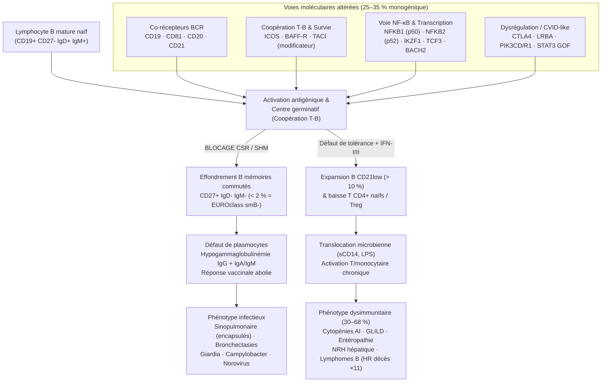
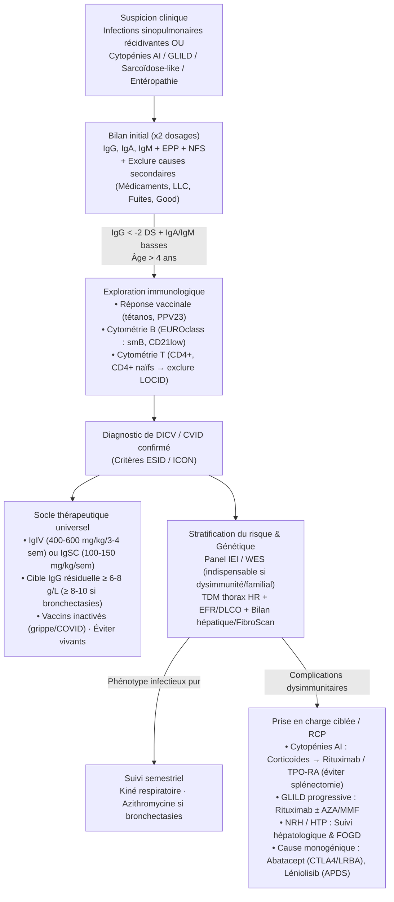

# Fiche #002 — Déficit immunitaire commun variable (DICV / CVID)

> [!IMPORTANT]
> **Protocole Atlas IUIS 2024 — Semaine 1, Jour 2** · Statut : **Synthétisée (Deep Research)** · Format prêt pour indexation Notion (« Classification IUIS »).

---

## 0. Carte d'identité IUIS 2024

| Propriété | Valeur |
|---|---|
| **Nom officiel** | Déficit immunitaire commun variable (DICV / *Common Variable Immunodeficiency Disorders*, CVID) |
| **Table IUIS 2024** | **Table III** — Déficits prédominants de l'immunité humorale (*Predominantly antibody deficiencies*) |
| **Sous-table** | **Table III.2** — Réduction sévère d'au moins 2 isotypes d'Ig avec lymphocytes B normaux ou bas (phénotype CVID) |
| **Gène(s) impliqué(s)** | **~65–75 % polygénique / indéterminé** ; **~25–35 % monogénique** : *NFKB1* (cause monogénique #1 en Europe), *NFKB2*, *ICOS*, *CD19*, *CD81*, *CD20* (*MS4A1*), *CD21* (*CR2*), *TNFRSF13C* (BAFF-R), *IKZF1*, *IRF2BP2*, *TCF3*, *BACH2*, *RAC2*, *ATP6AP1*, *ARHGEF1*, *SH3KBP1*, *SEC61A1*, *PTEN* ; gène modificateur/susceptibilité majeur : *TNFRSF13B* (TACI) ; phénocopies *CVID-like* : *PIK3CD/PIK3R1* (APDS), *CTLA4*, *LRBA*, *STAT3* GOF |
| **Locus** | Multiple (ex. *NFKB1* : 4q24 ; *NFKB2* : 10q24.32 ; *TNFRSF13B* : 17p11.2 ; *ICOS* : 2q33.2) |
| **Transmission** | Variable : sporadique/polygénique majoritaire ; **AD** à pénétrance incomplète (*NFKB1*, *NFKB2*, *IKZF1*, *TCF3*, *CTLA4*…) ou **AR** (*ICOS*, *CD19*, *CD81*, *LRBA*…) |
| **OMIM** | `#607594` (CVID1–14) · `#616576` (*NFKB1*) · `#615577` (*NFKB2*) |
| **Rang de priorité** | **#2 / 555** (Semaine 1 — Jour 2) |

---

## 1. TL;DR (Synthèse exécutive)

> [!TIP]
> Le **déficit immunitaire commun variable (DICV / CVID)** est l'erreur innée de l'immunité (IEI) symptomatique la plus fréquente en pratique clinique (**~1 : 25 000 à 1 : 50 000**), diagnostiquée principalement chez le jeune adulte (20–40 ans) après un retard diagnostique médian de 4 à 7 ans. Il résulte d'un **défaut de différenciation terminale des lymphocytes B** (altération du centre germinatif, effondrement des **lymphocytes B mémoires commutés CD27+IgD−IgM−**, expansion de B **CD21low** autoréactifs) entraînant une hypogammaglobulinémie (IgG abaissées ≥ 2 DS + IgA et/ou IgM basses) et un défaut de réponse vaccinale. Bien que ~25–35 % des cas soient désormais résolus sur le plan moléculaire (principalement *NFKB1* AD, *NFKB2*, *IKZF1*, *CTLA4/LRBA* ou le modificateur *TNFRSF13B*/TACI), la majorité demeure complexe/polygénique. Cliniquement, deux grands phénotypes s'opposent : une forme **purement infectieuse** (infections sinopulmonaires à bactéries encapsulées, bronchectasies) de bon pronostic sous substitution par immunoglobulines (IgIV/IgSC), et une forme **dysimmunitaire / inflammatoire** (30–68 % des patients : cytopénies auto-immunes, **GLILD**, entéropathie chronique/norovirus, hyperplasie nodulaire régénérative hépatique, lymphoprolifération et **lymphomes B / cancers gastriques**) associée à un **risque de mortalité multiplié par 11** et justifiant un séquençage génétique systématique pour ouvrir l'accès aux thérapies ciblées.

---

## 2. Contexte historique

- **1953 — Description princeps (Janeway et al.)** : Un an après la description de la XLA chez l'enfant par Bruton, Charles Janeway rapporte les premiers cas d'agammaglobulinémie d'apparition tardive chez l'adulte (y compris chez des femmes), posant les bases du DICV.
- **1971 — Création du terme « CVID » (OMS)** : Un comité de l'Organisation mondiale de la santé propose l'appellation *Common Variable Immunodeficiency* pour regrouper les hypogammaglobulinémies primitives hétérogènes n'entrant pas dans les déficits mendéliens classiques.
- **1999–2016 — Critères diagnostiques & phénotypage** : Critères ESID/PAGID (1999), **classification EUROclass** par cytométrie B (Wehr et al., *Blood* 2008), définition du sous-groupe **LOCID** (*Late-Onset Combined Immunodeficiency*) par l'étude française **DEFI** (Malphettes et al., *Clin Infect Dis* 2009), critères ESID révisés (2014/2019) et consensus international **ICON** (Bonilla et al., *JACI Pract* 2016).
- **2003 — Premier gène monogénique (*ICOS*)** : Grimbacher et al. identifient des délétions homozygotes d'*ICOS* comme première cause monogénique de CVID, suivies de *TNFRSF13B* (TACI, 2005), *CD19* (2006), *NFKB2* (2013) et **NFKB1** (Fliegauf 2015 ; Tuijnenburg 2018), aujourd'hui reconnu comme la première cause monogénique en Europe.
- **2020–2026 — Démembrement génomique & médecine de précision** : L'essor du WES/WGS révèle ~25–35 % de causes monogéniques ou *CVID-like* (APDS, CTLA-4, LRBA, STAT3 GOF), permettant de passer d'une immunosuppression empirique à des thérapies ciblées (léniolisib, abatacept, inhibiteurs de JAK).

---

## 3. Épidémiologie & Données de registres

- **Prévalence** : **1 : 25 000 à 1 : 50 000** dans les populations européennes et nord-américaines (jusqu'à ~1 : 20 000 selon certaines estimations) ; plus rare en Asie de l'Est. **IEI symptomatique la plus fréquente** suivie dans les centres adultes (représentant ~20–25 % de l'ensemble des IEI enregistrées dans ESID).
- **Sex-ratio & Âge au diagnostic** : Sex-ratio global équilibré (~1:1), avec une prédominance masculine dans les formes à début pédiatrique et légèrement féminine à l'âge adulte. Distribution bimodale avec un premier pic dans l'enfance (**33,7 %** de début < 10 ans dans la cohorte ESID de 2 212 patients, Gathmann et al., *JACI* 2014) et un pic principal entre **20 et 40 ans**.
- **Retard diagnostique** : Médiane de **4 à 7 ans** (ESID, USIDNET, DEFI), en réduction progressive mais encore responsable d'une forte prévalence de bronchectasies dès le diagnostic.
- **Données des grandes cohortes** :
  - **ESID (n = 2 212, Gathmann et al., 2014)** : 33,7 % début < 10 ans ; forte hétérogénéité des pratiques d'IgRT en Europe ; retard diagnostique corrélé à la mortalité.
  - **Mount Sinai — New York (n = 473 suivis sur 4 décennies, Resnick et al., *Blood* 2012)** : 94 % d'infections ; **68 % de complications non infectieuses** (auto-immunité 28,6 %, pneumopathie chronique 28,5 %, bronchectasies 11,2 %, entéropathie 15,4 %, granulomatose 9,7 %, hépatopathie 9,1 %, lymphome 8,2 %, autres cancers 7,0 %). **Mortalité globale 19,6 %**, avec un **risque de décès multiplié par 11** (**HR = 10,95**, *p* < 0,0001) en présence de complications non infectieuses par rapport au phénotype purement infectieux.
  - **Cohorte française DEFI (n = 313, Malphettes et al., 2009)** : **8,9 %** des patients répondent aux critères de **LOCID** (infection opportuniste et/ou CD4+ < 200/mm³), avec consanguinité significativement plus fréquente (29 % vs 8 %, *p* = 0,004).
  - **Revue systématique mondiale (J Hum Immun 2025, PMCID: PMC13177467)** : prévalence médiane des complications non infectieuses : splénomégalie **35,2 %**, diarrhée chronique **27,8 %**, cytopénies auto-immunes **18,0 %**, hyperplasie nodulaire lymphoïde **17,0 %**, entéropathie **16,0 %**, PID/GLILD **8,7 %**.

---

## 4. Physiopathologie, Génétique moléculaire & Schéma 1

### Mécanismes immunologiques
Contrairement à la XLA (blocage médullaire précoce pro-B → pré-B), le DICV se caractérise dans ~90 % des cas par un **nombre normal ou modérément abaissé de lymphocytes B circulants**, mais un **blocage périphérique de la différenciation terminale** dans le centre germinatif :
1. **Défaut de commutation isotypique (CSR) et d'hypermutation somatique (SHM)** : effondrement des lymphocytes B mémoires commutés (**CD19+CD27+IgD−IgM− < 2 %** des B dans le groupe `smB-` d'EUROclass) et défaut de génération de plasmablastes/plasmocytes médullaires à longue durée de vie.
2. **Expansion des lymphocytes B CD21low (> 10 %)** : population B anergique, enrichie en récepteurs autoréactifs et associée à une signature transcriptionnelle **interféron de type I et II (IFN-γ)**, fortement corrélée à la splénomégalie, la GLILD et les cytopénies auto-immunes.
3. **Dysrégulation T associée & translocation microbienne** : diminution des lymphocytes T CD4+ naïfs (`CD45RA+`) et des **Treg (FoxP3+)**, épuisement T (`PD-1+`, `sCD25`, `sTIM-3`), et **translocation microbienne intestinale** liée au déficit en IgA sécrétoires (élévation du **sCD14**, LBP, zonuline et ADN bactérien circulant), entretenant une inflammation systémique chronique.

### Paysage génétique (WES / WGS)
- **Rendement moléculaire** : **~25–35 %** (31 % dans la cohorte Mount Sinai de 405 patients, Cunningham-Rundles et al., *Front Genet* 2024), plus élevé en cas de début pédiatrique, d'antécédents familiaux ou de complications granulomateuses/auto-immunes.
- **Gènes majeurs** :
  - ***NFKB1* (AD, haploinsuffisance p105/p50)** : cause monogénique #1 en Europe (~4–5 % des CVID), pénétrance incomplète liée à l'âge, déficit humoral progressif, lymphoprolifération, splénomégalie (48 %), auto-immunité (48 %).
  - ***NFKB2* (AD, voie NF-κB non canonique p100/p52)** : triade évocatrice **CVID précoce + déficit antéhypophysaire (ACTH/cortisol) + alopécie/trachyonychie** (syndrome DAVID).
  - ***TNFRSF13B* (TACI)** : variants retrouvés chez ~8–10 % des CVID (ex. `p.Cys104Arg`, `p.Ala181Glu`) ; considéré comme **gène de susceptibilité / modificateur** (fréquent chez des porteurs sains), fortement associé aux cytopénies auto-immunes et à la lymphoprolifération ; peut agir en **épistasie digénique** (ex. *TCF3* + *TACI*).
  - **Co-récepteurs B & coopération T-B** : *ICOS* (AR), complexe CD19/CD21/CD81 (AR), *CD20* (*MS4A1*), *TNFRSF13C* (BAFF-R).
  - **Facteurs de transcription & phénocopies *CVID-like*** : *IKZF1* (IKAROS), *TCF3*, *BACH2*, *IRF2BP2* ; et gènes de dysrégulation ou PI3K mimant un CVID : *CTLA4* (AD), *LRBA* (AR), *PIK3CD/PIK3R1* (APDS), *STAT3* GOF.
- **Facteurs épigénétiques & polygéniques** : défaut de déméthylation des îlots CpG lors de la transition B naïf → B mémoire (Del Pino-Molina 2019 ; single-cell atlas Rodriguez-Ubreva 2022).

### Schéma 1 — Physiopathologie, voies moléculaires et classification EUROclass

---

## 5. Présentation clinique, Pathogènes & Phénotype immunologique

### A. Manifestations infectieuses (~90–95 % des patients)
- **Infections sinopulmonaires récidivantes** (présentes au diagnostic chez ~75 % des patients) : sinusites chroniques, otites, bronchites, pneumonies communautaires récidivantes compliquées de **bronchectasies** (11–30 % selon les cohortes).
  - *Germes principaux* : ***Streptococcus pneumoniae***, ***Haemophilus influenzae*** (non typable++), *Moraxella catarrhalis*, *Staphylococcus aureus*, *Mycoplasma pneumoniae*.
- **Infections digestives** : diarrhées chroniques ou récidivantes à ***Giardia duodenalis***, ***Campylobacter jejuni***, *Salmonella* spp., *Clostridioides difficile*, ***Helicobacter pylori*** (gastrite atrophique) et **norovirus chronique** (~7–11 % des entéropathies CVID).
- **Infections sévères / inhabituelles** : méningites (6 %), septicémies (8 %), arthrites septiques à *Mycoplasma/Ureaplasma*. La survenue d'**infections opportunistes** (*Pneumocystis jirovecii*, *Cryptosporidium*, CMV, mycobactéries atypiques) doit faire reclasser le patient en **LOCID** ou rechercher un déficit combiné (CID/PIRD).

### B. Manifestations non infectieuses / dysimmunitaires (30–68 %)
Elles peuvent **précéder le diagnostic de plusieurs années** et révéler la maladie en l'absence d'infections notables :
- **Auto-immunité (~25–37 %)** : dominée par les **cytopénies auto-immunes** (~18–22 % : **PTI** #1, **AHAI**, syndrome d'Evans, neutropénie auto-immune). Autres : thyroïdite, vitiligo, alopécie, uvéite, arthrites séronégatives, anémie de Biermer.
- **Lymphoprolifération bénigne (~20–35 %)** : splénomégalie (35 %), adénopathies persistantes, hyperplasie nodulaire lymphoïde (HNL) digestive.
- **Granulomatose systémique (~9–15 %) & GLILD (~10–20 %)** : pneumopathie interstitielle granulomateuse et lymphocytaire (nodules, verre dépoli, adénopathies médiastinales) mimant une **sarcoïdose** (mais avec hypogammaglobulinémie !).

### C. Phénotype immunologique & classification EUROclass (Wehr et al., *Blood* 2008)
- **Immunoglobulines** : IgG < −2 DS (souvent < 4–5 g/L chez l'adulte) + diminution des IgA (< 0,07 g/L fréquente) et/ou des IgM.
- **Réponse vaccinale** : absence de séroconversion aux antigènes protéiques (tétanos, diphtérie) et/ou polysaccharidiques (pneumocoque non conjugué PPV23).
- **Classification EUROclass (cytométrie des lymphocytes B)** :
  - **`B−`** (CD19+ ≤ 1 % des lymphocytes) : défaut précoce sévère (~10 % des CVID ; éliminer une XLA/agammaglobulinémie AR).
  - **`B+ smB−`** (B > 1 %, B mémoires commutés CD27+IgD−IgM− ≤ 2 % des B) : défaut du centre germinatif → **risque accru de splénomégalie et de granulomatose**.
  - **`B+ smB+`** (B mémoires commutés > 2 %) : phénotype plus modéré.
  - Modificateurs : **`CD21low`** (> 10 % des B) → associé à la **splénomégalie et l'auto-immunité** ; **`Trhigh`** (B transitionnels > 9 %) → associé aux **adénopathies**.
- **Sous-populations T** : indispensable pour dépister un **LOCID** (CD4+ < 200/mm³ ou CD4+ naïfs < 10–15 %).

---

## 6. Complications à long terme & Défis non résolus

1. **GLILD (*Granulomatous-Lymphocytic Interstitial Lung Disease*)** :
   - Combine pneumonie interstitielle lymphocytaire (LIP), bronchiolite folliculaire, hyperplasie lymphoïde et granulomes non nécrosants.
   - Facteur majeur de mortalité respiratoire (évolution vers la fibrose et l'insuffisance respiratoire chronique ; 6,1 % d'oxygénothérapie dans Resnick 2012).
2. **Entéropathie du DICV (~10–20 %)** :
   - Diarrhée chronique, malabsorption sévère, atrophie villositaire « *sprue-like* » (mimant une maladie cœliaque mais **sans anticorps anti-transglutaminase**, **sans plasmocytes** dans la *lamina propria* et **résistante au régime sans gluten**).
   - Rôle pathogène majeur du **norovirus chronique** (lésion épithéliale médiée par les lymphocytes T CD8+ cytotoxiques persistants ; PMC12612983).
3. **Hépatopathie & Hyperplasie nodulaire régénérative (NRH, ~10–15 %)** :
   - Première cause d'hépatopathie du DICV : infiltration sinusoïdale T CD8+ → oblitération veinulaire portale → **hypertension portale non cirrhotique (NCPH)** (ascite, varices œsophagiennes, hypersplénisme). Souvent révélée par une cholestase anictérique (PAL/GGT élevées) et une thrombopénie progressive ; la transplantation hépatique a un pronostic réservé (récidive de la NRH sur le greffon).
4. **Risque néoplasique majeur (prévalence globale ~8,6 %, méta-analyse sur 8 123 patients)** :
   - **Lymphomes non hodgkiniens B (4,1–8,2 %)** : DLBCL, lymphomes de la zone marginale / **MALT** (gastrique, pulmonaire, parotidien), survenant typiquement entre 40 et 70 ans ; facteurs de risque : **IgM résiduelles élevées**, lymphoprolifération, polyauto-immunité.
   - **Adénocarcinome gastrique (~1,5 %, risque relatif ×10 à ×50)** : favorisé par l'achlorhydrie, la gastrite atrophique auto-immune/Biermer et l'infection chronique à *H. pylori*.

---

## 7. Avenues thérapeutiques

- **Substitution par immunoglobulines (IgRT) — Socle absolu à vie** :
  - **IgIV** : 400–600 mg/kg toutes les 3–4 semaines ; **IgSC** : 100–150 mg/kg/semaine (ou **fSCIG** facilitée par hyaluronidase toutes les 3–4 semaines).
  - **Objectif biologique** : taux résiduel (*trough*) d'IgG **≥ 6–8 g/L**, relevé à **≥ 8–10 g/L** (voire personnalisé « taux biologique efficace ») en cas de **bronchectasies** ou d'infections persistantes.
  - **Limite critique** : les IgRT préviennent efficacement les pneumonies bactériennes mais **ne préviennent ni ne traitent les complications dysimmunitaires** (GLILD, cytopénies, entéropathie, NRH, lymphomes).
- **Antibioprophylaxie & kinésithérapie respiratoire** : azithromycine (250–500 mg × 3/semaine) en cas de bronchectasies avec exacerbations ≥ 3/an ; drainage bronchique quotidien.
- **Prise en charge des complications dysimmunitaires** :
  - **Cytopénies auto-immunes (PTI / AHAI)** : corticoïdes en cure courte + IgIV haute dose en urgence ; en 2e ligne : **rituximab** (375 mg/m²/sem × 4) ou agonistes du récepteur de la TPO (romiplostim/eltrombopag). **Éviter au maximum la splénectomie** (risque majeur de sepsis fulminant à encapsulés, même sous IgRT).
  - **GLILD** : si progression clinique/EFR (baisse CVF/DLCO) ou radiologique : corticoïdes seuls souvent insuffisants ou rechute à la décroissance → association **rituximab + azathioprine ou mycophénolate mofétil (MMF)**, ou **rituximab en monothérapie de 1re ligne** (efficacité démontrée sur DLCO, CPT et score TDM de Baumann, Smits/Lougaris et al., *J Clin Immunol* 2023).
  - **Entéropathie CVID** : éradiquer d'abord *Giardia*, *Campylobacter* et rechercher le **norovirus** (ribavirine/nitazoxanide d'efficacité inconstante) ; puis **budésonide oral** (à libération iléale/colique), anti-TNF ou védolizumab ; support nutritionnel.
- **Médecine de précision (si cause monogénique identifiée)** :
  - ***CTLA4* / *LRBA*** → **Abatacept** (CTLA4-Ig) ; ***PIK3CD/PIK3R1* (APDS)** → **Léniolisib** (inhibiteur sélectif de PI3Kδ) ; ***STAT3* GOF** → **Ruxolitinib / Tocilizumab**.
- **Allogreffe de CSH (HSCT)** : réservée aux formes réfractaires gravissimes (dysrégulation multiviscérale menaçant le pronostic vital, LOCID sévère ou lymphome), avec une mortalité liée à la greffe historiquement élevée (~40–50 % dans la série multicentrique de Wehr et al., *JACI* 2015), imposant une sélection rigoureuse.

---

## 8. Section pratique (Bedside, Guidelines & Schéma 2)

### Critères diagnostiques ESID (2014/2019) & ICON (2016)
Tous les critères suivants doivent être réunis :
1. **Clinique** : au moins une manifestation parmi : susceptibilité accrue aux infections, auto-immunité, granulomatose, lymphoprolifération polyclonale inexpliquée, ou parent atteint de déficit humoral.
2. **Biologie humorale** : diminution marquée des **IgG** (≥ 2 DS sous la moyenne pour l'âge, confirmée sur 2 dosages à ≥ 3 semaines d'intervalle) **ET** diminution des **IgA** et/ou des **IgM**.
3. **Défaut fonctionnel B** : mauvaise réponse vaccinale (et/ou iso-hémagglutinines absentes) **ET/OU** lymphocytes B mémoires commutés < 70 % de la normale pour l'âge.
4. **Âge & Exclusions** : **âge > 4 ans** ; exclusion formelle de toute **hypogammaglobulinémie secondaire** (médicaments : rituximab, anti-épileptiques, corticoïdes ; hémopathies : LLC, myélome, lymphome ; fuites protéiques : syndrome néphrotique, entéropathie exsudative ; thymome = syndrome de Good) et d'un **déficit cellulaire T profond** (CD4+ < 200/mm³, CD4+ naïfs effondrés, prolifération absente).

### Calendrier de suivi multidisciplinaire & Vaccinations
- **Tous les 3–6 mois** : examen clinique (poids, aires ganglionnaires, rate, auscultation), NFS-plaquettes, bilan hépatique (PAL/GGT++ pour dépister la NRH), IgG résiduelles, créatininémie.
- **Annuel** : EFR complètes avec **DLCO** (dépistage précoce de la GLILD), échographie abdominale + élastométrie hépatique (FibroScan) si cholestase/splénomégalie, recherche de *H. pylori* si dyspepsie.
- **Tous les 2–5 ans (ou selon clinique)** : **TDM thoracique haute résolution** (bronchectasies, nodules GLILD) ; **FOGD** (fibroscopie gastrique avec biopsies) systématique au diagnostic puis périodique si gastrite atrophique, métaplasie intestinale, *H. pylori* ou Biermer.
- **Séquençage génétique (panel IEI / WES)** : **recommandé dès le diagnostic** chez tout patient présentant une complication non infectieuse, un début pédiatrique, une histoire familiale ou un phénotype LOCID.
- **Vaccinations** : vaccins **inactivés fortement recommandés** (grippe saisonnière annuelle, COVID-19 ARNm — bénéfice sur l'immunité T). **Vaccins vivants atténués** (ROR, varicelle, fièvre jaune, BCG, VPO) généralement **contre-indiqués** (en particulier en cas de déficit T ou sous immunosuppresseurs).

### Schéma 2 — Algorithme diagnostique et de prise en charge multidisciplinaire

### Tableau de diagnostic différentiel

| Entité | Âge & Clinique clé | Lymphocytes B & T | Immunoglobulines | Piège / Clé diagnostique |
|---|---|---|---|---|
| **DICV / CVID** (Table III.2) | Enfant (> 4 ans) ou **adulte (20–40 ans)** ; infections + dysimmunité (30–68 %) | B normaux ou bas, **smB− (< 2 %)**, CD21low ↑ ; T conservés (hors LOCID) | **IgG ↓↓** + **IgA ↓** et/ou **IgM ↓** ; Ac vaccinaux abolis | Diagnostic d'exclusion ; ~25–35 % monogénique (*NFKB1*++) |
| **XLA (*BTK*)** (Table III.1) | Garçon dès 4–6 mois ; amygdales absentes ; entérovirus | **B absents (CD19+ < 2 %)** ; T normaux | Pan-hypogammaglobulinémie profonde | Formes hypomorphes de *BTK* à l'âge adulte mimant un CVID |
| **Syndrome de Good** | Adulte > 40–50 ans ; infections + opportunistes (CMV, *Candida*) | **B absents/très bas** + inversion CD4/CD8 | Hypogammaglobulinémie globale | **Toujours réaliser un TDM thoracique** (thymome associé) |
| **APDS1/2 (*PIK3CD/R1*)** | Enfance/ado ; lymphoprolifération massive, bronchectasies, EBV/CMV | B transitionnels ↑↑, smB ↓, T CD8+ sénescents ↑ | IgG ↓, IgA ↓, **IgM normale ou ↑** | Réponse spectaculaire au **léniolisib** (inhibiteur PI3Kδ) |
| **CTLA-4 / LRBA** (Table IV.3) | Enfant/adulte ; cytopénies AI, entéropathie sévère, GLILD, atteinte SNC | B bas/CD21low ↑ ; Treg dysfonctionnels | Hypogammaglobulinémie variable | Thérapie ciblée par **abatacept** |
| **Hypogammaglobulinémie secondaire** | Adulte ; post-**rituximab**, corticoïdes, LLC, myélome, néphrose | Variable (B absents post-anti-CD20) | IgG ↓ ± IgA/IgM (pic monoclonal si myélome) | Un CVID latent peut être **démasqué** par un rituximab donné pour un PTI ! |

### Perles cliniques & Pièges à ne jamais oublier

> [!WARNING]
> 1. **Toujours doser les IgG/IgA/IgM avant de poser un diagnostic de « sarcoïdose »** : une GLILD de DICV mime trait pour trait une sarcoïdose pulmonaire/ganglionnaire, mais les Ig sont basses (alors qu'une hypergammaglobulinémie polyclonale est classique dans la sarcoïdose).
> 2. **Toujours doser les Ig avant un traitement par rituximab pour un PTI ou une AHAI** : les cytopénies auto-immunes précèdent souvent les infections dans le DICV ; un rituximab administré sans dosage préalable rendra le diagnostic rétrospectif impossible pendant des mois.
> 3. **Ne jamais se fier aux sérologies infectieuses ou auto-immunes** : chez un patient DICV (et encore plus sous IgRT), les sérologies VHB/VHC/VIH, anti-transglutaminase ou anti-tissus sont faussement négatives ou faussement positives (transfert passif d'IgG) → utiliser la **PCR (ADN/ARN viral)** et l'histologie.
> 4. **Atrophie villositaire sans plasmocytes = entéropathie CVID, pas maladie cœliaque** : la présence de villosités aplaties avec absence quasi-totale de plasmocytes dans la *lamina propria* est quasi-pathognomonique du DICV ; rechercher systématiquement un **norovirus chronique** par PCR selles.
> 5. **Éviter la splénectomie** dans les cytopénies auto-immunes du DICV : préférer corticoïdes, rituximab et agonistes TPO-R en raison du sur-risque infectieux fatal post-splénectomie.
> 6. **Cholestase anictérique (PAL/GGT) + thrombopénie progressive = penser à la NRH hépatique** : réaliser un FibroScan et une évaluation de l'hypertension portale non cirrhotique (FOGD).
> 7. **IgM résiduelles élevées ≠ rassurant** : dans les cohortes longitudinales (Resnick 2012), des IgM basales plus élevées sont paradoxalement associées à la lymphoprolifération, au **risque de lymphome B** et à une survie réduite.
> 8. **Séquencer tôt les formes dysimmunitaires** : identifier un variant *CTLA4*, *LRBA*, *PIK3CD* ou *STAT3* GOF transforme radicalement la prise en charge grâce aux biothérapies ciblées.

---

## 9. Nouveautés & Littérature récente (2023–2026)

1. **Architecture génétique et phénotypes cliniques sur 405 patients (Cunningham-Rundles, Casanova & Boisson, *Front Genet* 2024 ; PMID: 38274105 / PMCID: PMC10808799)** :
   - Sur 405 patients CVID explorés par WES/panel ciblé, **31 % (125/405)** présentaient un variant délétère ou associé (*TNFRSF13B*/TACI n = 42, *NFKB1* n = 16, *NFKB2* n = 7, *CTLA4* n = 6, *IKZF1* n = 6, *IRF2BP2* n = 6, *TCF3* n = 5, *BACH2* n = 5…), avec **15 patients porteurs de variants digéniques/oligogéniques**. Les granulomatoses étaient significativement enrichies chez les patients avec variant identifié (17,7 % vs 7,5 %, *p* = 0,046).
2. **Cytopénies auto-immunes et diagnostic moléculaire (Cunningham-Rundles, *Hematology Am Soc Hematol Educ Program* 2024 ; PMID: 39643993 / PMCID: PMC11665743)** :
   - Revue éducative ASH 2024 sur 408 patients CVID confirmant que PTI/AHAI/neutropénie sont souvent la manifestation inaugurale, réaffirmant la contre-indication relative de la splénectomie et l'intérêt du séquençage précoce pour orienter vers les thérapies ciblées.
3. **Rituximab en monothérapie de 1re ligne dans la GLILD (Smits / Lougaris et al., *J Clin Immunol* 2023 ; PMID: 37755605 / PMCID: PMC10661825)** :
   - Étude prospective montrant qu'une monothérapie par rituximab (375 mg/m²/mois × 6 puis entretien trimestriel) en 1re ligne induit une rémission chez tous les patients traités avec amélioration significative de la **DLCO**, de la **CPT**, du score TDM de Baumann, de la qualité de vie et baisse des marqueurs d'activation/épuisement T (`sCD25`, `sTIM-3`), sans événement indésirable sévère.
4. **Fardeau global des manifestations non infectieuses (Revue systématique, *J Hum Immun* 2025 ; PMCID: PMC13177467)** :
   - Première synthèse exhaustive des complications non infectieuses du CVID confirmant leur omniprésence (splénomégalie 35,2 %, diarrhée 27,8 %, cytopénies AI 18,0 %, entéropathie 16,0 %, PID/GLILD 8,7 %) et leur impact déterminant sur la mortalité (lymphomes, GLILD, hépatopathies), appelant au développement d'essais cliniques dédiés.
5. **Entéropathie CVID et norovirus chronique (*PMC12612983*, nov. 2025) & Hépatopathie/NRH (*PMC10277479*, 2023)** :
   - Mise en lumière du rôle causal du norovirus chronique (prévalence ~7–11 %, lésion épithéliale médiée par les CD8+) dans l'atrophie villositaire du CVID, et consensus d'experts (> 80 %) sur le dépistage de la NRH par bilan hépatique, échographie et élastométrie transitoire (FibroScan), avec endoscopie digestive en cas d'hypertension portale (consensus 94 %).

---

## 10. Références vérifiées

1. **Poli MC, Aksentijevich I, Bousfiha AA, et al.** Human inborn errors of immunity: 2024 update on the classification from the International Union of Immunological Societies Expert Committee. *J Hum Immun*. 2025;1(1):e20250003. **PMID: 41608114** · **PMCID: PMC12829761**.
2. **Wehr C, Kivioja T, Schmitt C, et al.** The EUROclass trial: defining subgroups in common variable immunodeficiency. *Blood*. 2008;111(1):77–85. **PMID: 17898316** · DOI: `10.1182/blood-2007-06-091744`.
3. **Malphettes M, Gérard L, Carmagnat M, et al.** Late-onset combined immune deficiency: a subset of common variable immunodeficiency with severe T cell defect (DEFI study). *Clin Infect Dis*. 2009;49(9):1329–1338. **PMID: 19807277** · DOI: `10.1086/606059`.
4. **Resnick ES, Moshier EL, Godbold JH, Cunningham-Rundles C.** Morbidity and mortality in common variable immune deficiency over 4 decades. *Blood*. 2012;119(7):1650–1657. **PMID: 22180439** · **PMCID: PMC3286343** · DOI: `10.1182/blood-2011-09-377945`.
5. **Gathmann B, Mahlaoui N; CEREDIH, Gérard L, et al.** Clinical picture and treatment of 2212 patients with common variable immunodeficiency. *J Allergy Clin Immunol*. 2014;134(1):116–126. **PMID: 24582312** · DOI: `10.1016/j.jaci.2013.12.1077`.
6. **Bonilla FA, Barlan I, Chapel H, et al.** International Consensus Document (ICON): Common Variable Immunodeficiency Disorders. *J Allergy Clin Immunol Pract*. 2016;4(1):38–59. **PMCID: PMC4869529** · DOI: `10.1016/j.jaip.2015.07.025`.
7. **Tuijnenburg P, Lango Allen H, Burns SO, et al.** Loss-of-function nuclear factor κB subunit 1 (*NFKB1*) variants are the most common monogenic cause of common variable immunodeficiency in Europeans. *J Allergy Clin Immunol*. 2018;142(4):1285–1296. **PMID: 29477724** · **PMCID: PMC6148345** · DOI: `10.1016/j.jaci.2018.01.039`.
8. **Lougaris V, Baronio M, Gazzurelli L, et al.** Rituximab Monotherapy Is Effective as First-Line Treatment for Granulomatous Lymphocytic Interstitial Lung Disease (GLILD) in CVID Patients. *J Clin Immunol*. 2023;43(8):2091–2103. **PMID: 37755605** · **PMCID: PMC10661825** · DOI: `10.1007/s10875-023-01587-4`.
9. **Cunningham-Rundles C, Casanova JL, Boisson B.** Genetics and clinical phenotypes in common variable immunodeficiency. *Front Genet*. 2024;14:1272912. **PMID: 38274105** · **PMCID: PMC10808799** · DOI: `10.3389/fgene.2023.1272912`.
10. **Cunningham-Rundles C.** Common variable immunodeficiency: autoimmune cytopenias and advances in molecular diagnosis. *Hematology Am Soc Hematol Educ Program*. 2024;2024(1):137–142. **PMID: 39643993** · **PMCID: PMC11665743** · DOI: `10.1182/hematology.2024000538`.
11. **A systematic literature review of CVID reveals pervasive detrimental noninfectious manifestations.** *J Hum Immun*. 2025;2(1):e20250157. **PMCID: PMC13177467**.
