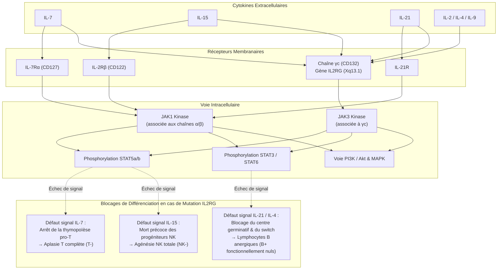
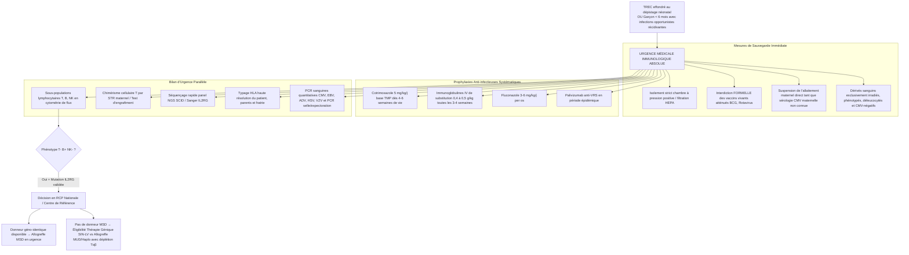

# Fiche #003 — Déficit immunitaire combiné sévère lié à l'X (SCID-X1)

> [!IMPORTANT]
> **Atlas IUIS 2024** | Semaine 1, J3 — *Inborn Errors of Immunity (IEI)*  
> Classification : Tableau I.1 — Déficits immunitaires combinés sévères (SCID T⁻ B⁺ NK⁻)

---

## 0. Carte d'identité IUIS 2024

| Paramètre | Caractéristique |
| :--- | :--- |
| **Nom de la pathologie** | Déficit immunitaire combiné sévère lié à l'X (*X-linked Severe Combined Immunodeficiency*, SCID-X1) |
| **Acronyme officiel** | SCID-X1 / X-SCID |
| **Gène causal** | *IL2RG* (*Interleukin 2 Receptor Subunit Gamma*) |
| **Locus chromosomique** | Xq13.1 |
| **Mode de transmission** | Récessif lié à l'X (gonosomique) |
| **Tableau IUIS 2024** | **Tableau I.1** : Déficits immunitaires combinés sévères |
| **Protéine altérée** | Sous-unité gamma commune ($\gamma_c$, ou CD132) |
| **Phénotype immunologique** | $T^- B^+ NK^-$ (cellules T absentes/effondrées, cellules B présentes mais non fonctionnelles, cellules NK absentes) |
| **Codes nosologiques** | **OMIM** : #300400 \| **Orphanet** : ORPHA:276 \| **CIM-10** : D81.2 \| **CIM-11** : 4A01.10 |

---

## 1. TL;DR (Synthèse exécutive)

> [!TIP]
> **Synthèse flash pour l'immunologiste clinicien :**  
> Le SCID-X1 est le déficit immunitaire combiné sévère le plus fréquent (~45–50 % des cas de SCID). Causé par des mutations de perte de fonction du gène *IL2RG* codant la chaîne gamma commune ($\gamma_c$/CD132), il interrompt l'assemblage de 6 récepteurs cytokiniques hétéro-oligomériques vitaux (IL-2, IL-4, IL-7, IL-9, IL-15, IL-21) et bloque l'activation de la kinase JAK3. Il en résulte une aplasie thymique complète ($T^-$ par défaut de signal IL-7), une absence de différentiation NK ($NK^-$ par défaut de signal IL-15) et une agammaglobulinémie fonctionnelle sévère ($B^+$ intrinsèquement anergiques par défaut de signal IL-21 et IL-4). Sans dépistage néonatal par quantification des TREC (*T-cell Receptor Excision Circles*), la maladie se révèle vers 2 à 4 mois de vie par un retard staturo-pondéral sévère, une diarrhée chronique et des infections opportunistes létales (*Pneumocystis jirovecii*, CMV, adénovirus). L'allogreffe de cellules souches hématopoïétiques (CSH) précoce (< 3,5 mois, idéalement sans infection active) et la thérapie génique autologue par vecteur lentiviral sous conditionnement myéloablatif atténué constituent les piliers curatifs majeurs.

---

## 2. Contexte historique

* **1950–1970 : L'ère clinique et le "Bubble Boy"** : Identifié cliniquement comme une forme sévère de lymphopénie familiale liée au sexe, le SCID-X1 est mondialement incarné par David Vetter (1971–1984), enfant contraint de vivre 12 ans en bulle stérile au Texas Children's Hospital avant de décéder d'un lymphome induit par le virus d'Epstein-Barr (EBV) après une tentative de greffe haplo-identique sans déplétion préalable rigoureuse.
* **1993 : Identification génétique** : L'équipe de Warren Leonard au NIH clone le gène codant la chaîne gamma du récepteur de l'IL-2 (*IL2RG*) et démontre que ses mutations sous-tendent le phénotype SCID-X1, prouvant peu après son partage au sein d'une famille multigénique de récepteurs aux interleukines.
* **1999–2000 : Premier succès mondial de thérapie génique** : À l'hôpital Necker-Enfants Malades (Paris), Alain Fischer, Marina Cavazzana et Salima Hacein-Bey-Abina réalisent la première correction génique ex vivo réussie de l'histoire de la médecine humaine à l'aide d'un vecteur rétroviral $\gamma$ (MMLV) transduisant les CSH autologues CD34⁺, restaurant durablement l'immunité T chez des nourrissons.
* **2002–2008 : Le revers de l'oncogenèse insertionnelle** : La survenue d'une leucémie aiguë lymphoblastique T chez 5 des 20 patients traités par vecteurs rétroviraux de première génération (activant le proto-oncogène *LMO2* ou *BMI1* via leurs longs segments répétés terminaux [LTR]) a conduit à une refonte de la virologie translationnelle. Cela a motivé le développement de vecteurs lentiviraux auto-inactivants (SIN) dénués d'activateurs transcriptionnels viraux, devenus la norme actuelle.

---

## 3. Épidémiologie & Données de registres

* **Prévalence et Incidence** :  
  * L'incidence globale des SCID est établie entre 1/50 000 et 1/58 000 naissances vivantes d'après les programmes universels de dépistage néonatal (NBS) nord-américains.  
  * Le SCID-X1 représente **43 à 48 %** de l'ensemble des cas dans les pays occidentaux non consanguins. L'incidence spécifique est estimée à environ **1 garçon sur 100 000 à 130 000**.
* **Registres Européens (ESID & CEREDIH)** :  
  * Les données du Registre français des déficits immunitaires héréditaires (CEREDIH) et de l'ESID confirment la nette prédominance masculine (liée à l'X) avec plus de 98 % des cas chez des garçons. Des formes exceptionnelles ont été décrites chez des filles porteuses d'un syndrome de Turner (45,X0) ou d'une inactivation biaisée extrême et non aléatoire du chromosome X (*skewed lyonization*).  
  * Avant l'introduction du dépistage néonatal par les TREC, l'âge médian au diagnostic était de 3,5 à 4,2 mois, avec un retard diagnostique grevant la survie en raison d'infections opportunistes documentées dans plus de 80 % des cas.
* **Registres Nord-Américains (PIDTC & USIDNET)** :  
  * Les analyses rétrospectives et prospectives du PIDTC (*Primary Immune Deficiency Treatment Consortium*) englobant plus de 36 ans de cohortes montrent que l'avènement du dépistage TREC a fait progresser la survie globale à 2 ans post-allogreffe de **73 % (ère pré-dépistage) à > 92 % (ère post-dépistage)**. Le diagnostic avant l'âge de 3,5 mois et l'absence d'infection active au conditionnement sont les deux variables pronostiques indépendantes les plus discriminantes.

---

## 4. Physiopathologie, Génétique moléculaire & Schéma 1

### Base moléculaire et interactions structurales
Le gène *IL2RG* comprend 8 exons répartis sur 4,2 kb et code pour la protéine $\gamma_c$ (CD132), une glycoprotéine transmembranaire de type I de 369 acides aminés (40 kDa). Le domaine extracellulaire contient quatre résidus cystéine conservés et un motif WSXWS structural indispensable à la liaison du ligand. 

La chaîne $\gamma_c$ est le transducteur de signal partagé par 6 cytokines hématopoïétiques majeures :
1. **IL-7** : Complexe hétérodimérique IL-7R$\alpha$ (CD127) + $\gamma_c$. La rupture de ce signal bloque la thymopoïèse au stade progéniteur pro-T, provoquant une **aplasie T ($T^-$)**.
2. **IL-15** : Complexe hétérotrimérique IL-15R$\alpha$ + IL-2R$\beta$ (CD122) + $\gamma_c$. Ce signal est obligatoire pour la survie et la maturation terminale des précurseurs NK, expliquant **l'agénésie NK ($NK^-$)**.
3. **IL-21** : Complexe IL-21R + $\gamma_c$. L'IL-21 commande la coopération T-B au sein des centres germinatifs, l'hypermutation somatique, la commutation isotypique (*class switch*) et la différenciation en plasmocytes à longue durée de vie. Son absence rend les lymphocytes B receveurs **intrinsèquement incapables de sécréter des anticorps affins**, malgré un nombre de lymphocytes B normal ou augmenté ($B^+$).
4. **IL-4** : Complexe IL-4R$\alpha$ (CD124) + $\gamma_c$ (type I). Absence d'aide humorale Th2 et défaut d'induction isotypique IgE/IgG1.
5. **IL-2** : Complexe trimérique IL-2R$\alpha$ (CD25) + IL-2R$\beta$ + $\gamma_c$. La perte de signalisation altère le développement et l'homéostasie des lymphocytes T régulateurs (Treg CD4⁺ CD25⁺ FoxP3⁺).
6. **IL-9** : Complexe IL-9R + $\gamma_c$. Rôle trophique lymphoïde secondaire.

### Voie de signalisation intracellulaire
Le domaine intracytoplasmique de $\gamma_c$ s'associe constitutivement à la tyrosine kinase **JAK3** via son domaine Box1/Box2. La liaison de l'interleukine induit une hétérodimérisation de $\gamma_c$ avec la chaîne spécifique du récepteur couplée à JAK1. Il en résulte :
* Une trans-phosphorylation réciproque et une activation catalytique de **JAK3 et JAK1**.
* Le recrutement et la phosphorylation des facteurs de transcription **STAT** (principalement **STAT5a/STAT5b** pour IL-2/IL-7/IL-15 ; **STAT3** pour IL-21 ; **STAT6** pour IL-4).
* L'activation conjointe des cascades **PI3K/Akt/mTOR** (survie cellulaire, anti-apoptose médiée par Bcl-2) et **Ras/Raf/MEK/MAPK** (prolifération clonale).



---

## 5. Présentation clinique, Pathogènes & Phénotype immunologique

### Présentation clinique
* **Forme néonatale présymptomatique (dépistage TREC positif)** : Examen clinique initialement strictement normal. L'absence d'infections cutanéo-muqueuses ou respiratoires à la naissance est trompeuse en raison de la protection passive temporaire conférée par les IgG maternelles transplacentaires.
* **Forme historique révélée par défaillance infectieuse (2 à 4 mois de vie)** :
  * **Cassure staturo-pondérale majeure** secondaire à l'inflammation chronique et à la malabsorption.
  * **Diarrhée chronique réfractaire** avec atrophie villositaire, vomissements et déshydratation dénutritive.
  * **Infections cutanéomuqueuses récidivantes** : Muguet buccal et dermite fessière candidosiques extensifs et résistants aux antifongiques locaux usuels.
  * **Signes physiques d'alarme** : Absence totale de tissu lymphoïde périphérique palpable (aucun ganglion lymphatique superficiel décelable même en présence d'infections sévères) et absence d'amygdales visibles.
  * **Pneumopathie interstitielle hypoxémiante aiguë**.

### Pathogènes préférentiels
* **Champignons & Parasites** : *Pneumocystis jirovecii* (cause majeure d'admission initiale en réanimation pédiatrique pour détresse respiratoire aiguë hypoxémiante), *Candida albicans* invasif, *Cryptosporidium parvum* (cholangite sclérosante et entérite réfractaire).
* **Virus à réplication intracellulaire** : Cytomégalovirus (CMV ; pneumonie interstitielle, rétinite, hépatite), Adénovirus (hépatite fulminante, gastro-entérite invasive nécrosante), Virus respiratoire syncytial (VRS), Métapneumovirus, Parainfluenza 3, Entérovirus (méningo-encéphalites chroniques), EBV.
* **Complications vaccinales iatrogènes par germes vivants atténués** :
  * **BCGite / BCGose disséminée** : Induite par le vaccin antituberculeux s'il est administré par erreur en maternité. Se complique d'adénites suppurées, d'ostéomyélites multifocales et de chocs septiques mycobactériens.
  * **Poliomyélite vaccinale associée** ou entérite prolongée à rotavirus après vaccin vivant oral.

### Phénotype immunologique hématologique
* **Numération formule sanguine (NFS)** : Lymphopénie absolue extrême, généralement **< 1 000 lymphocytes/$\mu$L** (valeur normale pour l'âge : 3 000 à 9 500/$\mu$L). Une NFS normale ne réfute cependant pas le diagnostic s'il existe une expansion clonale de cellules T maternelles ou de cellules B dysfonctionnelles.
* **Sous-populations lymphocytaires (Cytométrie de flux)** :
  * **Lymphocytes T CD3⁺** : Effondrés ou indétectables (< 300 cellules/$\mu$L d'origine fœtale autologue). Les sous-populations CD4⁺ et CD8⁺ sont absentes.
  * **Lymphocytes B CD19⁺ / CD20⁺** : Présents, souvent en proportion relative très élevée (parfois 80–95 % des lymphocytes résiduels), mais de morphologie naïve immatures (CD19⁺ IgM⁺ IgD⁺ CD27⁻).
  * **Lymphocytes NK CD16⁺ CD56⁺ CD3⁻** : Absence quasi-totale (< 20 cellules/$\mu$L).
* **Marqueurs thymiques moléculaires** : TREC indétectables (< 10 copies/$\mu$L de sang total ou négativité complète à la PCR sur carton de Guthrie).
* **Immunoglobulines sériques** : Hypogammaglobulinémie globale progressive avec effondrement des IgA et des IgM dès la naissance, et chute progressive des IgG après le déclin des anticorps maternels résiduels (> 3–6 mois).
* **Tests fonctionnels in vitro** : Absence complète de prolifération lymphocytaire après stimulation par la phytohémagglutinine (PHA) ou le concanavaline A (< 10 % du témoin contrôle).

### Diagnostic différentiel spécifique : La réaction du greffon contre l'hôte maternelle (mGvHD)
Chez 30 à 40 % des nourrissons SCID-X1 non dépistés, des lymphocytes T maternels ayant traversé la barrière transplacentaire pendant la grossesse survivent et prolifèrent en l'absence de rejet par le système immunitaire fœtal immunocompromis. 
* **Conséquences cliniques** : Érythrodermie desquamative généralisée, alopécie, hépatosplénomégalie, ictère cytolytique et diarrhée sévère simulant un syndrome d'Omenn ou une maladie du greffon contre l'hôte (GvHD).
* **Conséquences au laboratoire** : Fausse "normalisation" apparente du chiffre absolu des lymphocytes T CD3⁺ et CD8⁺. L'analyse moléculaire par polymorphisme de microsatellites (STR) ou caryotype fluorescent (FISH XX/XY) démontre la présence exclusive de cellules lymphocytaires féminines (maternelles) chez un nourrisson de génotype mâle.

---

## 6. Complications à long terme & Défis non résolus

1. **Déficit humoral résiduel et dépendance à vie aux IgIV** :  
   Dans les allogreffes de CSH sans conditionnement myéloablatif (ou conditionnées par immunosuppression seule type ATG sans alkylant), les CSH allogéniques corrigent la lignée T mais ne prennent pas racine dans la niche souche médullaire. Les lymphocytes B restent d'origine receveur avec persistance du déficit en $\gamma_c$ : l'absence d'aide dépendante de l'IL-21 interdit la mémoire humorale, obligeant **30 à 50 % des patients greffés à recevoir des perfusions d'immunoglobulines à vie**.
2. **Épuisement thymique secondaire (*Waning of T-cell immunity*)** :  
   Les progéniteurs lymphoïdes greffés sans prise de greffe souche durable (absence de chimérisme myéloïde) ont une longévité finie. À partir de l'adolescence (15–25 ans post-greffe), on assiste fréquemment chez les patients transplantés sans chimérisme des CSH à un déclin drastique des CD4⁺, une oligoclonalité du répertoire V$\beta$ du TCR, une perte des TREC et la réapparition d'infections opportunistes tardives.
3. **Effets secondaires et toxicité tardive des agents alkylants** :  
   L'emploi du busulfan pour créer une niche médullaire expose le nourrisson à des séquelles endocriniennes : dysgénésie gonadique, hypogonadisme hypergonadotrope, stérilité, retard statural et hypoplasie amélaire dentaire avec agénésie d'incisives.
4. **Hépatopathies virales cryptogéniques et cholangite sclérosante** :  
   La persistance occulte d'infections virales ou parasitaires contractées en période pré-greffe (*Cryptosporidium*, Adénovirus, CMV, virus de l'hépatite E) peut progresser insidieusement vers la cirrhose biliaire et l'hypertension portale malgré la reconstitution lymphocytaire T.
5. **Oncogenèse insertionnelle résiduelle en thérapie génique** :  
   Bien que les vecteurs lentiviraux auto-inactivants aient supprimé le risque de leucémie aiguë lymphoblastique T à *LMO2*, ils conservent une propension à s'intégrer préférentiellement dans des gènes activement transcrits, créant occasionnellement des épissages aberrants cryptiques (e.g. clonogénicité transitoire liée à *HMGA2*) qui exigent une biosurveillance hématologique annuelle à long terme.

---

## 7. Avenues thérapeutiques

```
                     STRATÉGIE THÉRAPEUTIQUE DU SCID-X1
                                     │
           ┌─────────────────────────┴─────────────────────────┐
           ▼                                                   ▼
  [DONNEUR FAMILIAL GÉNO-IDENTIQUE]                [ABSENCE DE DONNEUR MSD/MFD]
  (MSD / MFD : ~15-20% des cas)                                │
           │                                      ┌────────────┴────────────┐
           ▼                                      ▼                         ▼
   Greffe de CSH sans                   [THÉRAPIE GÉNIQUE SIN-LV]     [ALLOGREFFE ALTERNATIVE]
   conditionnement ou à                 • Moelle osseuse autologue    • Donneur non apparenté 10/10 (MUD)
   conditionnement réduit                   transduite (IL2RG)        • Sang de cordon ombilical
   → Survie globale >95%                • Busulfan ciblé (AUC réduit) • Haplo-identique avec TCRαβ/CD19-déplétion
                                        • Absence totale de GvHD      • Conditionnement à toxicité réduite
```

### 1. Transplantation allogénique de cellules souches hématopoïétiques (TCSH)
* **Donneur géno-identique intrafamilial (MSD)** : Standard d'or historique. Réalisable sans conditionnement myéloablatif en cas d'extrême urgence, bien qu'un conditionnement d'intensité réduite (RIC) ou myéloablatif ciblé à base de busulfan soit de plus en plus préconisé pour garantir l'implantation des CSH donneuses, le chimérisme myéloïde et la reconstitution humorale B autonome.
* **Donneur non apparenté compatible 10/10 (MUD) ou haplo-identique paternel/maternel** :  
  L'utilisation d'allogreffes haplo-identiques avec déplétion immunomagnétique poussée des lymphocytes $T\alpha\beta$ et des cellules CD19⁺, combinée à une sérothérapie lymphodéplétive (ATG ou alemtuzumab) et un conditionnement à toxicité réduite, a élevé les taux de survie au-delà de 85–90 %, tout en prévenant la survenue de GvHD aiguë sévère.

### 2. Thérapie génique ex vivo par vecteur lentiviral auto-inactivant (SIN-LV)
* **Principe** : Récolte de cellules souches hématopoïétiques autologues CD34⁺ (par ponction de moelle osseuse ou cytaphérèse après mobilisation), transduction ex vivo au moyen d'un vecteur lentiviral dérivé du VIH-1 portant l'ADNc complet d'*IL2RG* sous le contrôle d'un promoteur eucaryote interne physiologique (promoteur EF1$\alpha$ court).
* **Avantage capital** : Absence totale de risque de réaction du greffon contre l'hôte (GvHD) et élimination du risque de rejet immunitaire.
* **Conditionnement pharmacocinétiquement ciblé** : Administration de busulfan à faible dose ajustée sur l'aire sous la courbe (AUC ciblée entre 20 et 30 mg$\cdot$h/L) afin de libérer l'espace médullaire sans toxicité myéloïde irréversible. Cette stratégie permet le chimérisme stable de CSH modifiées, assurant la reconstitution conjointe des cellules T, des cellules NK et l'indépendance transfusionnelle en immunoglobulines (reconstitution B).

### 3. Édition génomique ciblée endogène (CRISPR/Cas9, Base Editing, Prime Editing)
* **Remplacement et insertion ciblée par recombinaison homologue (HDR)** : Correction directe du locus endogène *IL2RG* dans les cellules souches hématopoïétiques multipotentes en combinant des ribonucléoprotéines (RNP) Cas9 et un vecteur AAV6 donneur de matrice.
* **Édition de bases sans cassure double-brin (*Adenine Base Editing* - ABE)** : Permet de convertir les mutations de transition C$\cdot$G en T$\cdot$A ou A$\cdot$T en G$\cdot$C au sein du gène *IL2RG* avec une efficacité élevée et une absence quasi-totale de translocations ou d'insertions/délétions non ciblées (*indels*), restaurant une prolifération dépendante de l'IL-2 et de l'IL-15 ex vivo.

### 4. Conditionnements non génotoxiques sans chimiothérapie
* Émergence d'anticorps monoclonaux nus ou conjugués déplétant spécifiquement les CSH du receveur en ciblant le récepteur c-Kit (CD117) (e.g. briquilimab / JSP191). Cette approche évite le recours aux agents alkylants mutagènes tout en ouvrant l'accès des niches médullaires aux CSH corrigées ou allogéniques.

---

## 8. Section pratique (Bedside, Guidelines & Schéma 2)

### Algorithme clinique décisionnel d'urgence



### Diagnostics différentiels immunophénotypiques

| Pathologie | Gène | Hérédité | Phénotype Lymphocytaire | Particularités Physiopathologiques & Différentielles |
| :--- | :--- | :--- | :--- | :--- |
| **SCID-X1** | *IL2RG* | Récessif lié à l'X | $T^- B^+ NK^-$ | Chaîne $\gamma_c$ mutée ; perte des signaux IL-2, 4, 7, 9, 15, 21. Garçons. |
| **Déficit en JAK3** | *JAK3* | Autosomique récessif | $T^- B^+ NK^-$ | Phénocopie biochimique exacte du SCID-X1 (kinase dépendante de $\gamma_c$). Atteint garçons et filles. |
| **Déficit en IL-7R$\alpha$** | *IL7RA* | Autosomique récessif | $T^- B^+ NK^+$ | Chaîne $\alpha$ spécifique du récepteur IL-7 mutée. Cellules NK préservées (signalisation IL-15 intacte). |
| **Déficit en RAG1 / RAG2** | *RAG1*, *RAG2* | Autosomique récessif | $T^- B^- NK^+$ | Arrêt précoce du réarrangement V(D)J du TCR et du BCR. Cellules B absentes ; cellules NK normales. |
| **Déficit en Artémis** | *DCLRE1C* | Autosomique récessif | $T^- B^- NK^+$ | Défaut d'ouverture des boucles en épingle lors du NHEJ. Radiosensibilité cellulaire extrême (attention alkylants). |
| **Déficit en ADA** | *ADA* | Autosomique récessif | $T^- B^- NK^-$ | Accumulation de métabolites puriques toxiques (dATP) détruisant l'ensemble des lignées lymphoïdes. Dysplasie chondro-osseuse possible. |
| **Déficit CD3$\delta$ / $\epsilon$ / $\zeta$** | *CD3D, CD3E, CD3Z* | Autosomique récessif | $T^- B^+ NK^+$ | Anomalies structurelles du complexe TCR/CD3. Échec de maturation intra-thymique T. |
| **Athymie complète (DiGeorge)** | *FOXN1*, délétion 22q11 | Dépend de la cause | $T^- B^+ NK^+$ | Épithélium thymique non fonctionnel. Moelle osseuse normale (indication : greffe de tissu thymique allogénique). |

### Six perles cliniques pour le praticien hospitalier

1. **Une lymphocytose normale n'exclut jamais un SCID-X1** : Le taux de lymphocytes totaux peut paraître normal ou modérément diminué en raison d'une expansion massive de cellules B dysfonctionnelles ($B^+$) ou du passage transplacentaire de cellules T CD8⁺ maternelles activées (mGvHD). **Exigez toujours le phénotypage T/B/NK et la mesure des TREC.**
2. **Le piège fatal du vaccin BCG** : Tout nourrisson né dans une famille avec antécédent de décès masculin précoce ou suspecté d'immunodéficience ne doit sous aucun prétexte recevoir le vaccin BCG. S'il a été administré avant le résultat d'un dépistage TREC anormal, une quadrithérapie antimycobactérienne prophylactique précoce doit être débutée immédiatement sans attendre les signes cliniques de nécrose locale ou d'adénopathie.
3. **Le lait maternel : un vecteur mortel potentiel** : Si la mère est séropositive pour le CMV (IgG anti-CMV positives), l'allaitement maternel naturel direct doit être impérativement suspendu jusqu'à preuve du statut immunitaire complet de l'enfant. L'excrétion de CMV dans le lait maternel peut provoquer une virémie disséminée gravissime chez un nourrisson exempt de cellules T et NK.
4. **La règle transfusionnelle inviolable** : Tout produit sanguin labile (concentré érythrocytaire ou plaquettaire) destiné à un nourrisson atteint ou suspecté de SCID doit être **déleucocyté, irradié (25–50 Gy) et CMV-négatif**, sous peine de déclencher une maladie du greffon contre l'hôte transfusionnelle (ta-GvHD) mortelle dans 100 % des cas.
5. **Distinguer le SCID-X1 du déficit en IL-7R$\alpha$ sur la numération NK** : Devant un phénotype $T^- B^+$, l'analyse du contingent NK est discriminante en routine : les NK sont absents ($NK^-$) dans le SCID-X1 et le déficit en JAK3 car la signalisation dépendante de l'IL-15 est abolie ; ils sont préservés ($NK^+$) dans le déficit en chaîne IL-7R$\alpha$ car l'IL-15 transduit sans entrave via $\gamma_c$ et IL-2R$\beta$.
6. **Le mimétisme clinique de l'engraftment maternel (mGvHD)** : La présence d'un rash maculo-papuleux érythrodermique néonatal associé à une hyperéosinophilie et à une élévation des enzymes hépatiques doit faire doser les lymphocytes T et demander immédiatement un typage de chimérisme par STR sur tri lymphocytaire CD3⁺. Les cellules T circulantes sont des clones alloréactifs de la mère qui attaquent les tissus fœtaux.

---

## 9. Nouveautés & Littérature récente (2022–2026)

* **Impact pronostique transformationnel du dépistage néonatal TREC (Thakar et al., *Lancet*, 2023)** :  
  L'étude prospective de la cohorte PIDTC (903 patients suivis sur 36 ans) confirme que le dépistage néonatal modifie radicalement le pronostic des SCID, dont le SCID-X1, avec une survie globale à 2 ans post-greffe supérieure à 92 % chez les nourrissons dépistés contre 73 % chez ceux diagnostiqués sur symptômes infectieux. La transplantation d'enfants sans infection active au moment du conditionnement gomme les disparités entre donneurs compatibles et donneurs alternatifs haplo-identiques.
* **Mise à jour des définitions phénotypiques et diagnostiques PIDTC 2022 (Dvorak et al., *J Allergy Clin Immunol*, 2023)** :  
  Actualisation formelle des critères de stratification internationale pour le SCID typique, le SCID "leaky" (variants faux-sens hypomorphes avec production résiduelle de cellules T oligoclonales et auto-immunité) et le syndrome d'Omenn. L'intégration de la biologie moléculaire et de la détection de l'engraftment maternel par microsatellites redéfinit les seuils stricts d'inclusion en protocoles thérapeutiques curatifs.
* **Cartographie spatiale et signatures génomiques de l'intégrome lentiviral (Yan et al., *Sci Adv*, 2023)** :  
  L'analyse de plus de 280 000 sites d'intégration du vecteur lentiviral chez les patients SCID-X1 traités à St. Jude Children's Research Hospital révèle que les insertions s'effectuent de façon non aléatoire dans les compartiments chromosomiques nucléaires A1 et au sein de super-enhancers à proximité des complexes du pore nucléaire. L'étude valide la haute sécurité génomique des vecteurs lentiviraux actuels dépourvus de potentiel leucémogène réplicatif.
* **Compréhension des épissages cryptiques et dynamique clonale médiée par *HMGA2* (De Ravin et al., *Nat Commun*, 2022)** :  
  L'exploration de cohortes de patients plus âgés traités par thérapie génique lentivirale après échec de greffe initiale a mis en évidence des épissages cryptiques entraînant une expression transitoire d'une forme tronquée du proto-oncogène *HMGA2* dans des clones CD34⁺, conférant un avantage prolifératif bénin et stable sans dérive myélodysplasique ou leucémique maligne après plusieurs années de suivi.
* **Édition de bases adénine (*Adenine Base Editing* - ABE) au locus *IL2RG* (McIvor et al., *Mol Ther*, 2024)** :  
  Démonstration in vitro et dans des modèles précliniques humanisés de la faisabilité de corriger les variants faux-sens pathogènes récurrents d'*IL2RG* par conversion ciblée A$\cdot$T $\rightarrow$ G$\cdot$C sans générer de cassures double-brin d'ADN. Cette modalité ouvre la voie à une thérapie génique non virale prévenant tout réarrangement chromosomique indésirable dans les CSH.

---

## 10. Références vérifiées

1. **Thakar MS, Logan BR, Puck JM, Dunn EA, Buckley RH, Cowan MJ, et al.**  
   *Measuring the effect of newborn screening on survival after haematopoietic cell transplantation for severe combined immunodeficiency: a 36-year longitudinal study from the Primary Immune Deficiency Treatment Consortium.*  
   **Lancet.** 2023 Jul 8;402(10396):129-140.  
   **PMID : 37352885** | DOI : [10.1016/S0140-6736(23)00731-6](https://doi.org/10.1016/S0140-6736(23)00731-6)
2. **Dvorak CC, Haddad E, Heimall J, Dunn E, Buckley RH, Kohn DB, Cowan MJ, Pai SY, et al.**  
   *The diagnosis of severe combined immunodeficiency: Implementation of the PIDTC 2022 Definitions.*  
   **J Allergy Clin Immunol.** 2023 Feb;151(2):539-546.  
   **PMID : 36456361** | PMCID : PMC9905311 | DOI : [10.1016/j.jaci.2022.10.022](https://doi.org/10.1016/j.jaci.2022.10.022)
3. **Yan KK, Condori J, Ma Z, Metais JY, Ju B, Ding L, Dhungana Y, Lockey T, Cowan MJ, Sorrentino BP, Mamcarz E, et al.**  
   *Integrome signatures of lentiviral gene therapy for SCID-X1 patients.*  
   **Sci Adv.** 2023 Oct 6;9(40):eadg9959.  
   **PMID : 37801507** | PMCID : PMC10558130 | DOI : [10.1126/sciadv.adg9959](https://doi.org/10.1126/sciadv.adg9959)
4. **De Ravin SS, Liu S, Sweeney CL, Brault J, Whiting-Theobald N, Ma M, Puck J, Cowan MJ, Notarangelo LD, Kang E, Malech HL, Wu X.**  
   *Lentivector cryptic splicing mediates increase in CD34+ clones expressing truncated HMGA2 in human X-linked severe combined immunodeficiency.*  
   **Nat Commun.** 2022 Jun 28;13(1):3710.  
   **PMID : 35764638** | PMCID : PMC9240040 | DOI : [10.1038/s41467-022-31344-x](https://doi.org/10.1038/s41467-022-31344-x)
5. **McIvor RS, Eaton EJ, Webber BR, Moriarity BS.**  
   *Advancing gene targeting for primary immune deficiencies: Adenine base editing of the human IL2RG locus for correction of SCID-X1.*  
   **Mol Ther.** 2024 Jun 5;32(6):1606-1608.  
   **PMID : 38781958** | PMCID : PMC11184398 | DOI : [10.1016/j.ymthe.2024.05.026](https://doi.org/10.1016/j.ymthe.2024.05.026)