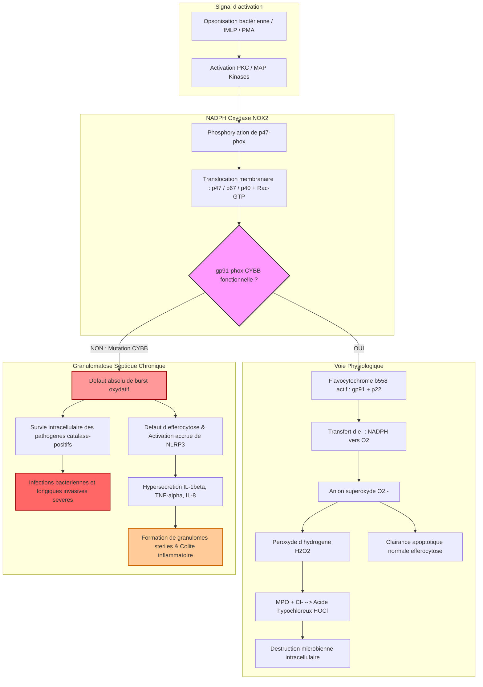
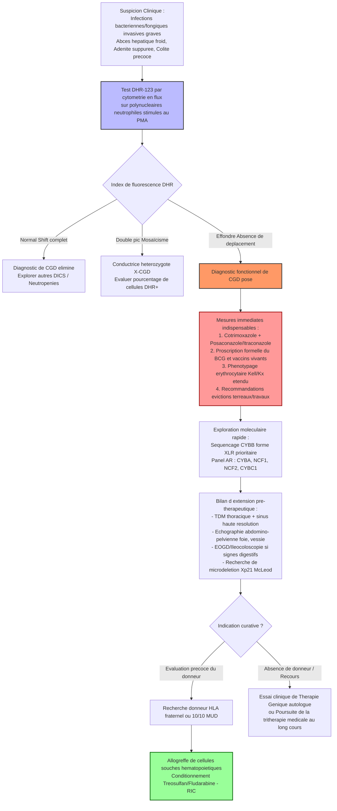

# Fiche #004 — Granulomatose septique chronique (CGD)

> [!IMPORTANT]
> **Protocole Atlas IUIS 2024** | Semaine 1, J4  
> Fiche de référence pour l'immunologiste clinicien, l'infectiologue et l'hématologue pédiatre/adulte.

---

## 0. Carte d'identité IUIS 2024

| Paramètre | Caractéristique |
| :--- | :--- |
| **Pathologie** | Granulomatose septique chronique liée à l'X (X-CGD) |
| **Classification IUIS 2024** | **Table V.3** — Déficits congénitaux du nombre ou de la fonction des phagocytes (*Defects of respiratory burst*) |
| **Gène princeps** | ***CYBB*** (*Cytochrome b-245 Beta Chain*) |
| **Locus chromosomique** | **Xp21.1** (OMIM gène : \*300481) |
| **Code OMIM phénotype** | **#306400** |
| **Transmission** | Récessive liée à l'X (*X-linked recessive*, XLR) |
| **Protéine altérée** | **gp91-phox** (aussi dénommée **NOX2** / sous-unité bêta du flavocytochrome b558) |
| **Autres gènes du complexe** | *CYBA* (p22-phox, AR), *NCF1* (p47-phox, AR), *NCF2* (p67-phox, AR), *NCF4* (p40-phox, AR), *CYBC1* (*EROS*, AR chaperone de maturation) |
| **Signature immunologique** | Absence de production d'espèces réactives de l'oxygène (ERO / *ROS*) par les neutrophiles/monocytes stimulés (test DHR pathologique) ; numération et sous-populations lymphocytaires quantitatives conservées |

---

## 1. TL;DR (Synthèse exécutive)

> [!TIP]
> **Synthèse en 7 points clés :**  
> 1. Déficit immunitaire inné primitif majeur caractérisé par l'inactivation de la NADPH oxydase phagocytaire (complexe NOX2) secondaire aux mutations de *CYBB* (65–70 % des cas).  
> 2. Défaillance critique du burst oxydatif (*respiratory burst*) bloquant la génération d'anion superoxyde ($O_2^{\bullet-}$), de peroxyde d'hydrogène ($H_2O_2$) et d'acide hypochloreux ($HOCl$).  
> 3. Susceptibilité élective aux bactéries et champignons catalase-positifs (*Staphylococcus aureus*, *Aspergillus* spp., *Burkholderia cepacia* complex, *Serratia marcescens*, *Nocardia* spp.).  
> 4. Hyperinflammation paradoxale médiée par l'activation incontrôlée de l'inflammasome NLRP3 et l'absence de clairance efférocytique, générant granulomes invasifs et entérocolites Crohn-like.  
> 5. Diagnostic fonctionnel de certitude rapide par cytométrie en flux à la dihydrorhodamine 123 (DHR-123) objectivant un index de stimulation effondré et le profil de mosaïcisme chez la mère.  
> 6. Trithérapie prophylactique obligatoire au long cours : Cotrimoxazole + Itraconazole (ou Posaconazole) $\pm$ IFN-$\gamma$ recombinant sous-cutané.  
> 7. Seul traitement curatif de routine validé : allogreffe précoce de cellules souches hématopoïétiques (allo-CSH) avec conditionnement d'intensité réduite/toxicité atténuée (survie globale > 90 %). La thérapie génique lentivirale autologue représente l'alternative d'avenir.

---

## 2. Contexte historique

- **1954–1957 :** Initialement isolée par Charles Janeway et Robert Good sous l'appellation de *« fatal granulomatosis of childhood »* chez de jeunes garçons décédant d'infections suppuratives récurrentes et d'hypergammaglobulinémie polyclonale.
- **1966 :** Bernard Holmes et Robert Good identifient l'anomalie cellulaire intrinsèque : les polynucléaires neutrophiles (PNN) des patients phagocytent normalement les bactéries mais sont incapables de les détruire par défaut d'activation métabolique oxydative.
- **1978 :** Anthony Segal et ses collaborateurs découvrent l'absence spectrale du cytochrome b membranaire dans les neutrophiles des garçons atteints, posant la base biochimique du complexe enzymatique.
- **1986 :** Étape fondatrice de la génomique médicale : Stuart Orkin, Anthony Monaco et Louis Kunkel isolent le gène *CYBB* par clonage positionnel (*reverse genetics*). Il s'agit du **tout premier gène morbide humain identifié sans connaître au préalable la séquence exacte en acides aminés de sa protéine**.

---

## 3. Épidémiologie & Données de registres

- **Incidence globale :** Estimée entre 1/200 000 et 1/250 000 naissances vivantes dans les pays occidentaux.
- **Répartition génotypique :**
  - **Occident (données USIDNET / ESID / CEREDIH) :** La forme liée à l'X (*CYBB*) est prédominante (environ **65 à 70 %** des cas), suivie par le déficit en p47-phox (*NCF1*, environ 20–25 %), puis p22-phox (*CYBA*, ~5 %), p67-phox (*NCF2*, ~5 %) et très rarement *NCF4* ou *CYBC1*.
  - **Moyen-Orient et Afrique du Nord :** En raison d'un taux élevé d'endogamie et de consanguinité, la distribution s'inverse drastiquement : les formes autosomiques récessives (*NCF1*, *CYBA*, *NCF2*) représentent jusqu'à 70 à 80 % des cohortes locales.
- **Survie et évolution temporelle :**
  - Données historiques (avant les années 1980) : mortalité infantile sévère (> 50 % avant l'âge de 10 ans).
  - Données modernes du CEREDIH et de l'ESID : médiane de survie dépassant désormais 40 à 50 ans sous prophylaxie antimicrobienne bien conduite et recours élargi à l'allo-CSH pédiatrique.
  - L'âge médian au diagnostic dans les registres européens est de 2,5 à 3 ans pour la forme *CYBB*, mais des diagnostics à l'âge adulte (formes hypomorphes avec activité oxydative résiduelle) sont régulièrement documentés.

---

## 4. Physiopathologie, Génétique moléculaire & Schéma 1

### Le complexe enzymatique NADPH oxydase (NOX2)
La NADPH oxydase des phagocytes est un hétérohexamère multiprotéique constitué :
1. **D'un complexe membranaire stable (flavocytochrome $b_{558}$) :**
   - **gp91-phox** (codée par *CYBB*, 570 acides aminés, hautement glycosylée) : cœur catalytique transmembranaire contenant des sites de liaison pour le FAD, deux groupements héminiques et le NADPH cytosolique.
   - **p22-phox** (codée par *CYBA*) : stabilise gp91-phox dans la membrane plasmique et la membrane des granules spécifiques/sécrétoires. La chaperone transmembranaire **EROS/CYBC1** est requise dans le réticulum endoplasmique pour l'assemblage et l'adressage de cet hétérodimère.
2. **De sous-unités cytosoliques régulatrices :**
   - **p47-phox** (*NCF1*), **p67-phox** (*NCF2*), **p40-phox** (*NCF4*).
   - Une petite GTPase régulatrice : **Rac1** (monocytes/macrophages) ou **Rac2** (neutrophiles).

### Mécanisme d'activation et bactéricidie
Au repos, le système est quiescent pour prévenir les dommages tissulaires. Lors de l'ingestion d'un microbe (opsonisé par IgG ou complément C3b/iC3b) :
- Les protéines kinases (PKC, MAP kinases) phosphorylent les résidus sérine de p47-phox.
- Le complexe cytosolique (p47/p67/p40) subit un changement conformationnel et migre vers la membrane pour s'assembler au flavocytochrome $b_{558}$, rejoint par Rac-GTP.
- Le complexe activé transfère des électrons du NADPH cytosolique vers l'oxygène moléculaire ($O_2$) luminal/intraphagosomique :
  $$\text{NADPH} + 2\,O_2 \xrightarrow{\text{NOX2}} \text{NADP}^+ + \text{H}^+ + 2\,O_2^{\bullet-}$$
- L'anion superoxyde est dismuté spontanément ou sous l'action de la superoxyde dismutase (SOD) en peroxyde d'hydrogène ($H_2O_2$) :
  $$2\,O_2^{\bullet-} + 2\,\text{H}^+ \xrightarrow{\text{SOD}} H_2O_2 + O_2$$
- La myéloperoxydase (MPO) déversée par les granules azurophiles transforme $H_2O_2$ et l'ion chlorure ($Cl^-$) en acide hypochloreux ($HOCl$), puissant agent biocide microbicide.

### Pourquoi la catalase est-elle le pivot microbiologique ?
- Les bactéries **catalase-négatives** (ex. *Streptococcus pneumoniae*, *Streptococcus pyogenes*) produisent leur propre $H_2O_2$ métabolique sans pouvoir le détruire. Les neutrophiles CGD utilisent ce peroxyde microbien via leur MPO intacte pour générer du $HOCl$ et les détruire efficacement.
- Les bactéries et moisissures **catalase-positives** (ex. *S. aureus*, *Aspergillus*) synthétisent une catalase qui hydrolyse leur propre $H_2O_2$ en eau et oxygène. En l'absence de production endogène d'ERO par le phagocyte, aucun dérivé toxique n'est disponible dans le phagosome : le microorganisme survit et prolifère en intracellulaire.

### Hyperinflammation et défaut de résolution
Le manque d'ERO altère plusieurs voies régulatrices homéostatiques :
1. **Défaut d'efférocytose :** L'absence d'ERO empêche l'oxydation des lipides membranaires des neutrophiles apoptotiques, retardant leur reconnaissance et phagocytose par les macrophages. Ces débris s'accumulent et induisent une nécrose secondaire pro-inflammatoire.
2. **Suractivation de l'inflammasome NLRP3 :** Le déficit en NOX2 lève l'inhibition physiologique sur la caspase-1, entraînant un clivage massif et une hypersécrétion d'interleukine-1 bêta (**IL-1$\beta$**), d'**IL-18** et de **TNF-$\alpha$**.
3. **Défaut de NETose dépendante des ERO :** Incapacité à expulser des pièges extracellulaires de chromatine bactéricides (*Neutrophil Extracellular Traps*).
4. **Constitution de granulomes :** La persistance antigénique couplée au tonus inflammatoire chronique stimule un recrutement permanent de macrophages, monocytes et lymphocytes T, aboutissant à des granulomes inflammatoires non caséeux obstructifs sans infection active résiduelle.

### Génétique moléculaire de *CYBB*
- Situé sur le bras court du chromosome X (**Xp21.1**), comprenant 13 exons.
- Plus de 1000 mutations privées recensées : mutations non-sens, faux-sens délétères, insertions/délétions avec décalage de cadre (*frameshift*), mutations des sites d'épissage.
- Phénotypes biochimiques :
  - $X91^0$ (absence complète de gp91-phox et d'ARNm, forme la plus sévère, classique).
  - $X91^-$ (expression protéique diminuée avec activité résiduelle minime).
  - $X91^+$ (expression normale d'une protéine mutée non fonctionnelle).
- **Syndrome des gènes contigus de l'Xp21 :** Une microdélétion en Xp21.1 peut emporter simultanément le gène *CYBB*, le gène ***XK*** adjacent (responsable du **syndrome neuroacanthocytaire de McLeod**), voire le gène de la dystrophie musculaire de Duchenne (*DMD*) et de la glycérol kinase (*GK*). L'association à un syndrome de McLeod expose à des complications transfusionnelles létales (allo-immunisation anti-Kx/anti-Km).

---

## 5. Présentation clinique, Pathogènes & Phénotype immunologique

### Le spectre microbiologique : Les 5 pathogènes cardinaux (*« The Big Five »*)
Les patients CGD présentent une vulnérabilité quasi exclusive vis-à-vis des pathogènes catalase-positifs capables de surmonter la neutralisation non oxydative :
1. ***Staphylococcus aureus*** : Première cause d'adénites cervicales suppuratives récidivantes et d'**abcès hépatiques staphylococciques** caractéristiques (souvent indolents, paucisymptomatiques avec fièvre isolée et syndrome inflammatoire biologique massif).
2. ***Aspergillus*** **spp.** : Principale cause de mortalité infectieuse.
   - *Aspergillus fumigatus* (le plus fréquent).
   - ***Aspergillus nidulans*** : Espèce particulièrement pathognomonique de la CGD, dotée d'un pouvoir invasif ostéolytique et vasculaire majeur, réputée pour sa dissémination par contiguïté trans-pleurale et trans-diaphragmatique.
   - *Aspergillus tanneri* et *Aspergillus calidoustus*.
3. ***Burkholderia cepacia*** **complex** : Bacille Gram négatif non fermentant aquatique redoutable, responsable de pneumopathies nécrosantes extensives et de bactériémies foudroyantes réfractaires (« *cepacia syndrome* »).
4. ***Serratia marcescens*** : Bacille Gram négatif responsable d'ostéomyélites aiguës ou multifocales hématogènes chez le nourrisson et le petit enfant, souvent inaugurales.
5. ***Nocardia*** **spp.** (*N. asteroides*, *N. cyriacigeorgica*) : Actinomycète aérobie filamenteux provoquant des abcès pulmonaires subaigus cavitaires et des disséminations au système nerveux central (abcès cérébraux à centre nécrotique).

**Autres agents microbiens spécifiques :**
- *Granulibacter bethesdensis* (lymphadénites nécrosantes subaiguës).
- *Chromobacterium violaceum* (infection fulminante après contact avec de l'eau stagnante tiède).
- *Francisella philomiragia* (exposition à l'eau de mer ou saumâtre).
- Mycobactéries environnementales et **infections post-vaccinales au BCG** : adénite régionale suppurée (BCGite) ou dissémination viscérale hématogène léthale (BCGose), contre-indiquant définitivement le vaccin vivant chez le suspect ou nouveau-né apparenté.

### Spectres cliniques par appareils
- **Manifestations pulmonaires (70–80 % des patients) :** Pneumopathies multifocales récidivantes à pyogènes ou filamenteux. Tableau suraigu gravissime : la **pneumopathie au compost** (*« Mulch pneumonitis »*), détresse respiratoire aiguë hypoxémiante fébrile survenant quelques heures après manipulation de broyat végétal, écorces ou compost, associant nodules miliaires aspergillaires disséminés et réaction granulomateuse explosive.
- **Manifestations cutanées et muqueuses :** Folliculites et pyodermites staphylococciques chroniques, hydradénite suppurée sévère, abcès péri-anaux fistulisés, aphtose buccale récidivante pseudobehçetoïde.
- **Manifestations digestives inflammatoires (30–50 %) :**
  - **Colite de la CGD :** Forme d'entérocolite mimant fidèlement la maladie de Crohn pédiatrique (douleurs abdominales, diarrhée glairo-sanglante, fissurations et fistules anales, retentissement staturo-pondéral précoce). L'histologie révèle des granulomes épithélioïdes non caséeux et des histiocytes pigmentés chargés de lipofuscine (pathognomoniques).
  - **Obstructions granulomateuses digestives stériles :** Sténose antrale/pylorique pseudotumorale du nourrisson (vomissements alimentaires post-prandiaux précoces), ou sténose œsophagienne/colique.
- **Manifestations urologiques inflammatoires :** Pseudotumeurs granulomateuses de la vessie, sténoses urétérales inflammatoires unilatérales ou bilatérales compliquées d'hydronéphrose silencieuse et d'insuffisance rénale obstructive.

### Bilan immunitaire conventionnel
- **Hémogramme :** Neutrophilie chronique fréquente en dehors de tout épisode infectieux aigu (témoin de l'hyperinflammation basale) ; anémie des maladies chroniques microcytaire arégénérative.
- **Immunité humorale :** Hypergammaglobulinémie polyclonale (IgG, IgA) quasi constante ; taux d'IgE parfois modérément accru.
- **Immunité cellulaire :** Numération des lymphocytes T, B et NK strictement normale ; prolifération lymphocytaire aux mitogènes conservée.

---

## 6. Complications à long terme & Défis non résolus

1. **Hypertension portale non cirrhotique (NCPH) :** Complication hépatique redoutable résultant de thromboses septiques microvasculaires répétées des veinules portes intrahépatiques et de l'inflammation granulomateuse, conduisant à une **hyperplasie nodulaire régénérative (HNR)**. Elle se traduit par une splénomégalie volumineuse, un hypersplénisme (thrombopénie et leucopénie masquant les infections) et des varices œsophagiennes à haut risque hémorragique.
2. **Insuffisance respiratoire chronique restrictive :** Séquelle d'épisodes infectieux répétés et d'inflammation interstitielle granulomateuse infraclinique, évoluant vers la fibrose parenchymateuse diffuse et la dilatation des bronches (DDB).
3. **Amylose réactionnelle AA :** Complication tardive chez l'adulte due au syndrome inflammatoire systémique chronique mal contrôlé, menant au syndrome néphrotique et à l'insuffisance rénale terminale.
4. **Spectre des conductrices hétérozygotes (*CYBB*) :**
   - Phénomène de lyonisation (inactivation non aléatoire du chromosome X sain) créant une double population neutrophile normale/déficiente.
   - **Seuil critique de chimérisme :** Si le pourcentage de PNN producteurs d'ERO chute en dessous de **10 à 20 %**, la femme conductrice développe un phénotype infectieux identique à celui des hommes atteints (abcès à staphylocoque, aspergillose invasive).
   - En cas d'inactivation intermédiaire (20–50 %), risque accru de manifestations auto-immunes et inflammatoires : lupus érythémateux cutané subaigu ou discoïde, aphtose récidivante sévère, phénomène de Raynaud, arthralgies.
5. **Défis immuno-hématologiques du syndrome de McLeod associé :** En cas de microdélétion Xp21.1 emportant *XK*, le patient présente le phénotype érythrocytaire rare McLeod ($K_0$, absence d'antigène Kx et expression très affaiblie des antigènes du système Kell). Une transfusion par culots globulaires conventionnels provoque une allo-immunisation irréversible contre les antigènes publics anti-Kx/anti-Km, rendant toute transfusion ultérieure quasi impossible et engageant le pronostic vital lors de l'allo-CSH.

---

## 7. Avenues thérapeutiques

### 1. Prophylaxie anti-infectieuse continue (médicale conventionnelle)
Doit être instaurée dès la confirmation diagnostique et poursuivie indéfiniment chez tout patient non transplanté :
- **Antibioprophylaxie :**
  - **Triméthoprime-sulfaméthoxazole (Cotrimoxazole) :** 5 mg/kg/jour de composant TMP (max 160 mg/j de TMP), fractionné en 1 ou 2 prises quotidiennes. Prévient efficacement les infections à *S. aureus*, *Burkholderia*, *Nocardia* et *Serratia*.
  - En cas d'intolérance/allergie aux sulfamides : Céphalosporines orales de 1ère/2ème génération (ex. céfalexine, céfaclor) ou triméthoprime seul, mais avec perte de couverture sur certains BGN.
- **Antifongioprophylaxie :**
  - **Itraconazole :** 5 mg/kg/j (pédiatrie) ou 100–200 mg/j (adulte), forme suspension buvable préférable pour la biodisponibilité (monitoring des concentrations résiduelles cible > 0,5–1,0 µg/mL).
  - **Posaconazole :** De plus en plus utilisé en première intention dès l'âge requis (suspension ou comprimés à libération prolongée), offrant une pharmacocinétique plus stable et une biodisponibilité supérieure face aux souches filamenteuses émergentes.
  - **Voriconazole :** Moins favorisé au très long cours en raison du risque de photosensibilité majeure, de fluorose osseuse, de périostite et de carcinome épidermoïde cutané induit par les UV.
- **Interféron-gamma recombinant humain (IFN-$\gamma$ 1b) :**
  - Dose : 50 µg/$m^2$ (si surface corporelle > 0,5 $m^2$) en injection sous-cutanée 3 fois par semaine.
  - Mécanisme : Stimule la transcription de gènes antimicrobiens indépendants du burst oxydatif et optimise l'acidification phagolysosomale. Réduit de 70 % la survenue d'infections sévères documentées dans les essais randomisés multicentriques historiques. Controversé en Europe dans la colite active, son utilisation est systématique aux États-Unis.

### 2. Allogreffe de cellules souches hématopoïétiques (allo-CSH)
- **Place stratégique :** Unique traitement curatif standardisé. Le paradigme moderne préconise une greffe précoce chez l'enfant avant l'accumulation des comorbidités irréversibles (lésions pulmonaires chroniques, NCPH).
- **Donneurs :** Frère/sœur HLA-géno-identique (idéal), donneur non apparenté compatible 10/10 (MUD), ou donneur haplo-identique avec déshydratation/sélection de greffon ou cyclophosphamide post-greffe (*PT-Cy*).
- **Conditionnement :** Les régimes de conditionnement myéloablatifs à toxicité réduite (ex. Tréosulfan + Fludarabine $\pm$ Thiotépa) ou d'intensité réduite (RIC) avec sérothérapie (ATG ou Alemtuzumab) ont considérablement diminué la mortalité liée au conditionnement.
- **Résultats :** Survie globale (*OS*) et survie sans événement (*EFS*) supérieures à **90–95 %** chez l'enfant greffé sans infection évolutive incontrôlée. La persistance d'un chimérisme myéloïde donneur d'au moins **10 à 20 %** suffit à prévenir les infections sévères, mais un chimérisme > 80 % est souvent nécessaire pour éliminer totalement la composante inflammatoire intestinale.

### 3. Thérapie génique autologue par vecteur lentiviral
- **Principe :** Prélèvement de cellules souches hématopoïétiques autologues CD34+, transduction *ex vivo* par un vecteur lentiviral d'auto-inactivation (SIN) portant le transgène *CYBB* sous le contrôle d'un promoteur synthétique restreint à la lignée myéloïde (ex. promoteur de la cathepsine G ou promoteur chimérique c-Fes/c-Fps), puis réinjection après conditionnement myéloablatif par busulfan ciblé.
- **Avantages :** Absence totale de risque de réaction du greffon contre l'hôte (GVHD) et élimination du besoin de donneur allogénique.
- **Statut clinique :** Essais multicentriques internationaux de phase I/II (Nature Medicine 2020, Blood 2023) ayant démontré une reconstitution stable du burst oxydatif chez > 20–30 % des neutrophiles périphériques, la guérison des infections préexistantes et l'éradication des colites, sans mutagénèse insertionnelle réplicative. Recherche translationnelle active axée sur le *gene editing* par prime-editing pour *NCF1* et *CYBB*.

### 4. Prise en charge des complications inflammatoires stériles
- **Corticothérapie générale (Prednisone 1–2 mg/kg/j) :** Efficace pour lever rapidement une obstruction digestive haute ou urétérale granulomateuse stérile, mais impose impérativement un renforcement ou un maintien strict de la double couverture antimicrobienne sous peine de dissémination fongique foudroyante.
- **Anti-inflammatoires ciblés / Épargne cortisonique :**
  - **Inhibiteurs de l'IL-1 (Anakinra, Canakinumab) :** Ciblage rationnel de l'hyperactivation de l'inflammasome NLRP3, remarquable pour contrôler les poussées d'entérocolite réfractaire ou les granulomes cutanéo-ganglionnaires.
  - **Anti-IL-12/23 (Ustekinumab) :** Innocuité favorable et excellente efficacité documentée dans la colite granulomateuse de la CGD réfractaire.
  - **Anti-intégrines (Védolizumab) :** Action sélective digestive limitant l'immunosuppression générale.
  - **Anti-TNF-$\alpha$ (Infliximab, Adalimumab) : CONTRE-INDICATION RELATIVE / ALERTE MAJEURE :** Plusieurs études rétrospectives et rapports de cohortes internationales (USIDNET/CEREDIH) ont rapporté des décès par infections fongiques invasives fulminantes (*Aspergillus*, *Histoplasma*) après initiation d'un anti-TNF chez des patients CGD ; leur utilisation est strictement déconseillée ou réservée à des situations d'impasse thérapeutique sous surveillance myco-bactériologique draconienne hospitalière.

---

## 8. Section pratique (Bedside, Guidelines & Schéma 2)

### Algorithme diagnostique et de prise en charge intégrée (Schéma 2)

### Diagnostics différentiels majeurs

| Pathologie | Mécanisme moléculaire | Profil DHR / Fonctionnel | Signes distinctifs différentiels |
| :--- | :--- | :--- | :--- |
| **Déficit en Myéloperoxydase (MPO)** | Mutations de *MPO* (autosomique récessive) | **DHR diminuée mais non nulle** ; test NBT strictement normal (la NBT mesure directement le $O_2^{\bullet-}$) | Cliniquement asymptomatique dans 95 % des cas ; sensibilité modérée à *Candida albicans* en contexte de diabète ; absence d'infections à *Aspergillus* invasif ou *Burkholderia*. |
| **Déficit d'adhésion leucocytaire (LAD-1)** | Mutations de *ITGB2* (CD18) | **DHR normale** (si stimulation par PMA directe intracellulaire) | Hyperleucocytose à PNN majeure (> 30–50 G/L), chute retardée du cordon ombilical, absence totale de pus aux sites d'infection, parodontite fulminante. |
| **Déficit complet en G6PD (Classe 1)** | Mutations sévères de *G6PD* | **DHR très altérée** (défaut de production de NADPH) | Anémie hémolytique enzymopénique néonatale sévère avec corps de Heinz, déclenchée par les fèves ou l'oxydation ; déficit oxydatif secondaire. |
| **Neutropénies congénitales sévères (SCN)** | Mutations *ELANE*, *HAX1*, *G6PC3* | Neutrophiles absents ou très rares (DHR non interprétable) | Absence de PNN circulants (< 0,5 G/L), blocage de maturation médullaire au stade promyélocytaire. |
| **Maladie de Crohn iléo-colique classique** | Polygénique dysimmunitaire | **DHR strictement normale** | Absence d'antécédents d'abcès hépatiques ou d'infections à pyogènes/fongiques catalase-positifs ; pas d'histiocytes lipofusciniques caractéristiques. |

---

### 6 Perles cliniques indispensables au lit du patient

1. **Le piège de la sérologie aspergillaire et du galactomannane :** Chez un patient atteint de CGD présentant un nodule pulmonaire fébrile, l'antigénémie galactomannane sérique est **très fréquemment négative** en raison d'une séquestration précoce au sein de granulomes fibreux et de l'absence d'angio-invasion massive initiale. Un galactomannane négatif n'exclut en aucun cas une aspergillose invasive : la biopsie percutanée ou le lavage broncho-alvéolaire avec PCR filamenteuse s'impose.
2. **L'abcès hépatique à staphylocoque est froid et torpide :** Contrairement au sujet immunocompétent, l'abcès hépatique de la CGD ne donne que rarement des douleurs vives de l'hypochondre droit ou une ictère franc. Il s'exprime typiquement par une fièvre inexpliquée, une perte de poids et une VS/CRP très élevée. Toute fièvre inexpliquée chez un patient CGD exige une échographie ou une tomodensitométrie hépatique immédiate.
3. **Danger vital de l'inhalation de terreaux et paillages (*Mulch*) :** Une mise en garde formelle et répétée doit être délivrée au patient et à sa famille : interdiction absolue de remuer du compost, de manipuler des écorces de pin décomposées, de séjourner dans des granges à foin ou de nettoyer des caves humides, sous peine de déclencher une pneumopathie au compost aiguë potentiellement fatale en 48 heures.
4. **Vérification du phénotype érythrocytaire Kell/Kx avant TOUTE transfusion :** Avant la toute première transfusion de culots globulaires, exiger un phénotypage étendu comprenant l'antigène Kell et Kx. Si le patient présente une microdélétion Xp21.1 avec syndrome de McLeod, il convient de transfuser **exclusivement du sang phéno-compatible McLeod ($K_0$)** issu de banques de sang rare, pour prévenir une allo-immunisation irréversible contre l'antigène public Kx.
5. **Corticoïdes : le double tranchant salvateur mais périlleux :** Les corticoïdes systémiques sont spectaculairement efficaces pour lever une obstruction urétérale ou pylorique granulomateuse stérile de la CGD. Néanmoins, ils ne doivent **JAMAIS être administrés en monothérapie sans couverture antifongique (azoles) et antibactérienne (cotrimoxazole) maximale**, car ils majorent exponentiellement le risque de dissémination fongique foudroyante.
6. **Le piège du paracétamol sur le test DHR :** L'ingestion récente de doses suprathérapeutiques de paracétamol peut inhiber transitoirement le burst oxydatif mesuré par la sonde DHR *in vitro*. En cas de résultat discutablement bas chez un patient aigu, répéter l'examen à distance ou confronter aux tests génétiques moléculaires.

---

## 9. Nouveautés & Littérature récente (2022–2026)

- **Corrélations génotype-phénotype et activité résiduelle (Wolach et al., *Blood*, 2024) :** Analyse d'une cohorte nationale démontrant formellement que la présence d'une activité enzymatique oxydative résiduelle même infime ($> 1\,\%$ du contrôle normal) correle à une réduction significative de la fréquence des infections invasives et à un gain majeur de survie sans progression à long terme, modifiant le calendrier d'indication de l'allo-CSH chez les formes hypomorphes.
- **Prise en charge intégrée et actualisation diagnostique (Staudacher & von Bernuth, *Frontiers in Pediatrics*, 2024) :** Revue exhaustive des standards de soins pédiatriques soulignant l'importance du dépistage précoce chez les mères conductrices par cytométrie DHR et préconisant une greffe allogénique d'emblée dès les premières années de vie avant tout épisode d'aspergillose invasive.
- **Spectre actualisé des complications pulmonaires (Salvator et al., *Revue des Maladies Respiratoires*, 2024) :** Travaux émanant du réseau français CEREDIH analysant les séquelles parenchymateuses à l'âge adulte. L'étude démontre que les épisodes répétés d'hyperinflammation granulomateuse interstitielle conduisent à une altération ventilatoire restrictive insidieuse, imposant des EFR annuelles et un scanner thoracique basse dose régulier.
- **Progrès de l'allogreffe hématopoïétique (Slatter & Gennery, *Journal of Clinical Medicine*, 2023) :** Mise au point sur les protocoles de conditionnement modernes démontrant que l'usage du Tréosulfan associé à la Fludarabine permet d'obtenir un chimérisme myéloïde stable supérieur à 90 % tout en évitant les toxicités hépatiques veino-occlusives classiquement induites par le Busulfan chez les patients ayant des antécédents d'abcès hépatiques.
- **Thérapie génique lentivirale physiologique (Wong et al., *Blood*, 2023) :** Développement d'un vecteur lentiviral de nouvelle génération (*MyeloVec*) intégrant des éléments activateurs endogènes du domaine topologique du gène *CYBB*. Ce vecteur restaure une régulation transcriptionnelle physiologique de la sous-unité gp91-phox dans les précurseurs myéloïdes humains, conférant une protection complète contre *Burkholderia cepacia* dans les modèles précliniques d'infection.

---

## 10. Références vérifiées

1. **Wolach B, Gavrieli R, Wolach O, Salamon P, de Boer M, van Leeuwen K, et al.** Genotype-phenotype correlations in chronic granulomatous disease: insights from a large national cohort. *Blood*. 2024 Sep 19;144(12):1300-1313. [PMID: 38905634]
2. **Staudacher O, von Bernuth H.** Clinical presentation, diagnosis, and treatment of chronic granulomatous disease. *Front Pediatr*. 2024 Jun 27;12:1384550. [PMID: 39005504]
3. **Salvator H, Mahlaoui N, Suarez F, Marcais A, Longchampt E, Tcherakian C, et al.** Complications pulmonaires de la granulomatose septique chronique [Pulmonary complications of Chronic Granulomatous Disease]. *Rev Mal Respir*. 2024 Feb;41(2):156-170. [PMID: 38272769]
4. **Slatter MA, Gennery AR.** Haematopoietic Stem Cell Transplantation for Chronic Granulomatous Disease. *J Clin Med*. 2023 Sep 20;12(18):6083. [PMID: 37763024]
5. **Wong RL, Sackey S, Brown D, Senadheera S, Masiuk K, Quintos JP, et al.** Lentiviral gene therapy for X-linked chronic granulomatous disease recapitulates endogenous CYBB regulation and expression. *Blood*. 2023 Mar 2;141(9):1007-1022. [PMID: 36332160]
6. **Kohn DB, Booth C, Kang EM, Michaelis KA, Roesler J, Rai R, et al.** Lentiviral gene therapy for X-linked chronic granulomatous disease. *Nat Med*. 2020 Feb;26(2):200-206. [PMID: 31932808]
7. **Dunogué B, Pilmis B, Mahlaoui N, Elie C, Coignard-Biehler H, Amazzough K, et al.** Chronic Granulomatous Disease in Patients Reaching Adulthood: A Nationwide Study in France. *Clin Infect Dis*. 2017 Mar 15;64(6):767-775. [PMID: 28362954]
8. **Kuhns DB, Alvord WG, Heller T, Feld JJ, Pike KM, Marciano BE, et al.** Residual NADPH oxidase and survival in chronic granulomatous disease. *N Engl J Med*. 2010 Dec 30;363(27):2600-2610. [PMID: 21190454]