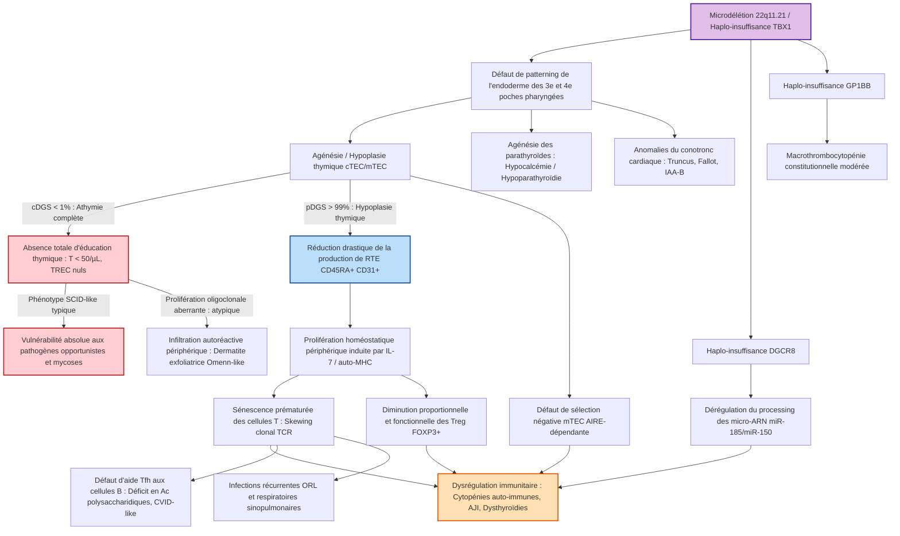
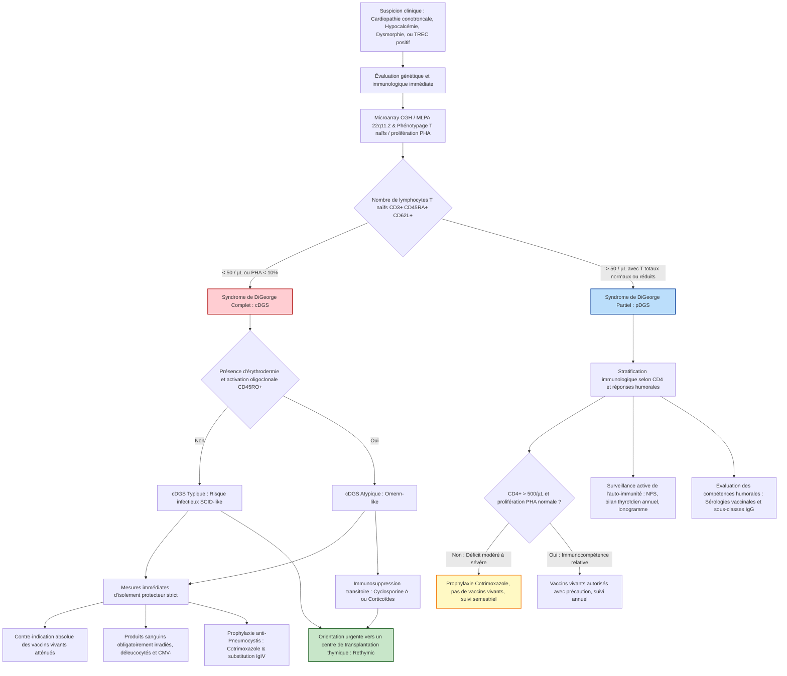

# Fiche #005 — Syndrome de DiGeorge / Délétion 22q11.2

> [!IMPORTANT]
> **Semaine 1, J5** — Classification IUIS 2024 : **Table II.3 (Déficits thymiques avec anomalies congénitales associées)**. Urgence immunologique néonatale dans sa forme complète (athymie congénitale) et défi multisystémique chronique immuno-hématologique, endocrinien et développemental dans sa forme partielle.

---

## 0. Carte d'identité IUIS 2024

| Paramètre | Définition & Caractéristiques clinico-biologiques |
| :--- | :--- |
| **Entité nosologique** | Syndrome de DiGeorge / Syndrome de microdélétion 22q11.2 (22q11.2DS) |
| **Gène en cause** | *TBX1* (T-box transcription factor 1) / microdélétion hémi-allélique 22q11.21 |
| **Classification IUIS 2024** | Table II : Déficits immunitaires combinés avec anomalies associées ou syndromiques — **Sous-classe II.3 : Déficits thymiques** |
| **Transmission** | Autosomique dominante (transmission parentale dans 7–10 % des cas ; > 90 % *de novo*) |
| **OMIM** | #188400 (Syndrome de DiGeorge / VCFS), *#602054* (*TBX1*) |
| **Locus cytogénétique** | Chromosome 22q11.21 (délétion typique de 3 Mb entre LCR22A et LCR22D englobant ~45-50 gènes codants) |
| **Compartiments cellulaires** | Épithélium thymique (cTEC/mTEC) $\rightarrow$ maturation des lymphocytes T (déficit naïf CD4+/CD8+, restriction TCR, altération Treg) ; dysfonction humorale B secondaire/intrinsèque |
| **Voies biochimiques & cellulaires** | Signalisation de l'organogenèse pharyngée : cascade *TBX1* - *FGF8*/*FGF10* - *BMP4* ; différenciation des 3ᵉ et 4ᵉ poches pharyngées ; expression d'AIRE et sélection négative intrathymique |

---

## 1. TL;DR (Synthèse exécutive)

> [!TIP]
> Le syndrome de microdélétion 22q11.2 est la cause la plus fréquente d'anomalie du développement thymique chez l'humain, médiée par l'haplo-insuffisance du facteur de transcription *TBX1*. Le spectre immunologique est dichotomisé en deux entités distinctes :
> 1. **Le syndrome de DiGeorge complet (cDGS, < 1 %)** : urgence absolue avec athymie congénitale, lymphopénie T sévère (lymphocytes T naïfs < 50/µL, phénotype SCID-like typique ou oligoclonal/atypique avec érythrodermie mimant un syndrome d'Omenn). Son traitement curatif repose impérativement sur la transplantation d'épithélium thymique allogénique en tranches (*allogeneic processed thymus tissue-agdc*), la greffe de moelle osseuse conventionnelle étant inefficace en l'absence de stroma.
> 2. **Le syndrome de DiGeorge partiel (pDGS, > 99 %)** : hypoplasie thymique avec lymphopénie T initiale d'intensité variable, dont la numération globale se normalise classiquement par prolifération homéostatique périphérique, au détriment d'un vieillissement prématuré du compartiment T (perte des lymphocytes T naïfs, skewing oligoclonal, raréfaction des Treg fonctionnels et défectuosité du contrôle centro-thymique AIRE-dépendant). Cette rupture de tolérance conduit à un risque majeur d'auto-immunité (cytopénies auto-immunes dans 5–10 % des cas, arthrite juvénile), de déficit immunitaire commun variable-like (*CVID-like*) à l'âge adulte et d'infections respiratoires récurrentes.

---

## 2. Contexte historique

- **1965** : Angelo DiGeorge, pédiatre et endocrinologue américain, rapporte une constellation clinique associant une agénésie thymique congénitale, une hypoparathyroïdie néonatale réfractaire et des convulsions hypocalcémiques chez des nourrissons décédant d'infections fulgurantes.
- **1978** : Robert Shprintzen décrit le syndrome vélo-cardio-facial (VCFS), associant division palatine, dysmorphie faciale, anomalies cardiovasculaires conotroncales et difficultés d'apprentissage.
- **1981–1992** : Identification des microdélétions du chromosome 22q11.2 par cytogénétique moléculaire (FISH) unifiant sous une même étiquette étiologique le syndrome de DiGeorge, le syndrome de Shprintzen (VCFS) et le syndrome d'anomalie conotroncale faciale de Burn.
- **2001** : Plusieurs équipes identifient *TBX1* comme le gène pivot dont l'invalidation chez la souris reproduit fidèlement la phéno-copie du contingent de malformations branchiales humaines.
- **2021** : Approbation réglementaire historique par la FDA de l'*allogeneic processed thymus tissue-agdc* (Rethymic®), confirmant le primat de l'ingénierie tissulaire thymique dans la prise en charge de l'athymie congénitale.

---

## 3. Épidémiologie & Données de registres

### Prévalence globale et démographie
- **Incidence à la naissance** : Estimée entre 1/3 000 et 1/4 000 naissances vivantes, constituant l'anomalie microdélétionnelle humaine la plus fréquente. L'incidence intra-utérine est plus élevée en raison d'une létalité foetale associée aux cardiopathies conotroncales sévères.
- **Délétion de novo vs familiale** : Dans 90 à 93 % des cas, l'anomalie résulte d'un événement méiotique *de novo* par recombinaison homologue inégale (NAHR). Dans 7 à 10 % des cas, elle est transmise par un parent affecté selon un mode autosomique dominant à pénétrance variable.

### Données consolidées des registres internationaux
- **Registres ESID & CEREDIH** : Le 22q11.2DS représente la cause prédominante de déficit immunitaire combiné syndromique (environ 8 à 12 % des cohortes globales d'erreurs innées de l'immunité syndromiques). Les données du registre CEREDIH démontrent une survie à long terme étroitement liée à la morbidité cardiologique initiale (sténoses de l'artère pulmonaire, interruptions de la crosse aortique) et à la prévention des sepsis précoces.
- **USIDNET (Étude Deshpande et al.)** : L'analyse rétrospective de la cohorte nord-américaine USIDNET a établi une corrélation non-linéaire paradoxale : une lymphopénie T CD3+ initiale n'est pas proportionnelle à l'incidence future de l'auto-immunité. L'auto-immunité clinique émerge préférentiellement chez les patients présentant un pDGS avec lymphopénie modérée à intermédiaire autorisant une survie T prolongée mais un dérèglement de la tolérance centrale.
- **Dépistage néonatal systématique (SCID NBS / TREC)** : Les programmes universels de mesure des cercles d'excision du récepteur T (TREC) identifient entre 1/15 000 et 1/30 000 nouveau-nés avec lymphopénie T syndromique, dont la microdélétion 22q11.2 constitue la première cause non-SCID détectée.

---

## 4. Physiopathologie, Génétique moléculaire & Schéma 1

### Architecture génomique de la région 22q11.2
Le locus 22q11.2 est flanqué de blocs d'ADN répétitif hautement homologues appelés duplications segmentaires ou répétitions à faible nombre de copies (*Low Copy Repeats*, LCR22), s'étendant de LCR22A à LCR22D :
- **Délétion typique (LCR22A–LCR22D, 3.0 Mb)** : Retrouvée chez ~85–90 % des patients ; elle excise approximativement 45 à 50 gènes codants pour des protéines, incluant *TBX1*, *CRKL*, *DGCR8*, *COMT*, *PRODH*, et *GP1BB*.
- **Délétions imbriquées proximales (LCR22A–LCR22B [1.5 Mb] ou LCR22A–LCR22C [2.0 Mb])** : Préservent ou excisent *TBX1*, conditionnant la sévérité du phénotype branchial.
- **Mutations ponctuelles de *TBX1*** : Rares mutations non-sens, faux-sens ou décalages de cadre dans le domaine T-box, confirmant le rôle nécessaire et suffisant de l'haplo-insuffisance de ce gène unique dans la survenue du phénotype de DiGeorge classique.

### Rôle fonctionnel de *TBX1* et de ses partenaires
*TBX1* code un facteur de transcription de la famille T-box, exprimé transitoirement dans le mésoderme somitique, l'endoderme des poches pharyngées et les crêtes neurales céphaliques :
1. **Organogenèse des 3ᵉ et 4ᵉ poches pharyngées** : L'endoderme de la 3ᵉ poche donne naissance à l'ébauche thymique (ventrale) et aux glandes parathyroïdes inférieures (dorsales). La 4ᵉ poche engendre les glandes parathyroïdes supérieures. L'absence d'activation transcriptionnelle de facteurs cibles (*FGF8*, *PAX9*, *FOXI3*) sous l'égide de *TBX1* bloque la prolifération de l'épithélium branchial et son involution prématurée.
2. **Déficit en micro-ARN (*DGCR8*)** : *DGCR8* (composant du complexe Microprocessor avec Drosha) est situé dans la région délétée. L'haplo-insuffisance de *DGCR8* compromet la biogenèse des miRNA (e.g., miR-185, miR-150), déstabilisant les seuils d'activation du récepteur lymphocytaire T (TCR) et amplifiant l'échappement auto-immun.
3. **Altération de la sélection négative et expression d'*AIRE*** : Dans les thymi hypoplasiques de pDGS, la compartimentation cortico-médullaire est désorganisée. Les cellules épithéliales thymiques médullaires (mTEC) présentent une expression quantitativament réduite de la molécule *AIRE* (*Autoimmune Regulator*) et des antigènes restreints aux tissus (TRA), entravant la sélection négative des clones autoréactifs.
4. **Compression de la diversité du répertoire et homéostasie périphérique** : Pour compenser la chute des émigrants thymiques récents (*Recent Thymic Emigrants*, RTE : CD45RA+ CD31+), les cellules T périphériques matures subissent une prolifération homéostatique dépendante de l'IL-7 et des interactions auto-MHC. Ce processus épuise prématurément les télomères, contracte la diversité clonale du TCR (mesurée par spectratypage Vβ) et induit un phénotype mémoirisé sénescent CD28- CD57+ susceptible aux dysfonctions effectrices.

### Dysfonction de l'immunité humorale
Bien que l'épithélium thymique soit le lit lésionnel primitif, la délétion 22q11.2 induit une atteinte humorale progressive :
- Perturbation de l'aide T folliculaire helper (*Tfh*, CXCR5+ PD-1+) conduisant à des anomalies du centre germinatif.
- Hypogammaglobulinémie (IgG, IgA, ou sous-classes d'IgG) et déficit de réponse vaccinale polysaccharidique (anti-pneumocoque) survenant chez 15 à 25 % des adultes (tableau frontière avec le DICV).
- Macrothrombocytopénie constitutionnelle par haplo-insuffisance du gène *GP1BB* (partie du complexe récepteur GPIb-IX-V des plaquettes sanguines).

---

## 5. Présentation clinique, Pathogènes & Phénotype immunologique

### Spectres cliniques de la microdélétion 22q11.2
La présentation associe à des degrés variables la tétrade classique :
1. **Cardiopathie conotroncale (75–80 %)** : Tétralogie de Fallot, interruption de l'arche aortique de type B (quasi-pathognomonique), truncus arteriosus, communication interventriculaire péri-membraneuse, anomalies des artères sous-clavières (artère sous-clavière droite aberrante / rétro-œsophagienne).
2. **Insuffisance parathyroïdienne (50–65 %)** : Hypocalcémie néonatale précoce révélée par trémulations, convulsions afébriles ou allongement du QT sur l'ECG. L'hypocalcémie peut réapparaître à l'occasion d'un stress chirurgical, fébrile ou d'une grossesse.
3. **Anomalies vélo-pharyngées et faciales (70 %)** : Fente palatine sous-muqueuse, luette bifide, incompétence vélopharyngée avec voix nasonnée et reflux d'aliments par les narines. Dysmorphie caractéristique : fentes palpébrales étroites, racine du nez bulbeuse, ailes narinaires hypoplasiques, micrognathie, implantation basse des pavillons auriculaires avec oreilles rondes et repliées.
4. **Déficit immunitaire et susceptibilité infectieuse** :

| Forme clinique | Fréquence | Profil T naïf (CD4+/CD8+ CD45RA+ CD62L+) | Clinique immunologique dominante | Pathogènes typiques |
| :--- | :--- | :--- | :--- | :--- |
| **cDGS typique** | ~0.5 % | Effondré (< 50/µL), TREC indétectables, PHA < 10 % | Clinique de SCID néonatal sans manifestations cutanées inflammatoires | *Pneumocystis jirovecii*, CMV, ADV, RSV, EBV, candidose cutanéomuqueuse extensive |
| **cDGS atypique** | ~0.5 % | T totaux normaux/élevés mais CD45RA+ nuls, prolifération monovariée | Érythrodermie exfoliative, adénopathies généralisées, hépatosplénomégalie, entéropathie (mimant l'Omenn) | Opportunistes majeurs + toxicité auto-inflammatoire et organomégalie polyclonale |
| **pDGS sévère** | ~5 % | Réduit significativement (CD3+ < 500/µL en période néonatale) | Infections virales sévères et bactériennes dès le premier semestre | Virus respiratoires (VRS, Influenza), Encapsulés (*S. pneumoniae*, *H. influenzae*) |
| **pDGS modéré à léger** | ~90 % | T totaux sub-normaux, déclin progressif des T naïfs, RTE effondrés | Infections ORL récidivantes (otites moyennes aiguës, sinusites) chez le nourrisson | *Streptococcus pneumoniae*, *Haemophilus influenzae*, Rhinovirus |
| **Immuno-dysrégulation (adulte)** | Variable | Inversion CD4/CD8, mémoirisation excessive, Tfh dysfonctionnels | Cytopénies auto-immunes réfractaires (PTI, AHAI), arthrite, thyroïdite, bronchiectasies | Bactéries encapsulées pyogènes si hypogammaglobulinémie associée |

---

## 6. Complications à long terme & Défis non résolus

### Auto-immunité et dysrégulation immunitaire
- **Cytopénies auto-immunes (5 à 10 %)** : Purpura thrombopénique immunologique (PTI), anémie hémolytique auto-immune (AHAI), syndrome d'Evans. Le diagnostic de PTI peut être masqué par la macrothrombocytopénie constitutionnelle liée à la délétion de *GP1BB*.
- **Rhumatismes inflammatoires (2 à 5 %)** : Arthrite juvénile idiopathique (AJI), typiquement polyarticulaire ou oligoarticulaire séronégative, survenant plus précocement que dans la population générale.
- **Endocrinopathies auto-immunes** : Thyroïdite de Hashimoto (la plus fréquente, jusqu'à 20 % des adultes), maladie de Basedow, maladie d'Addison et vitiligo.
- **Entéropathie inflammatoire auto-immune** : Maladie cœliaque (fréquence multipliée par 5 à 10 par rapport à la population générale).

### Évolution vers un déficit humoral progressif (CVID-like)
- À mesure que le contingent T subit une sénescence réplicative par prolifération oligoclonale, les interactions cognitives T-B au sein des zones folliculaires des ganglions s'effondrent.
- Une hypogammaglobulinémie sévère progressive avec perte des lymphocytes B mémoires commutés (CD19+ CD27+ IgD-) et absence de réponse aux antigènes polysaccharidiques non conjugués se développe chez environ 2 à 4 % des adultes, nécessitant une substitution par immunoglobulines intraveineuses ou sous-cutanées.

### Neuropsychiatrie et transition adulte
- **Spectre schizophrénique et psychotique** : Jusqu'à 25 à 30 % des adultes porteurs de la microdélétion 22q11.2 développent un trouble psychotique caractérisé ou une schizophrénie réfractaire (influence directe de l'haplo-insuffisance de *COMT*, *PRODH* et altération de la microglie/neuro-inflammation).
- **Troubles du neuro-développement** : Trouble du spectre de l'autisme (TSA, 20–40 %), trouble déficitaire de l'attention avec ou sans hyperactivité (TDAH, 30–50 %), anxiété sévère.

### Défis non résolus
1. **Biomarqueurs prédictifs de l'auto-immunité** : Absence de marqueur absolu permettant d'anticiper la bascule d'une immunodéficience stable vers une poussée cytopénique sévère.
2. **Délabrement pulmonaire insidieux** : Genèse des bronchiectasies favorisée conjointement par les micro-inhalations chroniques (reflux, dysfonction vélo-palatine), les infections à pyogènes répétées et le défaut de synthèse d'IgA sécrétoire.

---

## 7. Avenues thérapeutiques

### Transplantation d'épithélium thymique allogénique
- **Produit et statut** : *Allogeneic processed thymus tissue-agdc* (Rethymic®), composé de lamelles de tissu thymique de donneurs pédiatriques subissant une sternotomie chirurgicale, cultivées *ex vivo* pendant 12 à 21 jours pour dépléter les thymocytes résiduels du donneur tout en préservant l'architecture stromale (cTEC/mTEC).
- **Indication formelle** : Athymie congénitale (Syndrome de DiGeorge complet typique ou atypique).
- **Procédure** : Implantation chirurgicale directe des tranches thymiques dans les loges musculaires du quadriceps de l'hôte athymique.
- **Cinétique de prise** : Les progéniteurs hématopoïétiques lymphoïdes T de l'hôte migrent dans le greffon implanté ; l'émergence des lymphocytes T naïfs circulants fonctionnels s'observe après une latence de 6 à 12 mois. Taux de survie globale à long terme d'environ 75 à 80 %.
- **Contre-indication relative du HSCT** : L'allogreffe de cellules souches hématopoïétiques (HSCT) sans tissu thymique chez un patient athymique est incapable de régénérer une thymopoïèse *de novo*. Elle transfère uniquement des lymphocytes T matures du donneur, exposant à un risque de rejet, d'absence prolongée de lymphocytes T naïfs et d'une morbi-mortalité par GVHD sévère, sauf dans de rares cas de transplantation de progéniteurs T matures sans conditionnement chez un cDGS typique non exposé.

### Prise en charge hématologique et humorale
- **Immunoglobulines de substitution (IgIV / IgSC)** : Indiquées en cas d'hypogammaglobulinémie clinique avérée (IgG résiduelles < 4 g/L ou < 5 g/L avec infections récidivantes) ou de défaut spécifique de production d'anticorps antipolysaccharidiques post-vaccination pneumococcique.
- **Immunosuppression ciblée dans la dysrégulation** :
  - *Cytopénies auto-immunes réfractaires* : Corticothérapie à court terme, immunoglobulines polyvalentes à dose immunomodulatrice (2 g/kg), Rituximab (anti-CD20) avec prudence (risque d'agammaglobulinémie définitive), ou agonistes du récepteur de la thrombopoïétine (Romiplostim, Eltrombopag).
  - *Inhibiteurs de mTOR (Sirolimus)* et *Inhibiteurs de JAK* : Utilisés dans les formes avec lymphoprolifération agressive ou entéropathie auto-immune associée.

### Médecine régénérative et thérapies d'avenir
- **Thymus bio-ingénieré et organoïdes thymiques** : Matrices thymiques humaines décellularisées réensemencées avec des cellules souches pluripotentes induites (iPSC) différenciées en précurseurs épithéliaux thymiques (iTECs).
- **Correction génique ciblée de *TBX1*** : Édition génique CRISPR/Cas9 visant à compenser l'haplo-insuffisance dans des modèles organoïdes précliniques.

---

## 8. Section pratique (Bedside, Guidelines & Schéma 2)

### Diagnostic différentiel

| Entité / Pathologie | Gène en cause / Anomalie | Caractéristiques distinctives cliniques | Phénotype immunologique discriminant |
| :--- | :--- | :--- | :--- |
| **Syndrome CHARGE** | *CHD7* (8p12) ou *SEMA3E* | Colobome oculaire, atrésie des choanes, anomalies des canaux semi-circulaires, dysmorphie auriculaire spécifique | Athymie ou hypoplasie thymique possible ; lymphopénie T pouvant être indiscernable d'un DiGeorge |
| **Déficit en FOXN1** | *FOXN1* (17q11.2, transmission AR) | Athymie congénitale associée à une alopécie totale universelle et à une dystrophie unguéale sévère (*Nude mouse phenotype*) | Absence complète de développement des cTEC/mTEC, blocage de l'ontogenèse T |
| **Délétion 10p13-p14** | Microdélétion cryptique 10p | Phénotype dit de « DiGeorge-2 », cardiopathie conotroncale, retard mental sévère | Hypoplasie thymique avec lymphopénie T similaire à la 22q11.2 |
| **Embryopathie à l'acide rétinoïque / Diabétique** | Tératogène environnemental (non génétique) | Exposition maternelle au Roaccutane ou diabète mal équilibré : microtie, fentes faciales, conotronc | Hypoplasie thymique secondaire mimant le phénotype branchial de DiGeorge |
| **SCID T-B+NK+ / Omenn** | *IL2RG*, *JAK3*, *RAG1/2*, *ARTEMIS* | Absence d'anomalies de dérivation branchiale faciale, cardiopathies conotroncales absentes | Absence primitive intrinsèque des progéniteurs T hématopoïétiques (le stroma thymique est présent mais non habité) |

### 6 Perles cliniques pour le praticien

1. **Sang irradié non négociable en salle de naissance et au bloc de cardiothoracique** : Tout nouveau-né porteur d'une cardiopathie conotroncale (en particulier interruption de la crosse aortique type B ou truncus) doit impérativement recevoir des dérivés sanguins **phénotypés, déleucocytés, irradiés à 25-30 Gy et CMV-négatifs** tant que le statut des lymphocytes T naïfs n'est pas établi, sous peine d'induire une réaction du greffon contre l'hôte transfusionnelle (TA-GVHD) létale.
2. **Le piège de la normalité de la formule sanguine (NFS)** : Un taux de lymphocytes totaux absolu normal à la NFS ne permet jamais d'exclure un déficit immunitaire T sévère ou un DiGeorge atypique. Le clinicien doit exiger le sous-typage par cytométrie en flux mesurant les lymphocytes T naïfs (**CD3+ CD45RA+ CD62L+ / CD31+**).
3. **Penser à la pseudothrombopénie constitutionnelle de Paris-Trousseau / GP1BB** : Les patients délétés en 22q11.2 présentent une macrothrombocytopénie modérée constitutionnelle asymptomatique (plaquettes entre 80 000 et 150 000/µL avec volume plaquettaire moyen augmenté) liée à la perte d'une copie de *GP1BB*. Ne pas débuter précipitamment d'immunosuppresseurs lourds pour un pseudo-PTI devant une thrombopénie isolée stable.
4. **Vaccins vivants atténués (ROR, Varicelle, BCG) : la règle de sécurité chiffrée** : Suivant les recommandations internationales (ESID 2024 / US Guidelines 2023), l'injection du ROR ou de la varicelle requiert obligatoirement : un taux de lymphocytes **CD4+ > 500/µL** (au-delà de l'âge d'un an), des **CD8+ > 300/µL**, et une prolifération mitogénique à la PHA normale (> 50 % du témoin). Le BCG est formellement contre-indiqué en période néonatale en l'absence de phénotypage T.
5. **Surveillance du calcium avant toute chirurgie majeure** : L'hypoparathyroïdie peut être infraclinique et équilibrée à l'état basal chez le grand enfant ou l'adulte, mais décompenser brutalement sous forme de tétanie, spasme laryngé ou arrêt cardiaque per-opératoire sous l'effet des transfusions massives (chélation du calcium ionisé par le citrate) ou du stress chirurgical. Doser systématiquement la calcémie ionisée et la parathormone (PTH).
6. **L'exploration systématique de la voix et du carrefour aérodigestif** : Une rhinolalie ouverte (voix nasonnée), des régurgitations nasales ou des bronchopneumopathies récurrentes chez un nourrisson doivent faire rechercher activement une fente sous-muqueuse par palpation du voile du palais et une nasofibroscopie fonctionnelle avant de conclure à des infections respiratoires чисто immunologiques.

---

## 9. Nouveautés & Littérature récente (2022–2026)

- **Recommandations de l'ESID pour la prise en charge de l'athymie congénitale (Kreins et al., *J Allergy Clin Immunol*, 2024)** : Consensus européen unifié standardisant le recours précoce au dépistage par TREC, les critères diagnostiques stricts (naïfs < 50/µL) et l'algorithme d'orientation vers les centres transplanteurs de tissu thymique cultivé allogénique (*allogeneic processed thymus tissue*).
- **Consensus international sur la prise en charge immunologique du 22q11.2 (Mustillo et al., *J Clin Immunol*, 2023)** : Établissement des seuils d'autorisation vaccinale, de l'encadrement périopératoire des transfusions sanguines et du calendrier de dépistage des défaillances humorales et auto-immunes de l'enfance à l'âge adulte.
- **Trajectoires immunitaires et prédiction de l'auto-immunité (Crowley et al., *J Allergy Clin Immunol*, 2022)** : Analyse longitudinale multicentrique démontrant que l'émergence des cytopénies auto-immunes et de l'arthrite est précédée par une perte précoce des émigrants thymiques récents (RTE) et une oligoclonalité T, modélisant les biomarqueurs de risque dès l'âge pédiatrique.
- **Caractérisation phénotypique fine des formes dysimmunitaires vs infectieuses (Costagliola et al., *J Clin Med*, 2023)** : Mise en évidence de l'expansion paradoxale des sous-populations CD8 mémoires effectrices et de l'effondrement des cellules dendritiques myéloïdes chez les patients souffrant de dérégulation par rapport aux profils infectieux purs.
- **Précision diagnostique des SCID et déficits profonds du PIDTC (Dvorak et al., *J Allergy Clin Immunol*, 2023)** : Révision formelle des définitions du consortium PIDTC entérinant la position nosologique de l'athymie congénitale (DiGeorge complet) au sein des déficits immunitaires combinés sévères d'origine stromale.

---

## 10. Références vérifiées

1. **Kreins AY, Dhalla F, Flinn AM, Howley E, Ekwall O, Villa A, Staal FJT, Anderson G, Gennery AR, Holländer GA, Davies EG; European Society for Immunodeficiencies Clinical Working Party.** European Society for Immunodeficiencies guidelines for the management of patients with congenital athymia. *J Allergy Clin Immunol*. 2024 Dec;154(6):1391-1408. doi: 10.1016/j.jaci.2024.07.031. [PMID: 39303894]
2. **Mustillo PJ, Sullivan KE, Chinn IK, Notarangelo LD, Haddad E, Davies EG, de la Morena MT, Hartog N, Yu JE, Hernandez-Trujillo VP, Ip W, Franco J, Gambineri E, Hickey SE, Varga E, Markert ML.** Clinical Practice Guidelines for the Immunological Management of Chromosome 22q11.2 Deletion Syndrome and Other Defects in Thymic Development. *J Clin Immunol*. 2023 Feb;43(2):247-270. doi: 10.1007/s10875-022-01418-y. [PMID: 36648576]
3. **Howley E, Davies EG, Kreins AY.** Congenital Athymia: Unmet Needs and Practical Guidance. *Ther Clin Risk Manag*. 2023 Mar 13;19:239-254. doi: 10.2147/TCRM.S379673. [PMID: 36935770]
4. **Costagliola G, Legitimo A, Bertini V, Alberio AMQ, Valetto A, Consolini R.** Distinct Immunophenotypic Features in Patients Affected by 22q11.2 Deletion Syndrome with Immune Dysregulation and Infectious Phenotype. *J Clin Med*. 2023 Dec 8;12(24):7579. doi: 10.3390/jcm12247579. [PMID: 38137647]
5. **Crowley TB, Campbell IM, Liebling EJ, Lambert MP, Levitt Katz LE, Heimall J, Bailey A, McGinn DE, McDonald McGinn DM, Sullivan KE.** Distinct immune trajectories in patients with chromosome 22q11.2 deletion syndrome and immune-mediated diseases. *J Allergy Clin Immunol*. 2022 Jan;149(1):445-450. doi: 10.1016/j.jaci.2021.06.007. [PMID: 34144109]
6. **Deshpande DR, Demirdag YY, Marsh RA, Sullivan KE, Orange JS; USIDNET Consortium.** Relationship between Severity of T Cell Lymphopenia and Immune Dysregulation in Patients with DiGeorge Syndrome (22q11.2 Deletions and/or Related TBX1 Mutations): a USIDNET Study. *J Clin Immunol*. 2021 Jan;41(1):29-37. doi: 10.1007/s10875-020-00854-y. [PMID: 32808164]