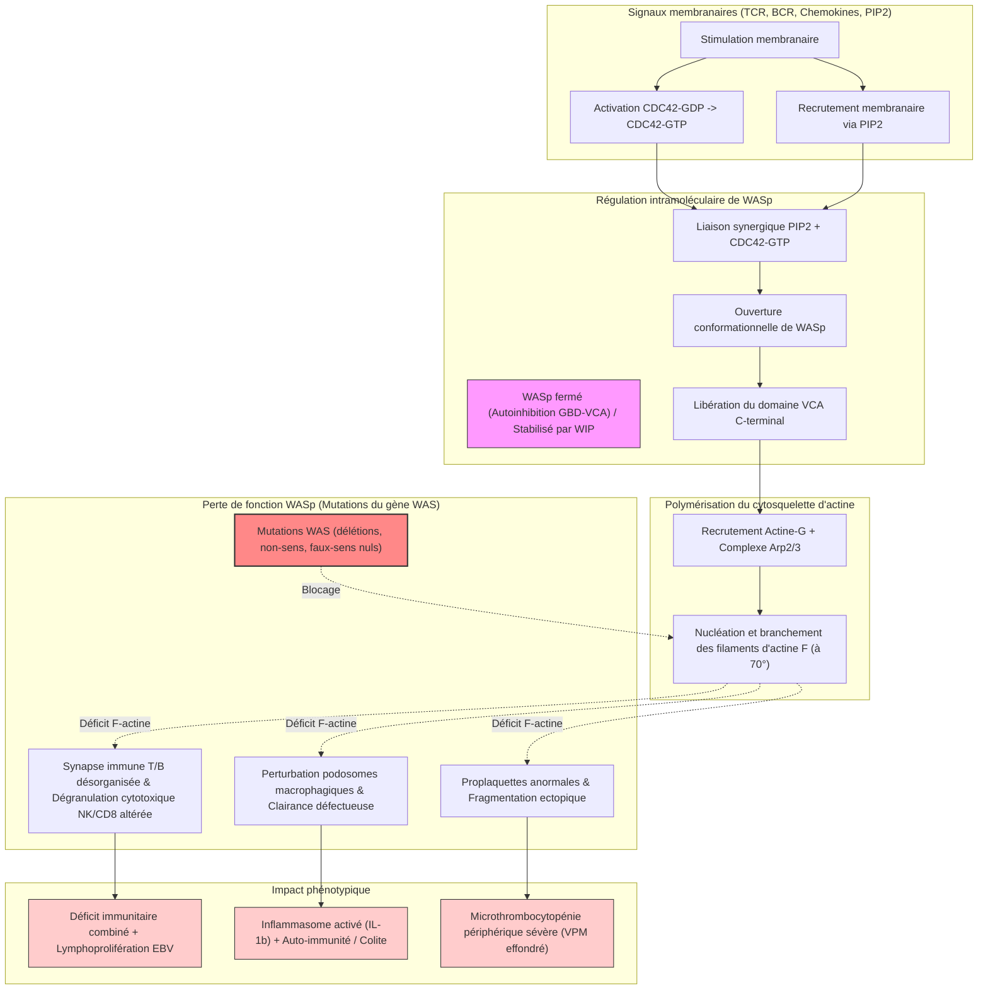
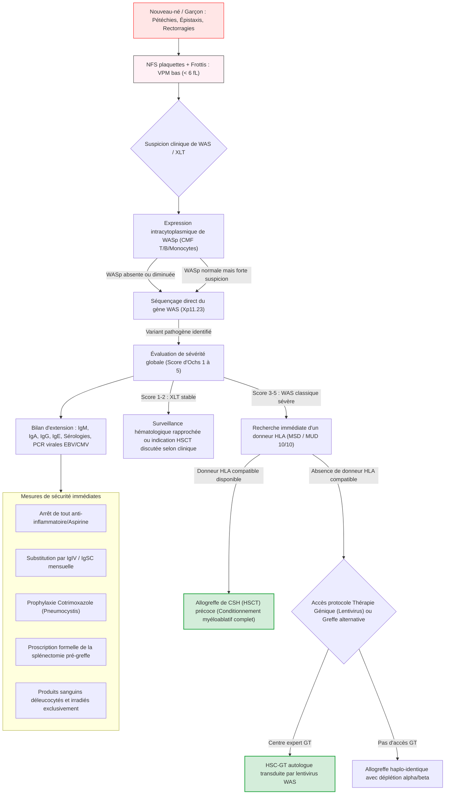

# Fiche #006 — Syndrome de Wiskott-Aldrich (WAS)

> [!IMPORTANT]
> **Atlas des Déficits Immunitaires Primitifs (IUIS 2024)**  
> **Cycle de formation clinique** : Semaine 1, Jour 6 (J6)  
> **Classification IUIS** : Tableau II.1 — *Combined immunodeficiencies with associated or syndromic features* (Déficits immunitaires combinés avec anomalies syndromiques)

---

## 0. Carte d'identité IUIS 2024

| Paramètre | Définition / Critère de référence |
| :--- | :--- |
| **Nom de la pathologie** | Syndrome de Wiskott-Aldrich (WAS) |
| **Gène causal** | *WAS* (*Wiskott-Aldrich Syndrome gene*) |
| **Locus chromosomique** | Xp11.23 |
| **Mode de transmission** | Récessif lié à l'X (XLR) |
| **Protéine affectée** | WASP (*Wiskott-Aldrich Syndrome Protein*), 502 acides aminés |
| **Code OMIM** | **#301000** (WAS classique), **#313900** (Thrombocytopénie liée à l'X - XLT), **#300299** (Neutropénie liée à l'X - XLN, gain de fonction) |
| **Classification IUIS 2024** | Tableau II.1 — Déficits immunitaires combinés avec anomalies syndromiques |
| **Score clinique de référence** | **Score phénotypique d'Ochs** (gradé de 1 à 5) |
| **Triade pathognomonique** | Microthrombocytopénie congénitale + Eczéma atopique + Infections récidivantes |
| **Anomalies hématologiques cardinales** | Thrombopénie avec **Volume Plaquettaire Moyen (VPM) effondré** (< 5-7 fL) |
| **Profil immunitaire typique** | IgM abaissée, IgA/IgE élevées, IgG normale ou basse, anergie vaccinale polysaccharidique, lymphopénie T progressive, synaptopathie immune |

---

## 1. TL;DR (Synthèse exécutive)

> [!TIP]
> Le syndrome de Wiskott-Aldrich (WAS) est une immuno-actinopathie récessive liée à l'X causée par des variants pathogènes du gène *WAS* altérant la polymérisation branchée du cytosquelette d'actine médiée par Arp2/3. Il associe classiquement chez le garçon une microthrombocytopénie néonatale hémorragique (VPM effondré à la NFS), un eczéma réfractaire et un déficit immunitaire combiné progressif exposant aux germes encapsulés, aux virus et aux opportunistes. Le risque vital est dominé par les hémorragies cérébrales précoces, l'auto-immunité/hyperinflammation sévère (jusqu'à 70 % des cas) et les lymphomes B induits par l'EBV. La greffe allogénique de cellules souches hématopoïétiques (HSCT) avec conditionnement myéloablatif complet — garantissant un chimérisme myéloïde stable — ou la thérapie génique autologue par vecteur lentiviral constituent les seuls traitements curatifs définitifs.

---

## 2. Contexte historique

- **1937** : Le pédiatre allemand **Alfred Wiskott** décrit à Munich trois frères présentant une thrombopénie familiale, des épisodes de diarrhée sanglante, un eczéma sévère et des infections auriculaires récidivantes, tout en observant que leurs sœurs demeuraient indemnes.
- **1954** : Le pédiatre américain **Robert Anderson Aldrich** retrace l'arbre généalogique d'une famille d'immigrants néerlandais sur six générations et démontre formellement le mode de transmission récessif lié au chromosome X.
- **1968** : **Fritz Bach** et son équipe réalisent la toute première allogreffe de moelle osseuse réussie au monde chez un nourrisson atteint du syndrome de Wiskott-Aldrich, ouvrant la voie à la thérapie cellulaire curative des déficits immunitaires primitifs.
- **1994** : L'équipe de **Jill M. Derry** et **Hans D. Ochs** clone et identifie le gène *WAS* localisé sur le bras court du chromosome X (Xp11.23).
- **Années 2000–2010** : Caractérisation de la régulation moléculaire par la petite GTPase Cdc42 et le complexe Arp2/3. Les premiers essais cliniques de thérapie génique rétrovirale (vecteurs γ-rétroviraux) démontrent une efficacité mais sont compliqués de leucémies aiguës par mutagénèse insertionnelle (activation des proto-oncogènes *LMO2*, *MDS1-EVI1*), conduisant au développement exclusif des vecteurs lentiviraux auto-inactivants (SIN-lentivirus).

---

## 3. Épidémiologie & Données de registres

- **Incidence globale** : Estimée entre **1 et 4 pour 1 000 000 naissances de garçons vivants** sans prédilection ethnique établie. Les femmes hétérozygotes sont presque exclusivement asymptomatiques en raison de l'inactivation préférentielle et biaisée du chromosome X muté dans le compartiment hématopoïétique souche.
- **Registres CEREDIH (France)** et **ESID (Europe)** :
  - L'âge médian au diagnostic est historiquement de 24 mois pour les cas sporadiques sans antécédent familial, mais s'est réduit à **< 6 mois** au cours de la dernière décennie grâce à la reconnaissance précoce de la microthrombocytopénie.
  - La survie globale à 15 ans sans traitement curatif était inférieure à 35 % avant les années 1990 ; elle dépasse désormais **85–90 %** après allogreffe de moelle ou thérapie génique en centre de référence pédiatrique.
- **Registres PIDTC / USIDNET (Amérique du Nord)** :
  - Survie globale après allogreffe allogénique de cellules souches hématopoïétiques supérieure à **90 %** chez les enfants greffés avant l'âge de 5 ans et en l'absence d'infection systémique active ou d'auto-immunité non contrôlée au moment du conditionnement.
  - Identification du risque critique de rejet de greffe ou d'échec plaquettaire au long cours lié au chimérisme mixte instable dans la lignée myéloïde.

---

## 4. Physiopathologie, Génétique moléculaire & Schéma 1

### Structure protéique de WASp
WASp est une protéine d'échafaudage de 502 acides aminés exprimée exclusivement dans les cellules de la lignée hématopoïétique. Elle est articulée en 5 domaines fonctionnels majeurs :
1. **Domaine WH1 / EVH1 (N-terminal)** : Lie WIP (*WASp-Interacting Protein*), protégeant WASp de la dégradation prématurée par le protéasome et le système calpaïne.
2. **Domaine basique (B)** : Région riche en résidus basiques interagissant avec le phosphatidylinositol-4,5-bisphosphate ($\text{PIP}_2$) membranaire.
3. **Domaine GBD (*GTPase-Binding Domain*)** : Lie la petite GTPase active **Cdc42-GTP**. Responsable du maintien de la conformation autoinhibée fermée par repliement intramoléculaire sur le domaine carboxy-terminal VCA.
4. **Domaine polyproline (PPP)** : Recrute des protéines à domaine SH3 (kinases de la famille Src telles que Fyn, Lck, Lyn, ainsi que Btk et Grb2) et interagit avec la profiline pour alimenter l'élongation de l'actine.
5. **Domaine VCA (Verproline-Cofiline-Acidique, C-terminal)** : Région effectrice catalytique. Fixe les monomères d'actine G (sous-domaine V) et recrute le complexe **Arp2/3** (sous-domaines C et A), provoquant la nucléation et le branchement à 70° des microfilaments d'actine F.

### Mécanisme d'activation et conséquences cellulaires
- **État basal** : WASp adopte une conformation fermée autoinhibée par interaction hydrophobe de haute affinité entre son motif GBD et son motif VCA.
- **Activation** : La stimulation des récepteurs immuns (TCR, BCR, FcγR, récepteurs de chimiokines) induit la production de $\text{PIP}_2$ membranaire et la conversion de Cdc42-GDP en Cdc42-GTP. La liaison simultanée de $\text{PIP}_2$ et Cdc42-GTP lève l'autoinhibition, dépliant WASp et libérant le domaine VCA qui active le complexe Arp2/3.
- **Dysfonctions cellulaires résultantes** :
  - **Lymphocytes T / NK** : Défaut de polarisation du centrosome (MTOC), absence de stabilisation de la synapse immunologique, anergie de sécrétion polarisée des granules cytotoxiques (perforine/granzyme), épuisement lymphocytaire T progressif et instabilité des lymphocytes T régulateurs ($T_{\text{reg}}$ FOXP3+).
  - **Mégacaryocytes et Plaquettes** : Fragmentation ectopique intra-médullaire anormale des proplaquettes, déstabilisation du cytosquelette sous-membranaire plaquettaire, libération de **microplaquettes dysfonctionnelles** détruites de façon accélérée par les macrophages spléniques.
  - **Polynucléaires et Macrophages** : Incapacité à assembler les podosomes, arrêt de la chimiotaxie orientée, phagocytose défectueuse et mauvaise élimination des débris apoptotiques et des immunocomplexes (stimulant la sécrétion d'IL-1β et l'hyperinflammation).

### Schéma 1 : Cascade moléculaire et cellulopathies du déficit en WASp

---

## 5. Présentation clinique, Pathogènes & Phénotype immunologique

### Spectre phénotypique et gradation clinique (Score d'Ochs)
- **Score 1 (XLT pure)** : Thrombopénie congénitale isolée avec microplaquettes, saignements cutanéo-muqueux minimes.
- **Score 2 (XLT atténuée)** : Microthrombocytopénie + eczéma transitoire discret et/ou infections des voies aériennes supérieures banales sans retentissement pulmonaire.
- **Score 3 (WAS modéré)** : Microthrombocytopénie + eczéma atopique résistant aux dermocorticoïdes + infections bactériennes récurrentes.
- **Score 4 (WAS sévère classique)** : Microthrombocytopénie avec syndrome hémorragique majeur + eczéma atopique généralisé sévère (infecté) + infections bactériennes/virales/fongiques invasives récidivantes.
- **Score 5 (WAS compliqué)** : Présentation score 1 à 4 compliquée d'une **pathologie auto-immune/auto-inflammatoire** (anémie hémolytique auto-immune, purpura thrombopénique immunologique, vascularite cutanée/systémique, arthrite, glomérulonéphrite, MICI) ou d'un **cancer/hémopathie maligne**.

### Pathogènes préférentiels
- **Bactéries encapsulées** (défaut de production d'anticorps antipolysaccharidiques et d'activation lymphocytaire marginale B) : *Streptococcus pneumoniae*, *Haemophilus influenzae* de type b, *Neisseria meningitidis*.
- **Agents opportunistes** (défaillance de l'immunité cellulaire T) : *Pneumocystis jirovecii*, *Candida albicans*, entéropathogènes opportunistes.
- **Virus à tropisme leucocytaire et mucocutané** : Famille *Herpesviridae* (HSV-1/2 sévère ou disséminé, VZV sévère/chronique, infections néfastes et lymphoprolifération induite par le virus d'Epstein-Barr - **EBV**, réactivations à **CMV**).

### Profil immunobiologique quantitatif et fonctionnel
- **Numération Formule Sanguine (NFS) & Frottis sanguin** :
  - Plaquettes typiquement entre **$10\times 10^9/\text{L}$ et $60\times 10^9/\text{L}$**.
  - **VPM effondré** (généralement **< 6 fL**, valeur normale : 8–11 fL) : critère d'orientation diagnostique immédiat.
  - Absence fréquente d'anomalies leucocytaires initiales en dehors d'une lymphopénie T s'aggravant avec l'âge.
- **Dosage pondéral des immunoglobulines** :
  - **IgM** : Typiquement basse ou subnormale.
  - **IgA** : Élevée de façon précoce et marquée.
  - **IgE** : Fortement augmentée (associée à l'eczéma et à l'atopie sévère).
  - **IgG** : Normale dans la petite enfance, déclin progressif ultérieur.
- **Réponses vaccinales spécifiques** :
  - **Effondrement complet des réponses aux antigènes polyosidiques purs** (vaccin antipneumococcique 23-valent non conjugué).
  - Réponses aux anatoxines protéiques (tétanos, diphtérie) subnormales ou transitoires.
  - Taux des iso-hémagglutinines naturelles (anti-A, anti-B) effondré ou nul après 1 an.
- **Cytométrie en flux** :
  - Chute progressive du contingent des cellules T CD4+ et CD8+.
  - Raréfaction majeure des lymphocytes B mémoires CD27+.
  - **Expression intracytoplasmique de la protéine WASp** : Test de screening rapide par anticorps monoclonal chez les lymphocytes et monocytes (permettant d'orienter entre variant nul/absence totale ou variant hypomorphe avec expression résiduelle).

---

## 6. Complications à long terme & Défis non résolus

- **Auto-immunité et hyperinflammation (Score 5)** :
  - Touche 40 à 70 % des patients non curés avec l'avancée en âge.
  - Anémie Hémolytique Auto-Immune (AHAI) à test de Coombs positif et Purpura Thrombopénique Auto-Immun (PTAI/ITP) « réfractaire », aggravant drastiquement la thrombopénie constitutionnelle.
  - Vascularites cérébrales, vascularites systémiques destructrices mimant une périartérite noueuse ou un purpura de Henoch-Schönlein récidivant, glomérulonéphrite à dépôts d'IgA.
  - Colite inflammatoire précoce (phénotype IBD-like) sévère, corrélée à une hyperactivation de l'axe neutrophile/inflammasome et à une sécrétion incontrôlée d'**IL-1β**.
- **Malignité hématologique** :
  - Prévalence de 10 à 25 % chez les patients survivant au-delà de 10 ans sans greffe.
  - Survenue prédominante de **lymphomes non hodgkiniens à cellules B** (souvent EBV-induits), de lymphomes cérébraux primitifs et de syndromes myélodysplasiques/leucémies myéloïdes.
- **Le défi du chimérisme myéloïde post-allogreffe** :
  - Alors que le chimérisme lymphoïde T donneur s'établit facilement grâce à un avantage sélectif naturel des cellules WASp-positives, le chimérisme myéloïde/plaquettaire ne dispose pas de cet avantage.
  - En présence d'un **chimérisme myéloïde mixte résiduel (< 50 % donneur)**, la microthrombocytopénie et les cytopénies auto-immunes persistent souvent, imposant un second conditionnement myéloablatif ou une injection de cellules souches de rattrapage.
- **Réversions somatiques (Mosaïcisme somatique)** :
  - Survenue d'auto-mutations inverses restaurant un allèle sauvage fonctionnel dans certains clones de lymphocytes T ou cellules NK. Ce phénomène atténue ponctuellement le déficit cellulaire T mais ne corrige ni la mégacaryopoïèse, ni la thrombopénie, ni l'hyperinflammation myéloïde.

---

## 7. Avenues thérapeutiques

### Allogreffe de cellules souches hématopoïétiques (HSCT)
- **Standard de soins curatif absolu** : Doit être planifiée le plus tôt possible, idéalement avant l'âge de 2 ans, dès l'établissement du génotype WAS sévère.
- **Donneur** :
  - Donneur géno-identique intrafamilial (MSD) ou donneur volontaire non apparenté parfaitement apparié 10/10 (MUD) : survie globale > 90 %.
  - Donneur haplo-identique avec déshydratation sélective αβ+/CD19+ ou cyclophosphamide post-greffe (PTCy) : résultats excellents en l'absence de donneur compatible rapide.
- **Conditionnement** :
  - **Myéloablation complète indispensable** (Busulfan ciblé par pharmacocinétique + Fludarabine, ou Tréosulfan + Fludarabine + Sérothérapie [ATG]) pour assurer une éradication myéloïde complète évitant le chimérisme mixte mégacaryocytaire.

### Thérapie génique autologue par cellules souches hématopoïétiques transduites (HSC-GT)
- Utilisation de cellules progénitrices $\text{CD34}^+$ autologues transduites *ex vivo* par un **vecteur lentiviral intégrant le promoteur endogène du gène *WAS*** (vecteur développé par les consortia français, italiens et britanniques, e.g., OTL-103).
- Après conditionnement myéloablatif par Busulfan, réinjection des cellules autologues modifiées.
- **Bénéfices** : Absence totale de maladie du greffon contre l'hôte (GvHD), tolérance excellente chez les patients porteurs de vascularites ou d'infections actives rendant l'allogreffe conventionnelle prohibitive. Reconstitution lymphoïde T et plaquettaire durable, sans mutagénèse oncogénique rapportée sur des suivis de plus de 10 ans.

### Prise en charge médicale symptomatique & thérapies ciblées
- **Immunoglobulines de substitution (IgIV ou IgSC)** : Indispensables pour pallier le défaut en anticorps et prévenir les sepsis à pneumocoques (dose habituelle de substitution : 0,4 à 0,6 g/kg toutes les 3–4 semaines).
- **Prophylaxie anti-infectieuse** :
  - Triméthoprime-sulfaméthoxazole systématique (prévention de l'infection à *Pneumocystis jirovecii*).
  - Valaciclovir / Aciclovir prophylactique en cas d'antécédent de récurrence herpétique sévère.
- **Gestion de la microthrombocytopénie** :
  - Transfusions de culots plaquettaires phénotypés, déleucocytés et irradiés réservées aux **hémorragies graves mettant en jeu le pronostic vital ou chirurgie urgente**, pour limiter l'allo-immunisation anti-HLA pré-greffe.
  - **Agonistes du récepteur de la thrombopoïétine (TPO-RA)** : Eltrombopag, Romiplostim, utilisés comme traitement suspensif transitoire pour élever le plateau plaquettaire avant procédure invasive.
  - **Place de la splénectomie** : Historiquement efficace pour normaliser les plaquettes mais **désormais formellement contre-indiquée** ou strictement réservée aux échecs ultimes chez l'adulte, en raison d'un risque catastrophique de sepsis foudroyant à pneumocoques et de complications thrombo-emboliques majeures.
- **Biothérapies de régulation immunitaire** :
  - **Inhibition de l'IL-1 (Anakinra, Canakinumab)** : Émergence majeure démontrée pour le contrôle des vascularites, des arthrites et des colites réfractaires en phase d'attente de greffe cellulaire.
  - **Rituximab** : Indiqué dans les cytopénies auto-immunes (AHAI) médiées par les auto-anticorps et pour contrôler la réplication et la prolifération B induite par l'EBV.

---

## 8. Section pratique (Bedside, Guidelines & Schéma 2)

### Algorithme décisionnel diagnostique et thérapeutique (Mermaid)

### Diagnostic différentiel pragmatique

| Pathologie | Mode de transmission | Particularité plaquettaire (VPM) | Signes distinctifs différentiels | Marqueur diagnostique clé |
| :--- | :--- | :--- | :--- | :--- |
| **Purpura Thrombopénique Immunologique (PTI)** | Acquis (auto-immun) | **VPM augmenté** (macroplaquettes de régénération) | Absence d'eczéma, début brutal post-infectieux, pas de récessivité liée à l'X. | Moelle riche en mégacaryocytes, réponse aux corticoïdes/IgIV. |
| **Déficit en ARPC1B** | Récessif autosomique (AR) | **Microthrombocytopénie** ou plaquettes normales | Atteinte des deux sexes, vascularite systémique féroce, colite, IgE/IgA très élevées. | Mutation biallélique de *ARPC1B* (complexe Arp2/3). |
| **Syndrome d'Omenn / SCID** | AR ou XLR (*RAG*, *DCLRE1C*, *IL2RG*) | Plaquettes de **taille et nombre normaux** | Érythrodermie néonatale, alopécie, hépato-splénomégalie, lymphopénie B franche. | Oligoclonalité T majeure, TREC indétectables, absence de microthrombopénie. |
| **Thrombocytopénie Amégacaryocytaire Congénitale (CAMT)** | Récessif autosomique (AR) | Thrombopénie sévère sans microplaquettes strictes | Évolution inéluctable vers l'aplasie médullaire pancytopénique trilignée dès les 3 premières années. | Mutations bialléliques du récepteur de la thrombopoïétine (*MPL*). |
| **Syndrome d'Hyper-IgE (STAT3-LOF ou DOCK8)** | AD (*STAT3*), AR (*DOCK8*) | Plaquettes normales (sauf cytopénie auto-immune DOCK8) | Faciès rugueux, dents de lait retenues, pneumatocèles (*STAT3*) ; viroses cutanées massives HPV/Molluscum (*DOCK8*). | Génétique (*STAT3*, *DOCK8*), dosage d'IgE massif sans microthrombocytopénie. |

### 6 Perles cliniques pour l'interne et le praticien

1. **La règle du VPM devant un prétendu "PTI néonatal"** : Tout nourrisson de sexe masculin hospitalisé pour un purpura thrombocytopénique précoce pris pour un PTI doit faire mesurer son **Volume Plaquettaire Moyen (VPM)**. Un VPM bas (< 6–7 fL) ou un frottis montrant des « petites plaquettes poussiéreuses » élimine le PTI et signe jusqu'à preuve génétique du contraire un déficit en WASp.
2. **Ne pas confondre croûtes sanglantes et eczéma ordinaire** : L'eczéma du syndrome de Wiskott-Aldrich a la particularité clinique d'être constamment pétéchial et excorié avec des suintements hémorragiques intriqués, conséquence directe de la fragilité capillaire liée à la microthrombocytopénie.
3. **Le piège de la splénectomie pré-greffe** : Bien que la splénectomie normalise classiquement la numération plaquettaire en supprimant le filtre phagocytaire des microplaquettes, elle expose le patient non greffé à un taux de décès par sepsis fulminant à pneumocoque approchant 20–30 %. Elle augmente également le risque d'échec de prise de greffe ultérieure et ne doit pas être réalisée.
4. **Vigilance EBV systématique** : Les patients WAS sont particulièrement incompétents pour le contrôle immunologique du virus d'Epstein-Barr. Toute poussée fébrile inexpliquée, polyadénopathie ou hépato-splénomégalie impose une mesure de la charge virale plasmatique par **PCR EBV** à la recherche d'une prolifération oligoclonale B pré-lymphomateuse.
5. **Prévention de l'allo-immunisation plaquettaire** : Chez ces nourrissons destinés à une allogreffe ou une thérapie génique, toute transfusion plaquettaire doit être strictement limitée aux épisodes hémorragiques engageant le pronostic vital (OMS grade 3–4), en utilisant exclusivement des Concentrés Plaquettaires Déleucocytés, Phénotypés et Irradiés pour ne pas induire d'anticorps anti-HLA réfractaires.
6. **Le profil d'immunoglobulines inversé est une signature** : L'association d'une **IgM abaissée** contrastant avec des **IgA et IgE nettement supranormales** chez un nourrisson mâle présentant une dermatite atopique sévère doit faire évoquer d'emblée le diagnostic, même en l'absence de saignement patent au premier plan.

---

## 9. Nouveautés & Littérature récente (2022–2026)

- **Biomarqueur génétique prédictif de sévérité (Vallée et al., *Blood* 2024)** : Une vaste étude de cohorte internationale portant sur 577 patients atteints de WAS/XLT a démontré que le type de mutation dans le gène *WAS* conditionne étroitement la trajectoire évolutive. Les mutations faux-sens n'altérant que partiellement l'expression de la protéine confèrent une survie sans événement significativement plus longue, tandis que les mutations non-sens, délétions et altérations de sites d'épissage entraînant l'absence de protéine WASp prédisent avec une haute valeur pronostique la survenue précoce de complications auto-immunes et néoplasiques létales dès la première décennie de vie, justifiant une indication sans délai de transplantation ou thérapie génique.
- **Ciblage de l'interleukine-1 dans les formes hyperinflammatoires (Naviglio et al., *Blood* 2024)** : Les manifestations auto-immunes et auto-inflammatoires (entérocolite précoce, vascularite, arthrite) répondent mal aux corticoïdes et augmentent dramatiquement la mortalité pré-greffe. Cette série multicentrique a révélé une réponse clinique spectaculaire et rapide au blocage de l'IL-1 (anakinra ou canakinumab), agissant comme une thérapie passerelle (*bridge therapy*) salvatrice pour éteindre l'inflammation systémique avant l'allogreffe de CSH ou la thérapie génique.
- **Mise à jour des stratégies thérapeutiques globales (Vallée, Albert, Pai, *Blood* 2025)** : Dans la revue de référence « *How I treat Wiskott-Aldrich syndrome* », les experts ont réactualisé les algorithmes de sélection des donneurs et les protocoles de conditionnement, insistant sur la nécessité d'obtenir un chimérisme myéloïde stable via un conditionnement myéloablatif complet, et ont précisé le positionnement des agonistes du récepteur de la TPO (eltrombopag, romiplostim) pour épargner la splénectomie.
- **Consolidation des données d'efficacité et de sécurité à long terme de la thérapie génique autologue (Labrosse et al., *Blood* 2023 ; Magnani et al., *Nat Med* 2022)** : Le suivi à long terme (médiane > 7 ans) des cohortes pédiatriques traitées par transfert génique autologue au moyen de vecteurs lentiviraux régulés par le promoteur WASp démontre une reconstitution robuste et stable des compartiments T, B et plaquettaire, une résolution durable des infections et de l'eczéma, et l'absence totale de leucémisation ou d'intégration mutagénique clonale maligne, établissant cette modalité comme un standard d'excellence chez les patients sans donneur familial HLA-identique.

---

## 10. Références vérifiées

1. **Vallée TC, Glasmacher JS, Buchner H, et al.** Wiskott-Aldrich Syndrome: a study on 577 patients defining the genotype as a predictive biomarker for disease severity. *Blood*. 2024;143(24):2504-2516. [PMID: 38579284](https://pubmed.ncbi.nlm.nih.gov/38579284)
2. **Naviglio S, Cicalese MP, Rivers E, et al.** Interleukin-1 blockade in patients with Wiskott-Aldrich syndrome: a retrospective multinational case series. *Blood*. 2024;144(16):1699-1704. [PMID: 39046813](https://pubmed.ncbi.nlm.nih.gov/39046813)
3. **Vallée TC, Albert MH, Pai SY.** How I treat Wiskott-Aldrich syndrome. *Blood*. 2025;146(1):41-51. [PMID: 40209058](https://pubmed.ncbi.nlm.nih.gov/40209058)
4. **Labrosse R, Chu JI, Armant MA, et al.** Outcomes of hematopoietic stem cell gene therapy for Wiskott-Aldrich syndrome. *Blood*. 2023;142(15):1281-1296. [PMID: 37478401](https://pubmed.ncbi.nlm.nih.gov/37478401)
5. **Magnani A, Semeraro M, Adam F, et al.** Long-term safety and efficacy of lentiviral hematopoietic stem/progenitor cell gene therapy for Wiskott-Aldrich syndrome. *Nat Med*. 2022;28(1):71-80. [PMID: 35075289](https://pubmed.ncbi.nlm.nih.gov/35075289)