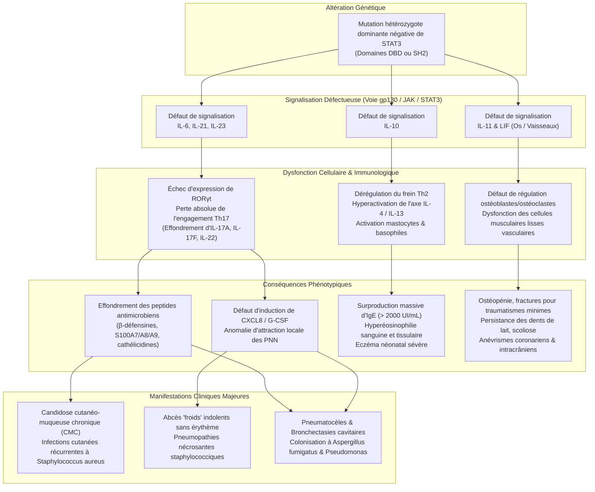
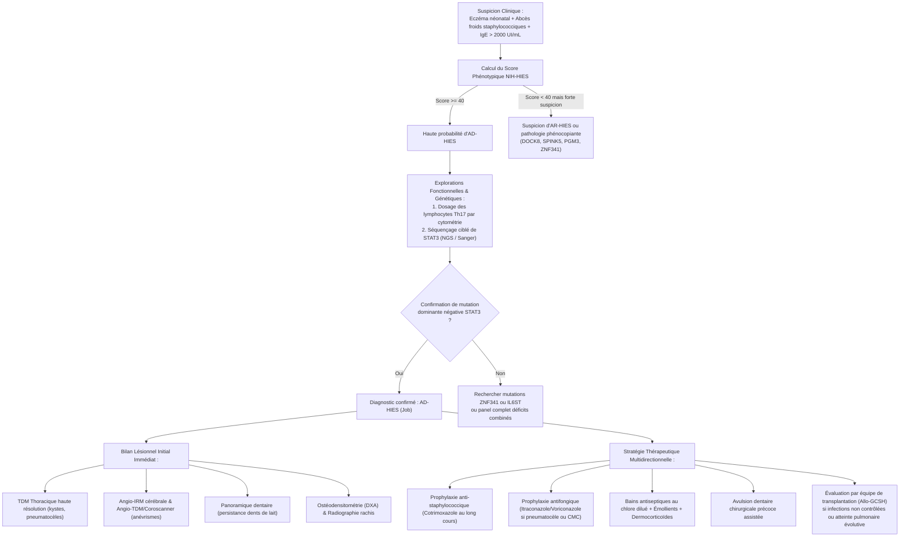

# Fiche #007 — Syndrome d'hyper-IgE autosomique dominant (AD-HIES / Job)

> [!IMPORTANT]
> **Semaine 1 : Déficits immunitaires combinés syndromiques — Jour 7**  
> Fiche de référence pour le clinicien immunologiste, l'interniste et le pédiatre. Classification selon le comité d'experts de l'IUIS (mise à jour 2024).

---

## 0. Carte d'identité IUIS 2024

| Paramètre | Définition clinique & biologique |
| :--- | :--- |
| **Nom de la pathologie** | Syndrome d'hyper-IgE autosomique dominant (AD-HIES) / Syndrome de Job-Buckley |
| **Classification IUIS 2024** | **Table II.5** — Déficits immunitaires combinés avec anomalies du développement squelettique / Hyper-IgE syndromiques |
| **Gène principal causal** | *STAT3* (*Signal Transducer and Activator of Transcription 3*) |
| **Locus chromosomique** | 17q21.2 |
| **Mode de transmission** | Autosomique dominant (formes *de novo* sporadiques : 50 à 70 %) |
| **Mécanisme mutationnel** | Mutations hétérozygotes dominantes négatives (DN), principalement dans le domaine de liaison à l'ADN (DBD) ou le domaine SH2 |
| **Code OMIM** | #147060 |
| **Code Orphanet** | ORPHA:2314 |
| **Triade princeps** | 1. Eczéma atopique réfractaire sévère néonatal / péri-orbitaire 2. Abcès cutanés dits « froids » et pneumopathies nécrosantes staphylococciques avec pneumatocèles 3. Hyper-IgE majeure (> 2 000 UI/mL, souvent > 10 000 UI/mL) et hyperéosinophilie sanguine |
| **Score diagnostique validé** | Score NIH-HIES (Grimbacher score) $\ge 40$ (très hautement prédictif) |

---

## 1. TL;DR (Synthèse exécutive)

> [!TIP]
> **Synthèse en 7 points clés :**  
> 1. **Déficit fonctionnel clé :** Altération de la signalisation dépendante de STAT3 inhibant l'engagement de la voie RORγt et la différenciation des lymphocytes **Th17** (absence d'IL-17A, IL-17F et IL-22).  
> 2. **Brèche barrière mucocutanée :** Déficit en peptides antimicrobiens (β-défensines, S100A7/A8/A9, cathélicidines) induisant une colonisation et des infections récurrentes à *Staphylococcus aureus* et *Candida albicans* (CMC).  
> 3. **Abcès « froids » :** Anaplasie de recrutement chimiotactique des polynucléaires neutrophiles (absence d'induction d'IL-8 par l'IL-17), conduisant à des abcès cutanés massifs dépourvus de chaleur ou d'érythème marqué.  
> 4. **Destruction pulmonaire précoce :** Évolution inexorable des pneumopathies nécrosantes vers des pneumatocèles et des bronchectasies, surinfectées secondairement par *Pseudomonas aeruginosa*, *Aspergillus fumigatus* et mycobactéries atypiques.  
> 5. **Anomalies syndromiques somatiques :** Faciès grossier, asymétrie crânio-faciale, rétention des dents lactéales primaires, scoliose sévère, ostéopénie fracturaire pour traumatismes minimes, et ectasies/anévrismes des artères coronaires et cérébrales.  
> 6. **Prise en charge médicale standard :** Prophylaxie antibactérienne anti-staphylococcique au long cours (TMP-SMX ou amoxicilline-acide clavulanique), prophylaxie antifongique (azoles), soins cutanés avec bains d'eau de Javel diluée, et surveillance tomodensitométrique/angio-IRM.  
> 7. **Nouvelles options :** Émergence du dupilumab (anti-IL-4Rα) pour les lésions eczématiformes réfractaires et élargissement des indications de la greffe allogénique de CSH (allo-GCSH), démontrant une guérison immunologique mais laissant subsister les risques vasculaires et squelettiques.

---

## 2. Contexte historique

- **1966 — Première description par Ralph Davis et al. :** Description de deux fillettes à peau claire, cheveux roux, souffrant d'un eczéma chronique et d'« abcès froids » cutanés récurrents, nommée « syndrome de Job » en référence au patriarche biblique couvert d'ulcères de la tête aux pieds (*Job 2:7*).
- **1972 — Rebecca Buckley et al. :** Mise en évidence chez deux patients de taux sériques extraordinairement élevés d'immunoglobulines E (IgE), associés à un eczéma sévère et à des infections récurrentes pulmonaires et articulaires, conférant à l'entité le nom de « syndrome de Buckley » ou *Hyper-IgE Syndrome* (HIES).
- **1999 — Score NIH (Grimbacher et al.) :** Formalisation du score phénotypique composite du National Institutes of Health (NIH), intégrant les stigmates immunitaires et les caractéristiques squeletto-dentaires pour guider la stratification diagnostique.
- **2007 — Identification du gène par l'équipe de Steven Holland et al. (NIH) et minegishi et al. (Japon) :** Découverte simultanée des mutations hétérozygotes à effet dominant négatif dans le gène *STAT3* chez les patients atteints de la forme classique autosomique dominante.
- **Années 2010–2020 :** Découverte des formes phénocopiantes ou satellites (déficits en *ZNF341*, *IL6ST*, *IL6R*), clarifiant le rôle de la voie de transduction IL-6/IL-23/STAT3/Th17 et positionnant les anomalies vasculaires (anévrismes coronariens/cérébraux) au premier plan de la mortalité tardive.

---

## 3. Épidémiologie & Données de registres

- **Prévalence & Incidence :**
  - Prévalence globale estimée entre **1 / 500 000 et 1 / 1 000 000** d'habitants sans prédominance de sexe ou d'ethnie.
  - Plus de 80 % des cas sporadiques sont porteurs de mutations *de novo*. Les formes familiales se transmettent sur le mode autosomique dominant avec une pénétrance variable pour les atteintes somatiques.
- **Données CEREDIH (Registre national français) :**
  - Dans la cohorte nationale coordonnée par le CEREDIH (Chandesris et al., Duréault et al.) :
    - Plus de 90 % des patients présentent un rash cutané néonatal ou un eczéma sévère dès les premières semaines de vie.
    - 75 à 80 % développent au moins une pneumopathie bactérienne avant l'âge de 5 ans.
    - La présence de pneumatocèles ou de bronchectasies est documentée chez plus de 50 % des patients à l'âge adulte, exposant à la colonisation par *Aspergillus* spp. (30 à 45 % des cas adultes) et au risque d'hémoptysie cataclysmique.
- **Données USIDNET & Registres Internationaux (IPINet, ESID, PIDTC) :**
  - **USIDNET (USA) :** Le délai diagnostique moyen historique dépassait 10 ans, le syndrome étant souvent banalisé en « atopie sévère infantile ».
  - **IPINet (Italie, Carrabba et al., 2023) :** Sur 30 patients suivis longitudinalement, l'âge médian au début des symptômes était inférieur à 12 mois (66,7 %), mais le retard diagnostique moyen s'élevait à 13,7 ans. L'institution d'une prophylaxie antimicrobienne précoce a permis de faire chuter l'incidence annuelle des pneumopathies de 76,7 % à 46,7 % et des abcès cutanés de 66,7 % à 56,7 %.

---

## 4. Physiopathologie, Génétique moléculaire & Schéma 1

### Mécanismes moléculaires & Signalisation
- **Biologie de STAT3 :** STAT3 est un facteur de transcription cytosolique ubiquitaire activé en aval de récepteurs cytokiniques utilisant la chaîne gp130 (*IL6ST*) ou d'autres chaînes accessoires : IL-6, IL-10, IL-11, IL-21, IL-22, IL-23, et le LIF (*Leukemia Inhibitory Factor*).
- **Effet dominant négatif :** STAT3 s'active par phosphorylation sur le résidu Tyr705 médiée par les tyrosines kinases JAK1/JAK2/TYK2, suivie d'une homodimérisation par interaction réciproque SH2-phosphotyrosine, transloquée dans le noyau pour se lier à des séquences GAS (*Gamma-Activated Sites*).
  - Les mutations hétérozygotes (DBD, SH2) codent une protéine mutée stable qui séquestre les monomères natifs sauvages dans des hétérodimères non fonctionnels. L'activité transcriptionnelle globale chute à moins de 25 % du niveau physiologique (effet dominant négatif).
- **Conséquences immunologiques :**
  1. **Aplasie de la lignée Th17 :** L'absence de signalisation IL-6/IL-21/IL-23 bloque l'induction de *RORC* (encodant RORγt). Les lymphocytes T CD4+ sont incapables de produire l'IL-17A, l'IL-17F et l'IL-22.
  2. **Rupture de la barrière épithéliale :** L'absence d'IL-17 et d'IL-22 au niveau des kératinocytes et de l'épithélium bronchique empêche la synthèse inductible de peptides antimicrobiens (défensines β-2/β-3, lipocaline-2, réguline, psoriasine/S100A7). Le staphylocoque et le candida peuvent ainsi adhérer et proliférer.
  3. **Absence de chimiotactisme neutrophilique (« Abcès froids ») :** L'IL-17 est le signal trophique pourvoyeur de CXCL8 (IL-8) et G-CSF par les fibroblastes et cellules stromales. L'absence de ce gradient retarde l'afflux de neutrophiles au site de l'invasion microbienne, prévenant la réaction érythémateuse/chaleur locale typique, et favorise la formation de collections purulentes massives indolentes.
  4. **Dérégulation de l'axe Th2 & Hyper-IgE :** STAT3 médie le signal inhibiteur de l'IL-10 et de l'IL-21 sur la transcription d'IL-4 et l'engagement B. Son dysfonctionnement désinhibe la différenciation Th2 (sécrétion excessive d'IL-4, IL-5, IL-13), provoquant une commutation isotypique incontrôlée vers les IgE et une hypereosinophilie tissulaire/sanguine.
- **Conséquences extra-immunitaires :**
  - **Remodelage osseux & Squelette :** Le LIF et l'IL-11 utilisent STAT3 pour stimuler l'activité ostéoblastique et réguler la résorption ostéoclastique médiée par RANKL. Le déficit en STAT3 conduit à une ostéopénie, une perte de résistance osseuse trabéculaire, des fractures pathologiques et une absence de résorption des racines dentaires primaires.
  - **Matrice vasculaire & Tissu conjonctif :** L'intégrité de la limitante élastique interne des artères musculaires et coronariennes requiert une balance TGF-β/STAT3 intacte. Sa défaillance entraîne une élastolyse, des ectasies fusiformes, des anévrismes coronaires et cérébraux, et une hyperlaxité articulaire.

### Schéma 1 : Cascade physiopathologique de l'AD-HIES

---

## 5. Présentation clinique, Pathogènes & Phénotype immunologique

### Manifestations cliniques par appareils
1. **Atteinte cutanée :**
   - Éruption néonatale précoce (dès les premières semaines de vie) : pustulose à éosinophiles, dermatite séborrhéique profuse ou eczéma rétro-auriculaire et facial sévère, suintant, lichénifié.
   - **Abcès « froids » :** Collections fluctuantes sous-cutanées, indolores ou peu douloureuses, sans rougeur ni sensation de chaleur péri-lésionnelle, évoluant sur plusieurs semaines sans fièvre marquée.
   - Candidose cutanéo-muqueuse chronique (muguet buccal récidivant, perlèche, onychomycose).
2. **Atteinte pulmonaire & Thoracique :**
   - Pneumopathies bactériennes aiguës à staphylocoque dès la petite enfance.
   - Évolution destructrice spécifique : abcédation précoce, constitution de **pneumatocèles** à parois minces et de bronchectasies kystiques irréversibles.
   - Surinfection secondaire torpide des cavités kystiques conduisant à des hémoptysies et à une insuffisance respiratoire chronique obstructive.
3. **Atteinte squelettique, crânio-faciale & Dentaire :**
   - **Faciès caractéristique :** Asymétrie faciale, front bombé, pont nasal large et arête aplatie, peau rugueuse aux pores dilatés (« peau d'orange »), prognathisme modéré apparaissant à la puberté.
   - **Anomalies dentaires :** Échec de résorption radiculaire des incisives et molaires déciduales, entraînant la rétention de la denture primaire et l'éruption en « double rangée » de la denture définitive.
   - **Fragilité osseuse :** Ostéopénie généralisée précoce ; fractures pathologiques des os longs ou des côtes secondaires à des traumatismes minimes (souvent indolores).
   - Hyperlaxité articulaire marquée, scoliose thoraco-lombaire progressive chez plus de 60 % des adolescents.
4. **Atteinte digestive :**
   - RGO sévère, troubles de la motilité œsophagienne, diverticulose colique précoce avec risque élevé de **perforation colique spontanée** ou post-diverticulaire (souvent masquée par l'absence de péritonite fébrile franche).
5. **Atteinte vasculaire :**
   - Anévrismes et tortuosités des artères cérébrales (polygone de Willis) et des coronaires.
   - Risque d'infarctus du myocarde précoce chez le jeune adulte et d'hémorragie sous-arachnoïdienne cataclysmique.

### Pathogènes préférentiels
- **Bactéries à pyogènes :** *Staphylococcus aureus* (sécréteur ou non de PVL, méti-sensible ou résistant), *Streptococcus pneumoniae*, *Haemophilus influenzae*.
- **Bactéries opportunistes :** *Pseudomonas aeruginosa* (colonisateur chronique des pneumatocèles), mycobactéries atypiques (*Mycobacterium avium-intracellulare*, *Mycobacterium abscessus*).
- **Champignons & Levures :** *Candida albicans*, *Aspergillus fumigatus* (aspergillomes intra-cavitaires), *Pneumocystis jirovecii*, mycoses endémiques (*Histoplasma capsulatum*, *Coccidioides immitis*) et émergence de mycoses cutanées invasives (*Fusarium solani*).

### Bilan immunologique biologique
- **IgE sériques :** Élévation massive constante au diagnostic, généralement supérieure à 2 000 UI/mL (parfois > 20 000 à 50 000 UI/mL).  
  *Remarque capitale :* Les taux d'IgE peuvent décroître spontanément à l'âge adulte sans amélioration phénotypique.
- **Formule sanguine :** Hyperéosinophilie sanguine modérée à sévère (> 0,5 à $5 \times 10^9/\text{L}$), souvent corrélée aux poussées d'eczéma.
- **Sous-populations lymphocytaires & Cytométrie :**
  - Numération globale des lymphocytes T, B et NK conservée.
  - **Cytométrie fonctionnelle (Stain Th17 intracellulaire) :** Effondrement quasi-total des lymphocytes Th17 (CD4+ IL-17A+ IFN-γ-) après stimulation par PMA/Ionomycine (< 0,1 % des lymphocytes T CD4+ mémoires ; référence contrôle > 1 %).
  - Phosphorylation de STAT3 (p-STAT3 Tyr705) : Évaluée par phospho-flow après stimulation à l'IL-6 ou à l'IL-21 (diminution ou profil altéré selon la mutation).
- **Sérologies & Vaccinations :** Titres d'anticorps post-vaccinaux (tétanos, diphtérie, pneumocoque) généralement satisfaisants ou modérément diminués ; déficit possible en lymphocytes B mémoires commutés (CD19+ CD27+ IgD-).

---

## 6. Complications à long terme & Défis non résolus

1. **Destruction parenchymateuse pulmonaire & Hémoptysies cataclysmiques :**
   - Formation progressive de bronchectasies sacciformes et de kystes pulmonaires colonisés par *Aspergillus fumigatus* (formations d'aspergillomes).
   - L'érosion des artères bronchiques sous-jacentes est responsable d'hémoptysies foudroyantes, représentant la **première cause de décès** chez l'adulte jeune.
2. **Complications cardiovasculaires et anévrismales non reconnues :**
   - Ectasies et faux-anévrismes coronariens asymptomatiques se manifestant d'emblée par un infarctus aigu du myocarde avec artères non athéromateuses calcifiées.
   - Anévrismes sacciformes du polygone de Willis menaçant de rupture hémorragique fatale.
3. **Complications carcinologiques & Lymphomes :**
   - Incidence accrue de lymphomes malins non hodgkiniens (lymphomes B à grandes cellules, lymphomes diffus, localisations digestives et pulmonaires) et de carcinomes épidermoïdes cutanéo-muqueux.
4. **Défis non résolus :**
   - Inefficacité relative de l'allogreffe de cellules souches hématopoïétiques sur les atteintes squelettiques, dentaires et vasculaires, qui relèvent de tissus non hématopoïétiques exprimant *STAT3* muté.
   - Prise en charge chirurgicale à très haut risque des cavités pulmonaires (difficultés techniques d'hémostase, moignons bronchiques fragiles menant à des fistules broncho-pleurales réfractaires).

---

## 7. Avenues thérapeutiques

### Mesures conservatrices & Prophylaxies standard
- **Antibiothérapie prophylactique :**
  - **Cotrimoxazole (TMP-SMX) :** $5\text{ mg/kg/j}$ de triméthoprime en 1 à 2 prises quotidiennes chez l'enfant, ou $800/160\text{ mg}$ 1 fois par jour chez l'adulte (prévention de l'infection à *S. aureus* et *P. jirovecii*).
  - Alternative anti-staphylococcique : Céphalosporine de 1ère génération (céfalexine) ou amoxicilline-clavulanate.
- **Antifongiques prophylactiques :**
  - **Itraconazole** ($5\text{ mg/kg/j}$) ou **Voriconazole** dès la mise en évidence d'anomalies pulmonaires kystiques ou de candidose cutanéo-muqueuse réfractaire, avec surveillance des taux résiduels sanguins.
- **Soins de peau intensifs :**
  - Emollients, dermocorticoïdes puissants pour les poussées aiguës.
  - **Bains d'hypochlorite de sodium dilué** (bains de Dakin ou eau de Javel à 0,005 %) 2 à 3 fois par semaine pour réduire drastiquement l'infiltrat bactérien staphylococcique cutané sans induire de résistance.

### Biothérapies & Thérapies ciblées
- **Dupilumab (anti-IL-4Rα) :**
  - Blocage de la signalisation d'IL-4 et IL-13. Plusieurs séries cliniques récentes (2022–2025) rapportent une efficacité sur la dermatite atopique sévère, une régression de l'hyperéosinophilie et une réduction des infections cutanées staphylococciques secondaires en restaurant la fonction barrière épidermique.
- **Immunoglobulines humaines polyvalentes (IgIV / IgSC) :**
  - Indiquées en cas de défaut documenté de production d'anticorps spécifiques post-vaccinaux, de pneumopathies récidivantes malgré les antibioprophylaxies, ou chez les patients ayant des complications bronchiques établies.

### Greffe Allogénique de Cellules Souches Hématopoïétiques (allo-GCSH)
- **Indications actuelles :** Historiquement controversée du fait du caractère non hématopoïétique de nombreuses manifestations, elle est désormais proposée de façon ciblée face à des infections respiratoires/cutanées bactériennes ou fongiques incontrôlables, ou en cas de malignité hématologique.
- **Bénéfices :** Correction définitive du défaut en Th17, clairance de la CMC, guérison de l'eczéma et réduction majeure des épisodes infectieux.
- **Limites majeures :** Absence d'impact sur la fragilité squelettique (persistance du risque de fractures et de scoliose) et absence de régression de la vasculopathie artérielle (coronaires/SNC), nécessitant la poursuite stricte du dépistage somatique à long terme.

---

## 8. Section pratique (Bedside, Guidelines & Schéma 2)

### Algorithme de prise en charge et de décision thérapeutique

### Diagnostic différentiel

| Entité génétique / Clinique | Gène / Transmission | Points communs avec AD-HIES | Signes différentiels distinctifs clés |
| :--- | :--- | :--- | :--- |
| **Déficit en DOCK8** (AR-HIES) | *DOCK8* Autosomique récessif | Eczéma atopique sévère, IgE élevées, infections cutanées bactériennes | **Pas d'anomalies squelettiques ni de pneumatocèles**. Infections virales cutanées sévères disséminées (HSV, VZV, Molluscum, papillomavirus HPV profus), lymphopénie T/B/NK progressive, risque extrême de microangiopathie et de cancers cutanés précoces. |
| **Déficit en ZNF341** | *ZNF341* Autosomique récessif | Phénocopie quasi parfaite de l'AD-HIES (STAT3 non transcrit) | Transmission récessive (consanguinité fréquente). Absence de mutation directe de *STAT3*. Atteinte somatique et immunologique similaire. |
| **Déficit en Phosphoglucomutase 3 (PGM3)** | *PGM3* Autosomique récessif | Érosion cutanée, atopie sévère, IgE très élevées, infections pulmonaires | Retard neurodéveloppemental sévère, déficit intellectuel, hypomyélinisation, dysmorphie osseuse spécifique et anomalies de la glycosylation. |
| **Syndrome de Netherton** | *SPINK5* Autosomique récessif | Érythrodermie néonatale, atopie majeure, IgE très élevées, surinfections staphylococciques | Ichtyose linéaire circonflexe, cheveu invaginé (*trichorrhexis invaginata* ou cheveu en bambou visible au microscope), absence d'anomalies squelettiques ou dentaires. |
| **Dermatite atopique sévère polygénique** | Polygénique multifactoriel | Eczéma sévère, IgE très augmentées, surinfections cutanées à *S. aureus* | **Absence complète de pneumatocèles**, pas d'abcès « froids », absence de dysmorphie faciale, développement dentaire et squelettique strictement normal. |

### 6 Perles cliniques indispensables

1. **L'éruption du nouveau-né n'est pas une simple dermatite séborrhéique :** Toute pustulose néonatale ou eczéma croûteux apparaissant dans les 30 premiers jours de vie, en particulier localisé au visage et au cuir chevelu, doit faire évoquer l'AD-HIES et conduire à surveiller l'éosinophilie et les IgE.
2. **« L'abcès sans flamme » :** La découverte chez un nourrisson ou un enfant d'une voussure cutanée sous-tension, indolore, sans rougeur locale et sans fièvre significative, correspond classiquement à un abcès staphylococcique « froid ». Une ponction évacuatrice avec analyse microbiologique s'impose systématiquement.
3. **Le piège de la pneumatocèle silencieuse :** Les pneumopathies nécrosantes staphylococciques de l'AD-HIES guérissent souvent de façon anormale par des cavités bulleuses à parois fines (pneumatocèles). Tout patient AD-HIES ayant présenté une pneumopathie doit avoir une TDM thoracique de contrôle à distance pour cartographier les cavités susceptibles d'abriter des aspergillomes.
4. **La règle du dentiste pédiatrique :** L'échec d'expulsion des dents de lait vers l'âge de 6–8 ans n'est pas un banal retard. Si les dents définitives commencent à percer derrière la rangée lactéale primaire, une extraction chirurgicale programmée des dents déciduales doit être organisée pour éviter une dysmorphie d'arcade complexe.
5. **Le scanner vasculaire n'attend pas la cinquantaine :** Les accidents vasculaires cérébraux hémorragiques et les infarctus surviennent chez des patients jeunes et asymptomatiques sur le plan cardiovasculaire. Un angioscanner ou une angio-IRM des troncs cérébraux et des coronaires doit être discuté dès la fin de l'adolescence.
6. **Méfiance face aux douleurs abdominales chez l'adulte AD-HIES :** En raison du déficit de signalisation de l'IL-6 et de la réponse de phase aiguë atténuée (CRP souvent basse ou faussement rassurante), une diverticulite ou une perforation colique peut n'entraîner qu'une défense minime sans franc tableau péritonéal fébrile.

---

## 9. Nouveautés & Littérature récente (2022–2026)

- **Greffe allogénique de moelle osseuse (Étude internationale collaborative 2025) :**
  - Dans la plus large cohorte mondiale rétrospective évaluant l'allo-GCSH chez 41 patients atteints d'AD-HIES (*Blood Advances*, 2025), la survie globale à 5 ans s'est élevée à 93 %. La greffe a permis une clairance des pneumopathies récidivantes et de l'eczéma chez la majorité des patients. Toutefois, l'étude souligne formellement que les atteintes extra-immunitaires persistent : 20 % des patients ont développé de nouvelles fractures osseuses post-greffe, démontrant l'indépendance de l'atteinte ostéoblastique vis-à-vis du système hématopoïétique.
- **Repositionnement ciblé des biothérapies de l'atopie (Dupilumab) :**
  - Les études publiées entre 2022 et 2024 ont confirmé que le blocage du récepteur partagé IL-4Rα par le dupilumab permet de restaurer la polarisation Th1, de normaliser l'intégrité de la barrière cutanée et de réduire drastiquement le portage staphylococcique sans aggraver le risque d'infections invasives.
- **Identification des mycoses invasives émergentes non-Aspergillus (2023) :**
  - La description de séries multicentriques (notamment françaises et nord-américaines) a mis en exergue la survenue de fusarioses cutanées primaires invasives à *Fusarium solani* chez les patients STAT3-DN, nécessitant une vigilance mycologique accrue face à toute lésion nodulaire cutanée torpide.
- **Phénotypage vasculaire longitudinal (Registres européens IPINet / CEREDIH) :**
  - Les suivis de cohortes adultes ont renforcé la nécessité d'un dépistage systématique par imagerie vasculaire en coupes (angio-IRM/coroscanner), révélant une prévalence de dilatations anévrismales coronariennes ou cérébrales supérieure à 35 % chez les patients de plus de 25 ans.

---

## 10. Références vérifiées

1. **Tsilifis C, Raedler J, Renke J, Medinger M, Laberko A, Haraldsson Á, et al.** Allogeneic hematopoietic stem cell transplantation for STAT3 hyper-IgE syndrome: a worldwide study. *Blood Adv.* 2025 Aug 26;9(16):4126-4135. [doi: 10.1182/bloodadvances.2025016158](https://doi.org/10.1182/bloodadvances.2025016158). PMID: [40540800](https://pubmed.ncbi.nlm.nih.gov/40540800/). PMCID: PMC12359223.
2. **Abbara S, Freeman AF, Cohen JF, Leclerc-Mercier S, Sanchez L, Schlatter J, et al.** Primary Invasive Cutaneous Fusariosis in Patients with STAT3 Hyper-IgE Syndrome. *J Clin Immunol.* 2023 Apr;43(3):647-652. [doi: 10.1007/s10875-022-01404-4](https://doi.org/10.1007/s10875-022-01404-4). PMID: [36504258](https://pubmed.ncbi.nlm.nih.gov/36504258/).
3. **Carrabba M, Dellepiane RM, Lorenzini T, Giacomelli M, Scomodon O, Cortesi M, et al.** Long term longitudinal follow-up of an AD-HIES cohort: the impact of early diagnosis and enrollment to IPINet centers on the natural history of Job's syndrome. *Allergy Asthma Clin Immunol.* 2023 Apr 20;19(1):32. [doi: 10.1186/s13223-023-00776-5](https://doi.org/10.1186/s13223-023-00776-5). PMID: [37081481](https://pubmed.ncbi.nlm.nih.gov/37081481/). PMCID: PMC10116827.
4. **Matucci-Cerinic C, Viglizzo G, Pastorino C, Corcione A, Prigione I, Bocca P, et al.** Remission of eczema and recovery of Th1 polarization following treatment with Dupilumab in STAT3 hyper IgE syndrome. *Pediatr Allergy Immunol.* 2022 Apr;33(4):e13770. [doi: 10.1111/pai.13770](https://doi.org/10.1111/pai.13770). PMID: [35470938](https://pubmed.ncbi.nlm.nih.gov/35470938/).
5. **Holland SM, DeLeo FR, Elloumi HZ, Hsu AP, Uzel G, Brodsky N, et al.** STAT3 mutations in the hyper-IgE syndrome. *N Engl J Med.* 2007 Oct 18;357(16):1608-1619. [doi: 10.1056/NEJMoa073687](https://doi.org/10.1056/NEJMoa073687). PMID: [17881745](https://pubmed.ncbi.nlm.nih.gov/17881745/).