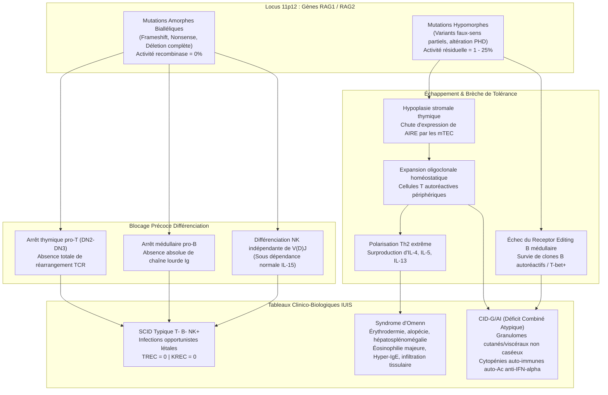
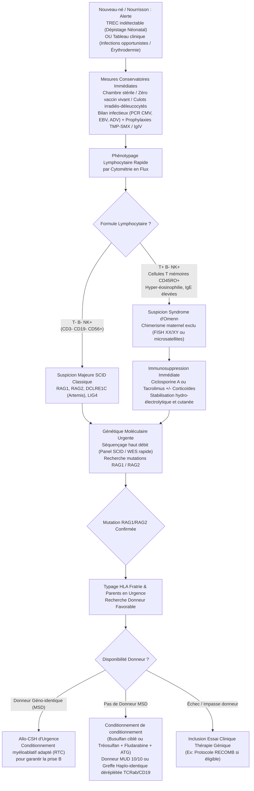

# Fiche #008 — Déficit en RAG1 / RAG2 (SCID T-B-NK+ & Syndrome d'Omenn)

> [!IMPORTANT]
> **Atlas IUIS 2024 — Fiche #008 | Semaine 2, J8**  
> *Classification :* Déficits immunitaires combinés sévères (SCID) avec absence de cellules T et B, cellules NK présentes ($T^- B^- NK^+$) et formes atypiques / dysimmunitaires apparentées (Syndrome d'Omenn, CID-G/AI).

---

## 0. Carte d'identité IUIS 2024

| Paramètre | Caractéristique |
| :--- | :--- |
| **Nom de l'entité** | Déficit en RAG1 / RAG2 (SCID $T^-B^-NK^+$, Syndrome d'Omenn, CID avec granulomes/auto-immunité) |
| **Classification IUIS 2024** | **Table I.2** (Déficits immunitaires combinés sévères : SCID $T^-B^-$) |
| **Gènes / Locus** | *RAG1* (OMIM *179615) & *RAG2* (OMIM *179616) — Locus contigu en tête-bêche sur le chromosome **11p12** |
| **Transmission** | Autosomique récessive (AR) |
| **OMIM Phénotypes** | #601457 (SCID $T^-B^-NK^+$) ; #603554 (Syndrome d'Omenn) ; #615615 (Combined Cellular and Humoral Immune Defects with Granulomas) |
| **Protéines codées** | Endonucléases V(D)J recombinases RAG1 (1040 aa) et RAG2 (527 aa) |
| **Formule immunitaire classique** | **$T^- B^- NK^+$** ($CD3^-$ effondré, $CD19^-/CD20^-$ effondré, $CD16^+CD56^+$ préservé ou élevé) |
| **Formule Omenn / Atypique** | $T^{variable}$ (cellules T autologues oligoclonales activées $CD4^+HLA\text{-}DR^+CD45RO^+$), $B^-$ ($CD19 < 1\%$), $NK^+$ |
| **Biomarqueurs cardinaux** | TREC indétectables ($< 10$ copies/$\mu$L), KREC indétectables, IgE massivement élevées (Omenn), éosinophilie majeure (Omenn) |

---

## 1. TL;DR (Synthèse exécutive)

> [!TIP]
> Le déficit complet en RAG1 ou RAG2 abolit l'initiation de la recombinaison V(D)J, provoquant un SCID précoce $T^-B^-NK^+$ létal sans traitement rapide, détectable au dépistage néonatal par l'absence absolue de TREC et de KREC. À l'inverse, des mutations hypomorphes maintenant une activité résiduelle d'échappement catalytique (1 à 30 %) sous-tendent un continuum pathologique spectaculaire dominé par le syndrome d'Omenn (érythrodermie exfoliative, alopécie, hépato-splénomégalie, hyper-IgE, éosinophilie et expansion de clones T autoréactifs infiltrants) ou des déficits combinés atypiques (CID-G/AI) révélés plus tardivement par des cytopénies auto-immunes réfractaires et des granulomes cutanéo-viscéraux. L'urgence thérapeutique repose sur l'isolement protecteur strict, l'interdiction absolue des vaccins vivants, l'immunosuppression ciblée de l'hyperinflammation (ciclosporine, anti-JAK) et la greffe allogénique de cellules souches hématopoïétiques (allo-CSH) avec conditionnement myéloablatif ou à toxicité réduite (RTC), condition *sine qua non* pour éradiquer les cellules souches hôtes non fonctionnelles et autoréactives et permettre un engraftment B durable.

---

## 2. Contexte historique

- **1965** : Le Dr Gilbert S. Omenn décrit une affection familiale létale du nourrisson caractérisée par une érythrodermie exfoliative, une hépatosplénomégalie, une lymphadénopathie généralisée, une éosinophilie majeure et une susceptibilité extrême aux infections (« réticuloendothéliose familiale avec éosinophilie »).
- **1989–1990** : Les équipes de David Baltimore et David Schatz isolent et caractérisent les gènes activateurs de la recombinaison *RAG1* et *RAG2*, identifiant la machinerie enzymatique indispensable au réarrangement des segments géniques des récepteurs antigéniques (TCR et BCR).
- **1996** : Schwarz, Villa, Notarangelo et Fischer identifient les premières mutations homozygotes et hétérozygotes composites nulles de *RAG1* et *RAG2* chez des nourrissons atteints de SCID $T^-B^-$.
- **1998** : L'équipe de Luigi Notarangelo et Anna Villa résout l'énigme du syndrome d'Omenn en démontrant qu'il est secondaire à des variants hypomorphes (missenses partiels) de *RAG1* ou *RAG2*, autorisant une production lymphocytaire oligoclonale résiduelle auto-agressive.
- **2008–2015** : Mise en évidence du spectre étendu des déficits hypomorphes en RAG chez l'enfant plus grand et l'adulte jeune, révélés par des granulomes épithélioïdes non caséeux stériles, des cytopénies auto-immunes multi-lignées et des vascularites nécrosantes (CID-G/AI).

---

## 3. Épidémiologie & Données de registres

- **Incidence globale :** Le SCID classique survient chez 1:50 000 à 1:65 000 naissances vivantes. Les mutations bialléliques de *RAG1* ou *RAG2* représentent environ **15 à 22 % de l'ensemble des cas de SCID** dans les pays occidentaux, constituant la **première cause génétique de SCID autosomique récessif** et la cause prédominante du groupe immunophénotypique $T^-B^-NK^+$.
- **Dépistage néonatal (NBS / TREC) :** Le dépistage systématique par qPCR TREC sur buvard de Guthrie identifie les SCID typiques à RAG1/2 avec une sensibilité proche de 100 % (TREC nuls ou $< 10$ copies/$\mu$L). Fait crucial, les formes d'Omenn présentent également des TREC quasi-effondrés en dépit d'une lymphocytose périphérique parfois normale ou élevée, car ces lymphocytes périphériques résultent d'une expansion clonale homéostatique post-thymique sans néo-génération thymique efficace.
- **Données PIDTC, EBMT et CEREDIH :**
  - Dans les registres nord-américains (PIDTC) et français (CEREDIH), *RAG1* est environ 3 à 4 fois plus fréquemment muté que *RAG2* en population générale hétérogène.
  - Dans les populations à fort taux de consanguinité (Afrique du Nord, Moyen-Orient, certaines communautés balkaniques ou slaves), une inversion peut être observée avec prédominance de variants fondateurs sur *RAG2* (ex. variant fondateur algérien *RAG2* c.104G>T ou variante slave *RAG1* c.256_257delAA).
  - La survie globale après allogreffe de moelle osseuse dépasse 85–90 % lorsque le diagnostic est posé en période néonatale avant toute infection invasive, mais chute à $< 65\text{--}70 \%$ en cas d'infection pulmonaire/virale pré-greffe non contrôlée ou de retard diagnostique sur forme atypique.

---

## 4. Physiopathologie, Génétique moléculaire & Schéma 1

### 4.1 Mécanismes moléculaires et enzymologie
1. **Complexe de clivage RAG1/RAG2 :** RAG1 (contenant le domaine catalytique DDE, les doigts de zinc et le domaine d'interaction avec le DNA) forme un hétérotétramère ($RAG1_2\text{-}RAG2_2$) avec RAG2 (qui possède un domaine *Kelch* régulateur et un domaine « plant homeodomain » PHD finger reconnaissant la marque épigénétique activatrice H3K4me3).
2. **Recombinaison somatique V(D)J :** Le complexe s'associe spécifiquement aux signaux de recombinaison (RSS, *Recombination Signal Sequences* constituées d'un heptamère, d'un spacer de 12 ou 23 pb et d'un nonamère). RAG1 introduit une coupure simple brin entre le RSS et le segment codant, libérant un hydroxyle 3'-OH libre qui attaque le brin opposé par transestérification, générant :
   - Une extrémité codante en épingle à cheveux fermée (*DNA hairpin*).
   - Une extrémité signal tronquée franche phosphorylée en 5'.
3. **Résolution par la voie NHEJ :** Le complexe Ku70/Ku80 recrute DNA-PKcs et ARTEMIS (DCLRE1C, endonucléase activée pour l'ouverture des hairpins), puis la ligase IV (LIG4/XRCC4/Cernunnos) suture les brins. En cas de mutation nulle de *RAG1* ou *RAG2*, la coupure initiale est impossible : blocage complet au stade pro-B (stade $CD19^+CD10^+c\mu^-$) et pro-T (double négatif DN2-DN3), conduisant à l'apoptose des précurseurs immatures.

### 4.2 Le paradoxe de l'hypomorphisme : d'Omenn à la dysimmunité
- **Activité résiduelle :** Des variants faux-sens affectant des résidus non strictement catalytiques maintiennent une activité résiduelle (1 à 25 %).
- **Effondrement de la sélection négative thymique :** Le blocage partiel empêche la colonisation cortico-médullaire thymique normale. Le défaut de rétro-inhibition induit une hypoplasie stromale, un effondrement des cellules épithéliales médullaires thymiques matures ($mTEC^{high}$) et une perte d'expression du facteur de transcription **AIRE**, abolissant la présentation des antigènes tissus-spécifiques et la délétion clonale centrale.
- **Échappement oligoclonal et switch Th2 :** Les rares clones T générés sortent dans un environnement intensément lymphopénique riche en IL-7 ; ils prolifèrent massivement de façon oligoclonale (répertoire TCR $\beta$ et $\alpha$ oligoclonal très restreint). Ces clones T matures autoréactifs expriment un profil d'activation Th2 pathologique sécrétant de grandes quantités d'**IL-4, IL-5 et IL-13**, expliquant l'éosinophilie tissulaire et le switch isotypique vers l'hyper-IgE.
- **Défaut de tolérance centrale et périphérique B (CID-G/AI) :** Le défaut d'édition des récepteurs (*receptor editing*) dans la moelle osseuse autorise l'émergence de lymphocytes B autoréactifs (souvent caractérisés par un phénotype $CD21^{low}CD11c^+T\text{-}bet^+$), induisant la synthèse d'auto-anticorps multi-organes et d'anticorps neutralisants dirigés contre l'interféron-alpha (anti-IFN-$\alpha$), favorisant des infections virales dévastatrices et des réactions granulomateuses.



---

## 5. Présentation clinique, Pathogènes & Phénotype immunologique

### 5.1 Phénotype SCID Typique ($T^-B^-NK^+$)
- **Début :** Dans les premiers mois de vie ($< 3\text{--}6$ mois) après épuisement des IgG maternelles transplacentaires.
- **Tableau clinique :** Retard de croissance staturo-pondérale statique sévère (*failure to thrive*), diarrhée chronique rebelle, muguet buccal invasif et récidivant résistant aux azolés, absence clinique de tissu lymphoïde (amygdales invisibles, aires ganglionnaires vides).
- **Spectre infectieux :**
  - *Champignons / Parasites :* Pneumopathie hypoxémiante à *Pneumocystis jirovecii*, candidose cutanéo-muqueuse extensive, cryptosporidiose hépatobiliaire.
  - *Virus :* Pneumopathie et hépatite à CMV, infections disséminées à ADV (Adénovirus), VRS, Parainfluenza 3, Entérovirus, EBV.
  - *Bactéries / Iatrogénie :* BCGite disséminée gravissime après vaccination néonatale par le BCG (rougeur indurée, adénite suppurée, lésions ostéoarticulaires et viscérales hématogènes).

### 5.2 Phénotype Syndrome d'Omenn
- **Tétrade clinique classique :**
  1. **Érythrodermie exfoliative généralisée** suintante avec pachydermie, lichénification, perte des sourcils et alopécie universelle précoce.
  2. **Polyadénopathies superficielles diffuses** et **hépatosplénomégalie** massive dues à l'infiltration histiocytaire et lymphocytaire Th2.
  3. **Diarrhée profuse par entéropathie exsudative** (perte protéique digestive sévère, hypoalbuminémie majeure, anasarque).
  4. **Retard de croissance staturo-pondérale gravissime** et vulnérabilité métabolique extrême (troubles thermorégulateurs cutanés).
- **Laboratoire cardinal :** Hyper-éosinophilie majeure ($> 1500\text{--}20 000/\mu\text{L}$), taux sériques d'**IgE monstrueusement élevés** ($> 1000\text{--}10 000\text{ UI/mL}$), absence quasi-totale de lymphocytes B circulants ($CD19 < 1\%$), lymphocytes T autologues activés ($CD3^+HLA\text{-}DR^+CD45RO^+$).

### 5.3 Phénotype Hypomorphe Atypique (CID-G/AI / Présentation Tardive)
- Révélation durant la petite enfance ou l'âge adulte (2 à 30 ans).
- **Auto-immunité multi-systémique réfractaire :** Cytopénies auto-immunes sévères (anémie hémolytique auto-immune de type Evans, purpura thrombopénique immunitaire, neutropénie auto-immune).
- **Maladie granulomateuse :** Granulomes épithélioïdes et gigantocellulaires stériles sans nécrose caséeuse, mimant une sarcoïdose précoce, touchant la peau, le foie, la rate, les poumons et les muqueuses ORL (lésions destructrices médiotransversales de la cloison nasale).
- **Complications virales sévères :** Susceptibilité spécifique aux herpèsvirus (varicelle disséminée nécrosante, encéphalite à CMV) et présence d'anticorps neutralisants de haute affinité anti-IFN-$\alpha$.

---

## 6. Complications à long terme & Défis non résolus

1. **Rejet de greffe et barrière allo-immune NK :** Dans le SCID $T^-B^-NK^+$, la persistance de cellules NK du receveur fonctionnelles et activées (*host NK cells*) constitue un obstacle immunologique majeur s'opposant à la prise de greffe (*engraftment*) des cellules souches allogéniques, imposant l'adjonction systématique d'agents sérothérapiques (sérum antilymphocytaire/ATG) ou d'un conditionnement myéloablatif adapté.
2. **Échec de la reconstitution humorale à long terme :** En l'absence de conditionnement myéloablatif libérant la niche souche médullaire, la prise de greffe myéloïde et lymphoïde B reste médiocre ; jusqu'à 30–50 % des patients greffés sans conditionnement alkylant demeurent dépendants à vie d'un traitement substitutif par immunoglobulines (IgIV/IgSC) faute de reconstitution B autologue fonctionnelle.
3. **Mortalité pré-greffe liée aux infections masquées et organomégalie (Omenn) :** Le syndrome d'Omenn expose à un risque critique de défaillance multi-viscérale au conditionnement si l'érythrodermie et l'inflammation Th2 ne sont pas préalablement éteintes par des agents immunosuppresseurs ciblés.
4. **Persistance de l'auto-immunité et de la dysrégulation thymique post-HSCT :** Dans les formes hypomorphes, l'architecture thymique préalablement altérée peut limiter la néo-génération d'un répertoire T naïf diversifié et de cellules Treg fonctionnelles à long terme, prédisposant à des maladies auto-immunes secondaires chroniques ou à la maladie du greffon contre l'hôte (GvHD).

---

## 7. Avenues thérapeutiques

```
      Urgence Médicale
Diagnostic de SCID / Omenn
            │
            ├────────────────────────────────────────┐
            ▼                                        ▼
   Mesures Immédiates                    Contrôle de l'Hyperinflammation
   - Isolement Protecteur                (Syndrome d'Omenn / CID-G/AI)
   - Arrêt vaccins vivants               - Ciclosporine A / Tacrolimus
   - Cotrimoxazole + Fluconazole         - Corticothérapie prudente
   - Remplacement IgIV                   - +/- Anti-JAK (Ruxolitinib)
   - Produits sanguins déleucocytés/     - Anti-IL-4R (Dupilumab)
     irradiés/CMV-négatifs                           │
            │                                        │
            └───────────────────┬────────────────────┘
                                │
                                ▼
                   Traitement Curatif Définitif
                                │
            ┌───────────────────┴───────────────────┐
            ▼                                       ▼
  Allo-CSH (Standard de Soins)          Thérapie Génique (Essais Cliniques)
  - Donneur géno-identique (MSD)        - Vecteurs lentiviraux régulés
    sans conditionnement lourd            (Essai européen RECOMB NCT04797260)
  - Donneur alternatif (MUD / Haplo) :  - Gene editing (CRISPR-Cas9 / ABE)
    Conditionnement RTC/MAC               en ciblage de locus endogène
    (Busulfan/Tréosulfan + Fludarabine)
```

- **Mise en condition et prophylaxies d'urgence :**
  - Isolement sous flux laminaire ou chambre à pression positive, filtration HEPA.
  - Interdiction absolue et formelle de vaccins à virus/bactéries vivants atténués (BCG, Rotavirus, ROR, VZV, Polio oral).
  - Sang et plaquettes impérativement **déleucocytés, irradiés ($25\text{ Gy}$) et séronégatifs pour le CMV** (pour prévenir la virose à CMV transfusionnelle et la GVHD post-transfusionnelle foudroyante).
  - Prophylaxie anti-*Pneumocystis* par triméthoprime-sulfaméthoxazole (TMP-SMX : $5\text{ mg/kg/j}$ de triméthoprime 3 jours par semaine) ou pentamidine aérosolisée/IV si intolérance.
  - Prophylaxie antifongique (fluconazole) et antibactérienne ; substitution intraveineuse par immunoglobulines polyvalentes ($0,4\text{ à }0,5\text{ g/kg}$ toutes les 3–4 semaines) pour maintenir un taux résiduel $> 8\text{ g/L}$.
- **Contrôle immunosuppresseur du syndrome d'Omenn :**
  - L'hyperprolifération T oligoclonale doit impérativement être jugulée avant l'induction de greffe : corticothérapie systémique ($1\text{--}2\text{ mg/kg/j}$) associée aux inhibiteurs de calcineurine (Ciclosporine A à dose cible résiduelle 150–250 ng/mL ou Tacrolimus).
  - L'utilisation ciblée d'inhibiteurs de JAK (ex. Ruxolitinib) ou d'agents ciblant l'axe IL-4/IL-13 (Dupilumab) représente une approche d'épargne efficace en cas d'érythrodermie et de tempête cytokinique réfractaires.
- **Allogreffe de cellules souches hématopoïétiques (Allo-CSH) :**
  - **Donneur familial HLA-identique (MSD) :** Si disponible, greffe sans conditionnement lourd ou avec conditionnement myéloablatif à toxicité réduite (RTC). Cependant, chez les patients SCID $B^-$, l'omission totale de conditionnement myéloïde conduit presque invariablement au non-engraftment des cellules B et à une dépendance à vie aux IgIV.
  - **Donneur non apparenté compatible (MUD) ou haplo-identique :** Nécessite obligatoirement un conditionnement alkylant (Tréosulfan-Fludarabine ou Busulfan à pharmacocinétique contrôlée ciblée sur l'AUC + Fludarabine $\pm$ sérothérapie ATG) afin de vider les niches médullaires et d'éliminer les cellules NK radiorésistantes de l'hôte.
- **Thérapies géniques et thérapies innovantes :**
  - *Thérapie génique d'addition par vecteur lentiviral autologue :* Plusieurs essais cliniques de phase I/II multicentriques internationaux (notamment le consortium européen RECOMB, clinicaltrials.gov NCT04797260) évaluent la transduction de progéniteurs $CD34^+$ par des vecteurs lentiviraux SIN codant pour *RAG1* sous promoteur spécifique pour éviter l'expression ectopique cytotoxique.
  - *Édition génomique ciblée (Gene Editing) :* L'insertion précise d'un cDNA codant complet dans l'exon 2 de *RAG2* par CRISPR-Cas9 et AAV6 préserve la régulation transcriptionnelle endogène et restaure le développement T et B dans des modèles précliniques humains.

---

## 8. Section pratique (Bedside, Guidelines & Schéma 2)



### Diagnostic différentiel des déficits en RAG1/RAG2

| Pathologie | Gène / Mécanisme | Phénotype immunitaire | Différenciation clinique et biologique |
| :--- | :--- | :--- | :--- |
| **Déficit en ARTEMIS (DCLRE1C)** | *DCLRE1C* (10p13) — Voie NHEJ | $T^- B^- NK^+$ | **Radiosensibilité cellulaire majeure** ; toxicité alkylante accrue ; absence fréquente de tissu gingivo-dentaire. |
| **SCID lié à l'X (X-SCID)** | *IL2RG* (Xq13.1) — Chaîne $\gamma_c$ | $T^- B^+ NK^-$ | Lymphocytes B présents en quantité normale ou augmentée ; garçons uniquement ; cellules NK effondrées. |
| **Déficit en ADA** | *ADA* (20q13.12) — Métabolique | $T^- B^- NK^-$ | Chute globale des 3 lignées (NK absentes) ; toxicité osseuse radiologique (dysplasie métaphysaire chondro-osseuse). |
| **Syndrome d'Omenn non-RAG** | *DCLRE1C, IL7RA, RMRP, CHD7* | Variable selon gène | Mutations dans d'autres gènes du TCR ou NHEJ ; rechercher une chondrodysplasie métaphysaire (*RMRP*) ou un CHARGE (*CHD7*). |
| **GvHD maternelle transplacentaire** | Engraftment de lymphocytes T maternels | $T^+ B^- NK^+$ | Les lymphocytes T circulants sont entièrement d'origine maternelle (détectables par chimérisme XX chez le garçon ou microsatellites STR). |
| **Syndrome d'hyper-IgE (Job)** | *STAT3* (dominant-négatif) | T, B et NK normaux | Pas de lymphopénie sévère ; faciès caractéristique, pneumatocèles, éruptions eczématiformes non érythrodermiques, fractures osseuses. |

### 6 Perles Cliniques & Pièges Bedside
1. **Le leurre de la lymphocytose dans le syndrome d'Omenn :** Un nourrisson érythrodermique peut présenter une numération lymphocytaire normale ou faussement rassurante ($3000\text{ à }8000/\mu\text{L}$) ; il s'agit d'une prolifération oligoclonale de lymphocytes T anormaux autoréactifs. Le test TREC sur Guthrie ou sang total est **effondré/nul**, rétablissant le diagnostic de SCID.
2. **Le piège du chimérisme materno-fœtal :** Avant de poser le diagnostic d'Omenn face à des lymphocytes T circulants, il est impératif d'éliminer une greffe spontanée de lymphocytes T maternels transplacentaires (pseudo-GvHD materno-fœtale) par analyse du chimérisme T (caryotype/FISH interphasique XX chez un garçon ou typage par microsatellites ADN STR).
3. **Conditionnement obligatoire pour le compartiment B :** Ne jamais tenter une greffe allogénique sans conditionnement de déplétion de la niche médullaire chez un SCID $RAG^{-/-}$, sous peine de créer une chimère purement T avec agammaglobulinémie résiduelle définitive nécessitant des perfusions d'immunoglobulines à vie.
4. **La menace mortelle des transfusions familiales de sang frais non irradié :** Une transfusion non irradiée issue de la famille pour corriger une anémie entraîne une GVHD post-transfusionnelle foudroyante et universellement mortelle par rejet de l'hôte par les lymphocytes du donneur. Tout produit sanguin doit être **irradié ($25\text{ Gy}$) et déleucocyté**.
5. **Le spectre CID-G/AI chez le grand enfant :** Toute sarcoïdose précoce atypique, toute granulomatose cutanée extensive ou tout syndrome d'Evans récidivant de l'enfant doit faire rechercher des mutations hypomorphes de *RAG1/RAG2*, même en présence de sous-populations lymphocytaires quantitatives subnormales.
6. **Toxicité des vaccins vivants :** La vaccination par le BCG chez un nouveau-né SCID $RAG1/2$ est une catastrophe iatrogène déclenchant une mycobactériose disséminée (BCGite systémique) grevant la survie post-greffe ; elle impose une quadrithérapie antimycobactérienne prolongée avant toute greffe.

---

## 9. Nouveautés & Littérature récente (2022–2026)

- **Cartographie multiomique de la dysrégulation immunitaire RAG (Bosticardo et al., *Science Immunology*, 2025) :** L'analyse en cellule unique (CITE-seq et multiomique) de larges cohortes de patients porteurs de variants de *RAG1* et *RAG2* a révélé que si l'érythrodermie d'Omenn est régie par une signature transcriptionnelle purement Th2/inflammatoire, les formes hypomorphes moins sévères sont paradoxalement caractérisées par un profil Th1 hyperinflammatoire tissulaire avec élévation d'interféron-gamma et génération d'un spectre étendu d'auto-anticorps ciblant spécifiquement les interférons de type I.
- **Impact du fardeau morbide et de l'atteinte d'organe sur la survie post-HSCT (Schuetz et al., *Blood*, 2023) :** Une vaste étude internationale multicentrique évaluant 60 patients porteurs de mutations hypomorphes de *RAG1/RAG2* a démontré que la présence d'infections actives ou de lésions d'organes au moment de l'allo-CSH diminue drastiquement la survie globale à 4 ans ($67,5\%$) comparativement aux patients diagnostiqués précocement par le dépistage néonatal ou enquête familiale ($> 85\%$), militant fermement pour une greffe ultra-précoce dès la détection biologique de la maladie.
- **Accumulation des lymphocytes B régulateurs atypiques T-bet+ (Csomos et al., *Nature Immunology*, 2022) :** La caractérisation des anomalies de tolérance périphérique induites par le déficit partiel en RAG chez l'Homme a mis en évidence un défaut majeur de l'édition du récepteur B (receptor editing) et une accumulation anormale de lymphocytes B autoréactifs $CD21^{low}CD11c^+T\text{-}bet^+$, directement corrélés à l'apparition des cytopénies auto-immunes et des vascularites systémiques.
- **Thérapie génique par correction ciblée du locus *RAG2* (Pavel-Dinu et al., *Blood Advances*, 2024) :** Première démonstration de la correction sans vecteur viral intégratif par l'approche CRISPR/Cas9 et AAV6 des cellules souches hématopoïétiques $CD34^+$ de patients SCID-RAG2, permettant une restauration physiologique complète de la recombinase V(D)J dans les organoïdes thymiques artificiels sans surexpression ectopique.
- **Validation préclinique et clinique des vecteurs lentiviraux régulés pour RAG1 (Meng et al., *Blood Advances*, 2025 & Gilioli et al., 2024) :** Preuve d'efficacité de la reconstitution lymphoïde T dans les organoïdes thymiques artificiels (ATO) dérivés de cellules de patients RAG1-SCID transduites avec le vecteur lentiviral optimisé du protocole clinique européen RECOMB (NCT04797260), démontrant une différenciation thymique polyclonale robuste.

---

## 10. Références vérifiées

1. **Bosticardo M, Dobbs K, Delmonte OM, Martins AJ, Pala F, Kawai T, et al.** Multiomics dissection of human RAG deficiency reveals distinctive patterns of immune dysregulation but a common inflammatory signature. *Science Immunology*. 2025 Jan 10;10(103):eadq1697. [PMID: 39792639](https://pubmed.ncbi.nlm.nih.gov/39792639) | [PMCID: PMC12087669](https://www.ncbi.nlm.nih.gov/pmc/articles/PMC12087669).
2. **Schuetz C, Gerke J, Ege M, Walter J, Kusters M, Worth A, et al.** Hypomorphic RAG deficiency: impact of disease burden on survival and thymic recovery argues for early diagnosis and HSCT. *Blood*. 2023 Feb 16;141(7):713-724. [PMID: 36279417](https://pubmed.ncbi.nlm.nih.gov/36279417) | [PMCID: PMC10082356](https://www.ncbi.nlm.nih.gov/pmc/articles/PMC10082356).
3. **Pavel-Dinu M, Gardner CL, Nakauchi Y, Kawai T, Delmonte OM, Palterer B, et al.** Genetically corrected RAG2-SCID human hematopoietic stem cells restore V(D)J-recombinase and rescue lymphoid deficiency. *Blood Advances*. 2024 Apr 9;8(7):1820-1833. [PMID: 38241684](https://pubmed.ncbi.nlm.nih.gov/38241684) | [PMCID: PMC11006817](https://www.ncbi.nlm.nih.gov/pmc/articles/PMC11006817).
4. **Csomos K, Ujhazi B, Blazso P, Romero-Carvajal A, Perez E, Krivan G, et al.** Partial RAG deficiency in humans induces dysregulated peripheral lymphocyte development and humoral tolerance defect with accumulation of T-bet+ B cells. *Nature Immunology*. 2022 Aug;23(8):1256-1272. [PMID: 35902638](https://pubmed.ncbi.nlm.nih.gov/35902638).
5. **Gilioli G, Lankester AC, de Kivit S, Staal FJT, Ott de Bruin LM.** Gene therapy strategies for RAG1 deficiency: Challenges and breakthroughs. *Immunology Letters*. 2024 Dec;270:106931. [PMID: 39303994](https://pubmed.ncbi.nlm.nih.gov/39303994).
6. **Meng X, Melsen JE, van der Holst R, de Mooij B, Vloemans S, van Eggermond M, et al.** RAG1 lentiviral gene therapy restores T-cell development of RAG1-SCID patient cells in artificial thymic organoids. *Blood Advances*. 2025 Nov 25;9(22):5920-5934. [PMID: 41289158](https://pubmed.ncbi.nlm.nih.gov/41289158).