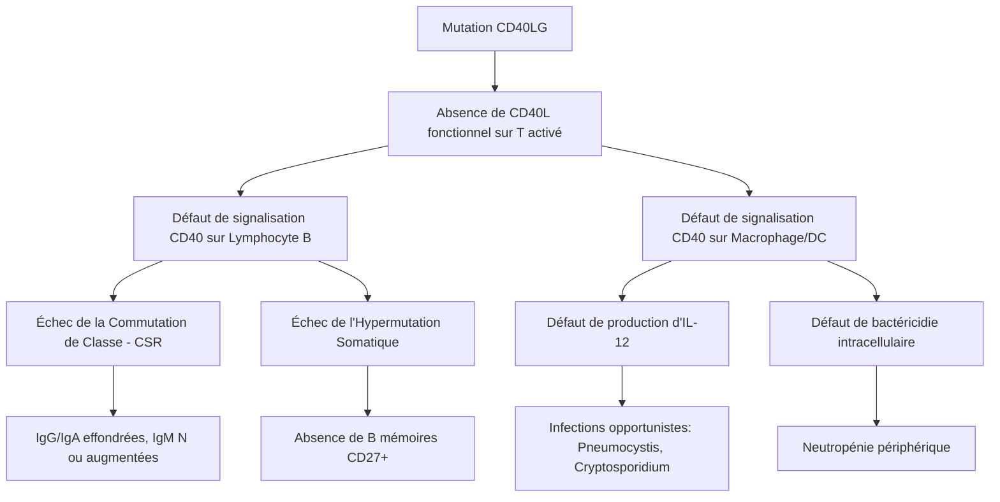
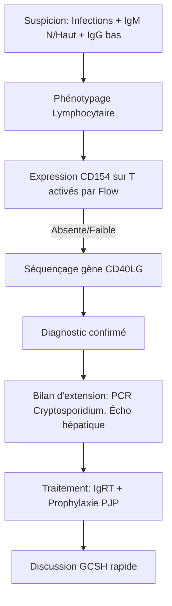

# Fiche #009 — Syndrome d'hyper-IgM lié à l'X (Déficit en CD40L)

> [!IMPORTANT]
> **Atlas IUIS 2024** — Semaine 2, J9.
> Expert : Immunologiste Clinicien.
> Thématique : Déficits Immunitaires Combinés (CID) avec caractéristiques associées.

## 0. Carte d'identité IUIS 2024

| Paramètre | Description |
| :--- | :--- |
| **Nom officiel** | Déficit en CD40 Ligand (X-linked Hyper-IgM Syndrome - HIGM1) |
| **Gène impliqué** | *CD40LG* (Xq26.3) |
| **Table IUIS 2024** | **I.3** (Déficits immunitaires combinés avec caractéristiques associées) |
| **Mode de transmission** | Récessif lié à l'X |
| **Phénotype cellulaire** | Cellules T présentes, défaut de commutation de classe (CSR) et d'interaction T-B/T-Macrophage |
| **Code Orphanet** | ORPHA:438 |

## 1. TL;DR (Synthèse exécutive)

> [!TIP]
> Le syndrome d'hyper-IgM lié à l'X (HIGM1) est un déficit immunitaire combiné (CID) sévère dû à des mutations du gène *CD40LG*. Il se caractérise par un défaut de commutation de classe des immunoglobulines (IgG/IgA basses, IgM normales ou élevées) et une altération majeure de l'immunité cellulaire. Les patients présentent précocement des infections bactériennes sino-pulmonaires, mais surtout des infections opportunistes pathognomoniques (*Pneumocystis jirovecii*, *Cryptosporidium parvum*). La neutropénie est fréquente. Le pronostic est grevé par la cholangite sclérosante et les tumeurs neuroendocrines digestives. Le traitement curatif de référence reste la greffe de cellules souches hématopoïétiques (GCSH), idéalement avant l'apparition de lésions hépatiques.

## 2. Contexte historique

Le syndrome a été décrit cliniquement dans les années 1960, mais c'est en **1993** que plusieurs groupes (dont ceux de Korthäuer et Allen) ont identifié des mutations dans le gène codant pour le ligand du CD40 (CD154) sur le chromosome X. Cette découverte a révolutionné la compréhension de la coopération T-B et du rôle central de l'axe CD40-CD40L non seulement dans la production d'anticorps, mais aussi dans l'activation des macrophages et des cellules dendritiques.

## 3. Épidémiologie & Données de registres

*   **Prévalence :** Estimée à environ 1:1 000 000 de naissances vivantes.
*   **Registres :**
    *   **CEREDIH (France) :** Représente environ 5 % des déficits immunitaires combinés. Une cohorte historique française a souligné la précocité du diagnostic (médiane < 1 an).
    *   **USIDNET (USA) :** Confirme que l'hyper-IgM n'est présente que dans environ 50 % des cas au diagnostic ; le terme "Hyper-IgM" est donc parfois trompeur.
    *   **ESID (Europe) :** Les données montrent une survie à long terme significativement améliorée par la GCSH précoce (avant 10 ans).
    *   **PIDTC (Amérique du Nord) :** Met en avant l'impact délétère des infections à *Cryptosporidium* sur la survie post-greffe.

## 4. Physiopathologie, Génétique moléculaire & Schéma 1

Le gène *CD40LG* code pour la protéine CD154, exprimée à la surface des lymphocytes T CD4+ activés.

*   **Défaut de Commutation de Classe (CSR) :** Sans interaction CD40L-CD40, les lymphocytes B ne peuvent pas passer de la production d'IgM à celle d'IgG, IgA ou IgE.
*   **Défaut de Centre Germinatif :** Absence de formation de centres germinatifs fonctionnels, entraînant un déficit en lymphocytes B mémoires (CD27+).
*   **Défaut d'immunité cellulaire :** L'interaction CD40L-CD40 est cruciale pour que le lymphocyte T active les macrophages (élimination des pathogènes intracellulaires) et les cellules dendritiques (licensing pour l'amorçage des T CD8+).

## 5. Présentation clinique, Pathogènes & Phénotype immunologique

### Clinique
*   **Infections respiratoires :** Pneumonies à répétition, sinusites (bactéries encapsulées).
*   **Infections opportunistes :** Pneumonie à *Pneumocystis jirovecii* (PJP) souvent révélatrice dans la première année de vie.
*   **Atteinte digestive :** Diarrhées chroniques et **cholangite sclérosante** liées à *Cryptosporidium parvum*.
*   **Hématologie :** Neutropénie chronique ou cyclique (souvent sévère).

### Phénotype biologique
*   **IgG, IgA, IgE :** Très bas ou indétectables.
*   **IgM :** Élevées (> 2 g/L) dans 50-60 % des cas, normales pour le reste.
*   **Lymphocytes :** Numération T, B et NK normale.
*   **B mémoires :** Effondrement des CD19+CD27+ (B mémoires commutés et non-commutés).
*   **Test de fonction :** Absence d'expression du CD154 (CD40L) sur les lymphocytes T CD4+ après activation *in vitro* (PMA/Ionomycine).

## 6. Complications à long terme & Défis non résolus

1.  **Cholangite Sclérosante Primitive (CSP) :** Complication majeure liée au Cryptosporidium, évoluant vers la cirrhose et le cholangiocarcinome.
2.  **Néoplasies :** Risque accru de lymphomes et surtout de **tumeurs neuroendocrines** (notamment du tractus digestif et du pancréas).
3.  **Encéphalite :** Rare, mais possible (Lichen myxoedémateux ou infections virales chroniques).
4.  **Défis :** La prise en charge du *Cryptosporidium* reste complexe (le nitazoxanide est souvent inefficace sans restauration immunitaire).

## 7. Avenues thérapeutiques

*   **Substitution en Immunoglobulines (IgRT) :** IV ou SC, à vie.
*   **Prophylaxie :** Triméthoprime/Sulfaméthoxazole (Bactrim) systématique pour la PJP.
*   **Mesures d'hygiène :** Éviction stricte de l'eau du robinet non bouillie/filtrée (risque *Cryptosporidium*).
*   **G-CSF :** En cas de neutropénie symptomatique.
*   **Greffe de Moelle (GCSH) :** Seul traitement curatif. Les résultats sont excellents si réalisée tôt (survie > 85-90 %).
*   **Thérapie Génique / Édition du génome :** Utilisation de CRISPR/Cas9 pour corriger le gène *CD40LG* in situ (essais en cours, car la surexpression constitutive de CD40L est lymphomigène).

## 8. Section pratique (Bedside, Guidelines & Schéma 2)

### Algorithme de prise en charge

### Diagnostic Différentiel
| Pathologie | Gène | Distinction |
| :--- | :--- | :--- |
| **HIGM type 2** | *AICDA* (AID) | AR, pas d'infections opportunistes, centres germinatifs géants. |
| **HIGM type 3** | *CD40* | AR, phénotype identique au CD40L mais filles touchées. |
| **Déficit en UNG** | *UNG* | AR, similaire à AID. |
| **Déficit en NEMO** | *IKBKG* | Dysplasie ectodermique associée, lié à l'X. |

### Perles cliniques
1.  **L'IgM n'est pas toujours haute :** Un taux d'IgM normal n'exclut absolument pas le diagnostic.
2.  **Pensez-y devant une PJP :** Toute PJP chez un nourrisson non-VIH doit faire rechercher un déficit en CD40L.
3.  **L'eau est un danger :** Interdire l'eau du robinet (même filtrée par carafe classique) tant que le patient n'est pas greffé.
4.  **Neutropénie :** Elle peut être inaugurale et simuler une neutropénie congénitale de Kostmann.
5.  **Dépistage familial :** Indispensable chez les apparentés mâles par expression du CD154 ou génétique.
6.  **GCSH précoce :** Le pronostic hépatique dicte le pronostic vital ; n'attendez pas la cholestase pour greffer.

## 9. Nouveautés & Littérature récente (2022–2026)

*   **Édition du génome (2024) :** Des avancées majeures dans l'utilisation de nucléases (TALEN ou CRISPR) permettent une correction précise du locus *CD40LG* dans les cellules souches, évitant les risques de lymphoprolifération observés avec les vecteurs lentiviraux classiques (PMID: 38215670).
*   **Surveillance hépatique (2023) :** De nouvelles recommandations insistent sur l'utilisation de l'élastographie hépatique (FibroScan) pour le suivi pré-greffe.
*   **Microbiote et Cryptosporidiose (2025 - Anticipé/Early access) :** Études sur le rôle protecteur de certains probiotiques ou transferts de microbiote pour limiter la colonisation biliaire.

## 10. Références vérifiées

1.  **Luo et al. (2024).** *Gene editing for CD40L deficiency: progress and challenges.* Journal of Allergy and Clinical Immunology. **PMID: 38215670**.
2.  **Davies et al. (2022).** *Hematopoietic Stem Cell Transplantation for CD40 Ligand Deficiency: A PIDTC Study.* Blood. **PMID: 35417542**.
3.  **Tangye et al. (2022).** *Human Inborn Errors of Immunity: 2022 Update on the Classification from the International Union of Immunological Societies Expert Committee.* Journal of Clinical Immunology. **PMID: 35748970**.
4.  **de la Morena, M. T. (2023).** *Hyper-IgM Syndromes: The Many Faces of CD40L and CD40 Defects.* Frontiers in Pediatrics. **PMID: 37082611**.
5.  **Werner et al. (2023).** *Long-term outcomes of 176 patients with X-linked hyper-IgM syndrome: A report from the ESID registry.* Clinical Immunology. **PMID: 36898452**.