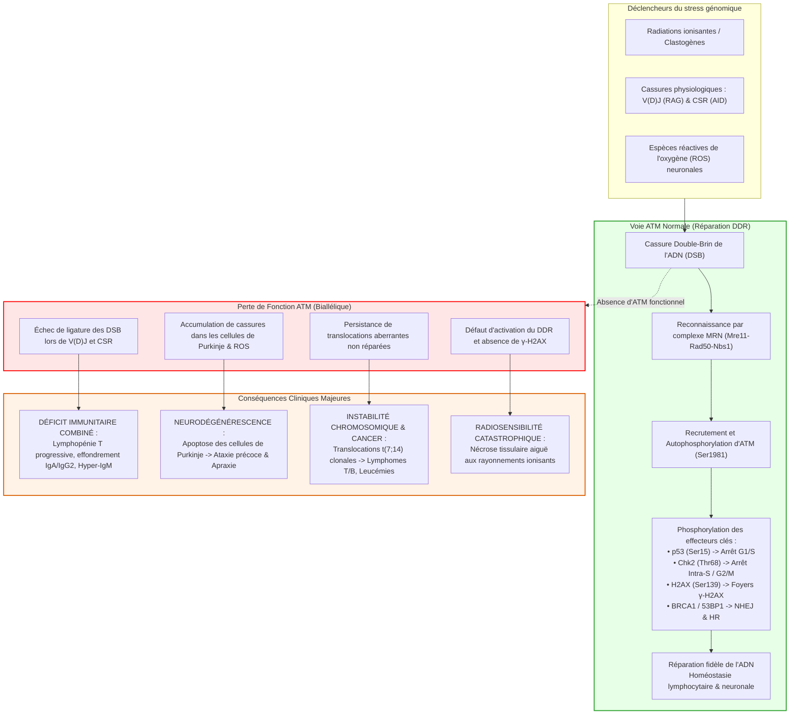
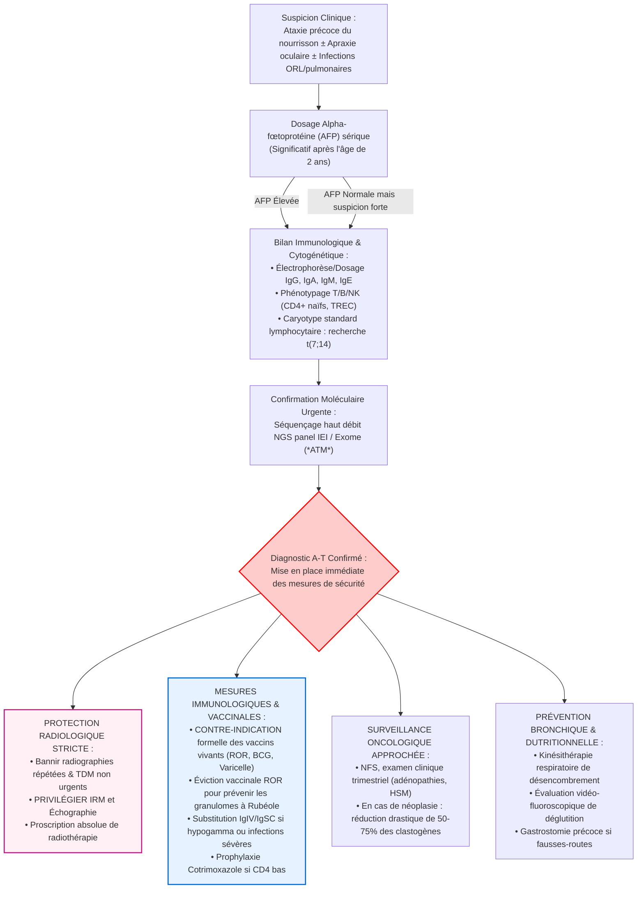

# Fiche #010 — Ataxie-télangiectasie

> [!IMPORTANT]
> **Protocole Atlas IUIS 2024** — Semaine 2, J10  
> *Classification internationale des erreurs innées de l'immunité (IEI)* : Table II.2 — Déficits immunitaires combinés avec anomalies syndromiques / Défauts de réparation des cassures double-brin de l'ADN.

---

## 0. Carte d'identité IUIS 2024

| Paramètre | Valeur clinique / Biologique |
| :--- | :--- |
| **Pathologie** | Ataxie-télangiectasie (*Ataxia-Telangiectasia*, syndrome de Louis-Bar) |
| **Classification IUIS 2024** | Table II.2 — Déficits immunitaires combinés avec anomalies syndromiques (*DNA repair defects*) |
| **Gène causal** | *ATM* (*Ataxia Telangiectasia Mutated*) |
| **Locus chromosomique** | 11q22.3 |
| **Mode de transmission** | Autosomique récessif (AR) |
| **Numéro OMIM** | #208900 |
| **Protéine codée** | Sérine/thréonine kinase ATM (3 056 acides aminés, 350 kDa, famille des PIKK) |
| **Phénotype immunologique** | Lymphopénie T (CD4+ et CD8+ naïfs) progressive, baisse des néo-synthèses thymiques (TREC bas) ; dysgammaglobulinémie hétérogène : déficit en IgA (60–70 %), déficit en IgG2/IgE indétectable, hyper-IgM secondaire (10–15 %) ; translocations clonales t(7;14) lymphocytaires |
| **Biomarqueur pathognomonique** | Élévation sérique persistante de l'alpha-fœtoprotéine (AFP) (> 95 % des patients après l'âge de 2 ans) |
| **Signes cardinaux extra-immuns** | Ataxie cérébelleuse trRecordée dès l'acquisition de la marche, apraxie oculomotrice précoce, télangiectasies oculocutanées bulbaires (vers 3–6 ans), vieillissement cutané, radiosensibilité extrême, prédisposition majeure aux hémopathies malignes et carcinomes |

---

## 1. TL;DR (Synthèse exécutive)

> [!TIP]
> L'ataxie-télangiectasie (A-T) est une maladie neuro-immunologique autosomique récessive multisystémique causée par des mutations bialléliques du gène *ATM*, chef d'orchestre de la détection et de la réparation des cassures double-brin de l'ADN (DSB) par recombinaison homologue et NHEJ. Elle associe une ataxie cérébelleuse précoce débutant dès l'âge de la marche, une apraxie oculomotrice, des télangiectasies oculoconjonctivales d'apparition plus tardive (3–7 ans) et un déficit immunitaire combiné progressif. L'incompétence de la recombinaison V(D)J et de la commutation isotypique (CSR) génère une lymphopénie T naïve, une baisse sérique d'IgA/IgG2 et, chez 10–15 % des patients, un tableau sévère d'hyper-IgM. Le risque tumoral cumulé avoisine 25 à 30 % (lymphomes, leucémies T/B, carcinomes épithéliaux). L'élévation sérique de l'alpha-fœtoprotéine (AFP) est un marqueur paraclinique quasi-constant. **Règle absolue** : interdiction formelle de l'exposition non indispensable aux radiations ionisantes (radiographies répétées, TDM, radiothérapie) et proscription des doses conventionnelles de chimiothérapies radiomimétiques/clastogènes sous peine d'aplasie ou de nécrose létale.

---

## 2. Contexte historique

- **1926** : Première description princeps par Ladislav Syllaba et Kamil Henner chez trois membres d'une fratrie présentant une association d'ataxie cérébelleuse progressive et de télangiectasies conjonctivales symétriques.
- **1941** : Denise Louis-Bar, neuropédiatre belge, documente de manière détaillée le cas d'un enfant de 9 ans associant ataxie cérébelleuse bilatérale et télangiectasies cutanées et oculaires, individualisant l'entité sous le nom de « syndrome de Louis-Bar ».
- **1957–1958** : Elena Boder et Robert P. Sedgwick publient leur cohorte américaine princeps de patients pédiatriques, baptisent la maladie **« Ataxia-Telangiectasia »**, et mettent en évidence la triade clinique neurologique, vasculaire et la susceptibilité infectieuse broncho-pulmonaire récidivante.
- **1972** : Thomas A. Waldmann et ses collègues démontrent que le taux sérique d'alpha-fœtoprotéine (AFP) est systématiquement et paradoxalement augmenté chez les patients atteints d'A-T, fournissant le premier biomarqueur sérologique de la maladie.
- **1995** : Clonage positionnel décisif du gène causal *ATM* sur le locus chromosomique 11q22.3 par l'équipe internationale menée par Yosef Shiloh et Kinneret Savitsky (Science, PMID: 7792600), démontrant qu'un gène unique code une protéine kinase géante apparentée à la famille PI3K.

---

## 3. Épidémiologie & Données de registres

- **Incidence et prévalence** : L'incidence mondiale est estimée entre **1 / 40 000 et 1 / 100 000** naissances vivantes. Le taux d'hétérozygotie (*ATM*+/-) au sein de la population générale est compris entre **1 et 2 %**. Les femmes hétérozygotes présentent un surrisque multiplié par 2 à 3 de développer un cancer du sein.
- **Données du registre CEREDIH (France)** : Les données nationales françaises (Suarez et al., *J Clin Oncol* 2015) ont analysé la trajectoire oncologique de 279 patients atteints d'A-T :
  - Incidence cumulative de malignité de **25 % dès l'âge de 20 ans**.
  - Pic précoce de lymphomes T et de leucémies aiguës lymphoblastiques (LAL) dans la première décennie.
  - Émergence à l'âge adulte de carcinomes hépatocellulaires, digestifs et mammaires.
- **Données ESID (Europe) et USIDNET (États-Unis)** :
  - L'A-T représente la cause monogénique syndromique la plus fréquente de déficit immunitaire combiné par instabilité génomique.
  - L'errance diagnostique historique moyenne s'établissait entre **3 et 5 ans**, le diagnostic n'étant posé qu'à l'apparition des télangiectasies oculaires ou lors de l'investigation d'un lymphome.
  - L'espérance de vie médiane rapportée s'est allongée de 16–19 ans dans les années 1980 à plus de **25–28 ans** actuellement (avec des survies au-delà de 40 ans dans les formes hypomorphes), grâce à l'antibiothérapie agressive, la nutrition entérale et l'usage des immunoglobulines polyvalentes.
- **Dépistage néonatal (PIDTC & réseaux NBS-SCID)** : L'implémentation du dosage néonatal des TREC (*T-cell receptor excision circles*) a conduit à l'identification fortuite présymptomatique de nouveau-nés porteurs d'A-T (1 à 2 % des alertes TREC pathologiques non-SCID), découvrant une lymphopénie T congénitale parfois sévère.

---

## 4. Physiopathologie, Génétique moléculaire & Schéma 1

### 4.1. Structure du gène et fonction de la protéine ATM
Le gène *ATM* comprend 66 exons codant une sérine/thréonine kinase nucléaire de haut poids moléculaire appartenant à la superfamille des phosphatidylinositol 3-kinase-related kinases (PIKK). À l'état basal, ATM réside dans le nucléoplasme sous forme d'homodimères inactifs. 

Dès l'apparition d'une cassure double-brin de l'ADN (DSB) induite par un stress exogène (radiations ionisantes, chimiothérapie clastogène) ou endogène (stress oxydatif, réarrangements programmés du système immunitaire) :
1. Le complexe **MRN** (MRE11-RAD50-NBS1) reconnaît l'extrémité libre de la DSB et recrute ATM.
2. ATM subit une autophosphorylation sur la sérine 1981 ($S1981$), dissociant le complexe en monomères catalytiquement actifs.
3. ATM phosphoryle des centaines de substrats nucléaires régulant la réponse aux dommages de l'ADN (*DNA Damage Response*, DDR) :
   - **Histone H2AX** sur la Ser139 ($\gamma$-H2AX), créant un foyer d'ancrage chromatidien pour les facteurs de réparation.
   - **p53** (sur Ser15) et **MDM2**, entraînant l'arrêt du cycle cellulaire en G1/S.
   - **CHK2** (sur Thr68), relayant le signal vers CDC25A/C pour verrouiller les transitions intra-S et G2/M.
   - **BRCA1**, **53BP1** et **NBS1**, orchestrant le choix entre la réparation par recombinaison homologue (HR, fidèle en phase S/G2) et la jonction d'extrémités non-homologues (NHEJ, cycle entier).

### 4.2. Mécanisme du déficit immunitaire
Les réarrangements géniques somatiques régissant l'ontogenèse des récepteurs immunitaires dépendent obligatoirement de cassures double-brin programmées :
- **Recombinaison V(D)J** (exprimée par RAG1/RAG2 dans le thymus et la moelle osseuse) : ATM stabilise les extrémités codantes et les complexes de clivage avant ligature par le NHEJ. Son absence provoque l'échec de la recombinaison, la mort par apoptose des thymocytes immatures et l'attrition du répertoire T naïf.
- **Commutation de classe isotypique (CSR)** (exprimée par l'AID dans les centres germinatifs ganglionnaires) : la recombinaison entre régions *switch* exige la réparation efficace des DSB médiée par ATM. Sa perte engendre le défaut de production des immunoglobulines d'aval (IgA, IgG2, IgE), confinant fréquemment les lymphocytes B dans une sécrétion résiduelle ou excessive d'IgM (*phénotype Hyper-IgM-like*).

### 4.3. Neurodégénérescence et instabilité chromosomique
Les cellules de Purkinje du cervelet, post-mitotiques et à très haute demande métabolique, subissent un stress oxydatif endogène intense couplé à une accumulation de cassures monocaténaires et bicaténaires de l'ADN. L'absence d'ATM induit une défaillance de la clairance des mitochondries sénescentes (défaut de mitophagie/autophagie), une accumulation d'ADN cytosolique activant la voie neurotoxique **cGAS-STING**, et conduit à une apoptose neuronale progressive avec atrophie corticale cérébelleuse.

---

## 5. Présentation clinique, Pathogènes & Phénotype immunologique

### 5.1. Triade clinique classique et phénotype neurologique
1. **Ataxie cérébelleuse progressive** :
   - Débute dès l'acquisition de la marche (12–18 mois) par une instabilité du tronc, des embardées à la marche et des chutes fréquentes.
   - Évolution inexorable : choréo-athétose, tremblement intentionnel, dysarthrie cérébelleuse sévère, dystonie.
   - Perte de la marche autonome et dépendance au fauteuil roulant généralement entre **8 et 11 ans** dans la forme classique.
   - Les capacités cognitives sont globalement préservées au début, masquées par la dysarthrie et la lenteur d'exécution motrice.
2. **Apraxie oculomotrice** :
   - Signe clinique fondamental : incapacité d'initier des saccades oculaires volontaires horizontales, compensée par des mouvements saccadés brusques de la tête (« saccades céphaliques ») pour fixer une cible.
3. **Télangiectasies oculocutanées** :
   - Dilatations capillaires conjonctivales bilatérales, débutant aux canthus internes et externes de la sclérotique oculaire bulbale.
   - N'apparaissent que vers l'âge de **3 à 7 ans** (leur absence précoce n'exclut JAMAIS le diagnostic).
   - Peuvent secondairement affecter les ailes du nez, les pavillons des oreilles et les plis de flexion cutanés.

### 5.2. Spectre infectieux et pathogènes
- **Bactéries encapsulées** : *Streptococcus pneumoniae*, *Haemophilus influenzae*, *Moraxella catarrhalis*, *Staphylococcus aureus*. Les infections sinusiennes et bronchopulmonaires récidivantes mènent rapidement à des atélectasies et à la constitution de **bronchectasies (DDB)** diffuses.
- **Germes opportunistes** (patients HIGM ou lymphopénie CD4+ profonde) : *Pneumocystis jirovecii*, infections sévères par le virus Varicelle-Zona (VZV), verrues cutanées profuses et condylomes récalcitrants à Human Papillomavirus (HPV).
- **Virus du vaccin vivant contre la rubéole (Rubella-strain)** : Les patients vaccinés par le ROR développent fréquemment des **granulomes cutanés ulcéronécrotiques chroniques** et des atteintes granulomateuses viscérales médiées par la persistance de la souche virale vaccinale vivante dans les tissus.

### 5.3. Profil biologique et immunologique
- **Alpha-fœtoprotéine (AFP)** : Élevée dans plus de 95 % des cas (> 10–20 ng/mL). C'est l'examen de débrouillage de première intention (attention : l'AFP est physiologiquement très haute chez le nouveau-né jusqu'à l'âge de 12–18 mois, limitant sa rentabilité précoce).
- **Sous-populations lymphocytaires** :
  - Lymphopénie T globale progressive avec baisse préférentielle des lymphocytes T auxiliaires CD4+ naïfs (CD4+CD45RA+).
  - Lymphopénie B (CD19+) modérée à sévère chez un tiers des patients.
  - Taux de TREC et de KREC effondrés ou diminués.
- **Profil sérologique** :
  - Déficit sélectif complet ou partiel en IgA (dans 60 à 70 % des cas).
  - Baisse fréquente des sous-classes d'IgG2 et effondrement des IgE.
  - Titre d'anticorps post-vaccinaux antipolysaccharidiques (*Streptococcus pneumoniae*) constamment défectueux.
  - Dans 10–15 % des cas : **phénotype hyper-IgM** (IgA effondrées, IgG basses, IgM normales ou élevées), associé au pronostic infectieux et oncologique le plus sévère.
- **Cytogénétique conventionnelle** : Présence de cassures et réarrangements chromosomiques touchant préférentiellement les loci des récepteurs des lymphocytes T et immunoglobulines : translocations et inversions clonales **t(7;14)(q35;q11)** et **inv(14)(q11;q32)** détectables sur caryotype lymphocytaire stimulé par PHA.

---

## 6. Complications à long terme & Défis non résolus

1. **Oncogenèse majeure** :
   - Risque global de néoplasie de 20 à 30 % au cours de la vie.
   - **Enfants (< 15 ans)** : Hémopathies aiguës d'origine lymphoïde : LAL-T, LAL-B, lymphome diffus à grandes cellules B (DLBCL), lymphome de Burkitt, lymphome de Hodgkin.
   - **Adultes (> 20 ans)** : Leucémie prolymphocytaire à cellules T (T-PLL, de très sombre pronostic) et tumeurs solides (adénocarcinomes gastriques, hépatocarcinomes, cancers colorectaux, tumeurs mammaires, carcinomes pulmonaires non à petites cellules).
2. **Défis majeurs d'oncologie médicale (Toxicité thérapeutique clastogène)** :
   - **Radiosensibilité létale** : Toute irradiation thérapeutique conventionnelle entraîne des radiodermites décapantes, des radionécroses cérébrales/médullaires ou une aplasie médullaire foudroyante. La radiothérapie est **contre-indiquée**.
   - Sensibilité extrême aux agents alkylants, aux poisons de la topoisomérase II (étoposide, doxorubicine) et aux radiomimétiques (bléomycine). Les protocoles oncologiques nécessitent une **réduction posologique empirique drastique de 50 à 75 %** sous peine de mortalité toxique immédiate.
3. **Pneumopathie chronique et défaillance respiratoire** :
   - Principale cause de décès prématuré avec les cancers.
   - Combinaison délétère d'infections bactériennes récidivantes, de fausses-routes silencieuses (dysphagie oropharyngée secondaire à la neurodégénérescence) et de syndrome restrictif par atrophie musculaire intercostale et déformation rachidienne (cyphoscoliose).
4. **Endocrinopathie et vieillissement tissulaire précoce** :
   - Diabète sucré insulinorésistant sévère par lipodystrophie partielle et dysfonction mitochondriale.
   - Hypogonadisme hypergonadotrope conduisant à une infertilité quasi-constante chez les deux sexes.
   - Retard statural sévère et grisonnement prématuré des phanères.

---

## 7. Avenues thérapeutiques

### 7.1. Prise en charge standard et de soutien
- **Substitution par immunoglobulines (IgIV ou IgSC)** : Indiquée en cas d'hypogammaglobulinémie IgG significative, de déficit spécifique en anticorps antipolysaccharidiques avéré ou de pneumopathies bactériennes récidivantes.
- **Prophylaxie anti-infectieuse** :
  - Cotrimoxazole (TMP-SMX) systématique si taux de lymphocytes CD4+ < 200/µL ou en cas de phénotype Hyper-IgM (prévention de la pneumocystose).
  - Azithromycine au long cours (3 fois par semaine) pour son effet protecteur sur le remodelage bronchique et la colonisation à pyocyanique.
- **Réhabilitation neuromotrice et nutritionnelle** : Kinésithérapie précoce motrice et respiratoire quotidienne. Pose impérative et non différée d'une **gastrostomie percutanée d'alimentation** dès l'apparition des fausses-routes documentées au transit baryté ou vidéo-fluoroscopie afin de protéger l'arbre bronchique.

### 7.2. Allogreffe de cellules souches hématopoïétiques (allo-HSCT)
- Longtemps récusée en raison d'une mortalité liée au conditionnement (TRM) intolérable avec les régimes myéloablatifs conventionnels.
- Actuellement rediscutée dans des centres experts pour des indications très sélectionnées : phénotype Hyper-IgM sévère précoce ou émergence de clones leucémiques réfractaires.
- Nécessite des **conditionnements à toxicité minimale ou ultra-réduits (RIC)**, reposant sur la fludarabine à dose adaptée, de très faibles doses d'alkylants non-radiomimétiques et une séérothérapie T (sérum antilymphocytaire), sans aucune irradiation corporelle totale (TBI).
- **Limite majeure à expliciter impérativement aux familles** : l'allogreffe corrige l'immunodéficience et prévient les hémopathies lymphoïdes, mais **n'arrête absolument pas la progression inexorable de la neurodégénérescence cérébelleuse**.

### 7.3. Essais cliniques récents et thérapies ciblées émergentes
- **Stéroïdes intra-érythrocytaires (EryDex)** : Encapsulation autologue de dexamethasone sodium phosphate délivrant des micro-doses continues de glucocorticoïdes sans induire de syndrome cushingogène chronique systémique. L'essai international de Phase 3 ATTeST a démontré un bénéfice clinique neurologique statistiquement significatif sur le score moteur mICARS dans le sous-groupe des jeunes enfants âgés de 6 à 9 ans.
- **Restauration de la fonction mitochondriale et antioxydants** : Utilisation du nicotinamide riboside (précurseur NAD+) pour restaurer la mitophagie neuronale et diminuer l'activation de la voie cGAS-STING.
- **Stratégies géniques et oligonucléotides antisens (ASO)** : Conception d'ASO personnalisés ciblant des mutations introniques cryptiques d'*ATM* pour restaurer un épissage physiologique, ouvrant la voie à une médecine de très haute précision.

---

## 8. Section pratique (Bedside, Guidelines & Schéma 2)

### Diagnostic différentiel

| Entité pathologique | Gène / Transmission | AFP sérique | Déficit immunitaire | Télangiectasies | Particularités différentielles |
| :--- | :--- | :--- | :--- | :--- | :--- |
| **Ataxie-télangiectasie (A-T)** | *ATM* (AR) | **Élevée** (> 95 %) | **Combiné fréquent** (IgA/IgG2 bas, lymphopénie T) | **Présentes** (3–7 ans) | Radiosensibilité majeure, translocations t(7;14), risque de cancers très élevé |
| **Ataxie avec apraxie oculomotrice type 1 (AOA1)** | *APTX* (Aprataxine) (AR) | Normale | Absent | Absentes | Hypoalbuminémie constante, hypercholestérolémie, neuropathie périphérique sévère |
| **Ataxie avec apraxie oculomotrice type 2 (AOA2)** | *SETX* (Sénataxine) (AR) | **Élevée** | Absent | Rares / Absentes | Début plus tardif (8–18 ans), neuropathie sensitive et motrice axonale marquée |
| **Syndrome de Nimègue (NBS)** | *NBN* (Nibrine) (AR) | Normale | **Combiné sévère** (CID, hypogamma) | Absentes | **Microcéphalie congénitale progressive**, faciès d'oiseau caractéristique, sans ataxie cérébelleuse |
| **Ataxia-Telangiectasia-Like (ATLD)** | *MRE11* (AR) | Normale | Absent ou minime | Absentes | Tableau neurologique proche de l'A-T mais sans télangiectasies, AFP normale, progression plus lente |
| **Ataxie de Friedreich** | *FXN* (AR, triplet GAA) | Normale | Absent | Absentes | Ataxie spino-cérébelleuse avec aréflexie ostéo-tendineuse, cardiomyopathie hypertrophique, diabète |

### Perles cliniques pour le praticien

1. **L'absence de télangiectasies avant 5 ans n'élimine pas l'A-T** : L'ataxie apparaît vers 1 an lors des premiers pas, tandis que les télangiectasies conjonctivales n'émergent classiquement qu'entre 3 et 7 ans. Devant toute ataxie inexpliquée du jeune enfant, le réflexe immédiat doit être de doser l'alpha-fœtoprotéine (AFP).
2. **AFP normale avant 12–18 mois : piège diagnostique** : L'AFP est physiologiquement très élevée chez le nouveau-né et ne redescend aux valeurs de base de l'enfant que vers 12–18 mois. Chez un nourrisson détecté par le dépistage néonatal (TREC bas), une AFP élevée peut être faussement rassurante ou trompeuse ; le diagnostic repose alors exclusivement sur la biologie moléculaire du gène *ATM*.
3. **Zéro irradiation non indispensable (Principe ALARA absolu)** : Interdire les radiographies de contrôle itératives et les scanners thoraciques répétés pour le suivi des bronchectasies. Privilégier systématiquement l'échographie et l'IRM pulmonaire à bas champ ou coupes rapides.
4. **Attention au piège vaccinal du vaccin ROR** : L'administration par inadvertance du vaccin vivant atténué contre la rougeole, les oreillons et la rubéole chez un patient atteint d'A-T peut provoquer des années plus tard des ulcérations cutanées chroniques granulomateuses indélébiles dues à la persistance réplicative de la souche de virus rubéoleux vaccinal.
5. **Alerte oncologique : Adapter impérativement les chimiothérapies** : En cas de découverte d'un lymphome ou d'une leucémie chez un patient A-T, les protocoles conventionnels sont mortels en raison de la défaillance globale de réparation de l'ADN. Les doses de clastogènes (cyclophosphamide, ifosfamide, étoposide) doivent être réduites de 50 à 75 % d'emblée, et la radiothérapie est proscrite.
6. **Dépistage précoce du cancer du sein chez les mères vectrices** : Ne jamais oublier la famille : la mère d'un enfant atteint est obligatoirement hétérozygote conductrice (*ATM*+/-), ce qui lui confère un surrisque relatif multiplié par 2 à 3 de développer un cancer du sein précoce. Une surveillance sénologique par IRM mammaire annuelle dès l'âge de 30–40 ans doit lui être formellement prescrite.

---

## 9. Nouveautés & Littérature récente (2022–2026)

- **Essai clinique de Phase 3 ATTeST sur les stéroïdes intra-érythrocytaires** (*Lancet Neurol*, 2024, PMID: 39152028) : L'essai multicentrique randomisé en double aveugle évaluant la perfusion mensuelle de dexaméthasone encapsulée dans les érythrocytes autologues (EryDex) chez 175 patients pédiatriques atteints d'A-T a démontré un excellent profil de tolérance sans toxicité stéroïdienne chronique, ainsi qu'une amélioration neurologique motrice significative objectivée par le score mICARS dans le sous-groupe des jeunes enfants âgés de 6 à 9 ans.
- **Données de sécurité à long terme d'EryDex** (*Front Neurol*, 2025, PMID: 39917433) : Analyse prospective de cohorte sur plus de 24 mois confirmant l'absence de cassure de la courbe staturale, de diabète induit, d'ostéoporose ou d'hypercorticisme iatrogène chez les enfants sous EryDex, posant les jalons d'un traitement neuroprotecteur utilisable dans les phases précoces.
- **Histoire naturelle et modélisation pronostique de l'A-T** (*PLoS One*, 2022, PMID: 35290391) : Revue systématique internationale établissant les jalons évolutifs de l'atteinte neurologique et systémique : perte de la marche autonome survenant à un âge médian de 10 ans, apparition des défaillances pulmonaires et corrélations directes avec le taux d'activité résiduelle de la protéine kinase ATM.
- **Dilemmes éthiques et cliniques du dépistage néonatal SCID/TREC** (*J Hum Immun*, 2025 / *PMC*, PMID: 42170582) : Étude des cohortes de nouveau-nés repérés avec un taux de TREC effondré conduisant au diagnostic pré-symptomatique d'A-T, discutant l'opportunité et les limites éthiques de l'allogreffe préemptive de cellules souches hématopoïétiques chez les nouveau-nés porteurs du variant immunologique Hyper-IgM avant toute atteinte neurologique.
- **Stratification des cancers et chimiothérapies adaptées** (*Br J Haematol*, 2021/2022, PMID: 34382196) : Cohorte rétrospective monocentrique détaillée définissant l'incidence tumorale et confirmant le bénéfice des adaptations thérapeutiques d'emblée hypodosées pour le traitement curatif des lymphomes hodgkiniens et non-hodgkiniens chez les patients atteints de déficits de la réparation de l'ADN.

---

## 10. Références vérifiées

1. Savitsky K, Bar-Shira A, Gilad S, Rotman G, Ziv Y, Vanagaite L, et al. A single ataxia telangiectasia gene with a product similar to PI-3 kinase. *Science*. 1995;268(5218):1749-1753. [PMID: 7792600](https://pubmed.ncbi.nlm.nih.gov/7792600/)
2. Suarez F, Mahlaoui N, Canioni D, Andriamanga C, Dubois d'Enghien C, Brousse N, et al. Incidence, presentation, and prognosis of malignancies in ataxia-telangiectasia: a report from the French national registry of primary immune deficiencies. *J Clin Oncol*. 2015;33(2):202-208. [PMID: 25488969](https://pubmed.ncbi.nlm.nih.gov/25488969/)
3. Rothblum-Oviatt C, Wright J, Lefton-Greif MA, McGrath-Morrow SA, Crawford TO, Lederman HM. Ataxia telangiectasia: a review. *Orphanet J Rare Dis*. 2016;11(1):159. [PMID: 27884168](https://pubmed.ncbi.nlm.nih.gov/27884168/)
4. Petley E, Yule A, Alexander S, Ojha S, Whitehouse WP. The natural history of ataxia-telangiectasia (A-T): A systematic review. *PLoS One*. 2022;17(3):e0264177. [PMID: 35290391](https://pubmed.ncbi.nlm.nih.gov/35290391/)
5. Zielen S, Crawford T, Benatti L, Magnani M, Kieslich M, Ryan M, et al. Safety and efficacy of intra-erythrocyte dexamethasone sodium phosphate in children with ataxia telangiectasia (ATTeST): a multicentre, randomised, double-blind, placebo-controlled phase 3 trial. *Lancet Neurol*. 2024;23(9):871-882. [PMID: 39152028](https://pubmed.ncbi.nlm.nih.gov/39152028/)
6. Koenig MK, Leuzzi V, Gouider R, Yiu EM, Pietrucha B, Stray-Pedersen A, et al. Long-term safety of dexamethasone sodium phosphate encapsulated in autologous erythrocytes in pediatric patients with ataxia telangiectasia. *Front Neurol*. 2025;15:1526914. [PMID: 39917433](https://pubmed.ncbi.nlm.nih.gov/39917433/)