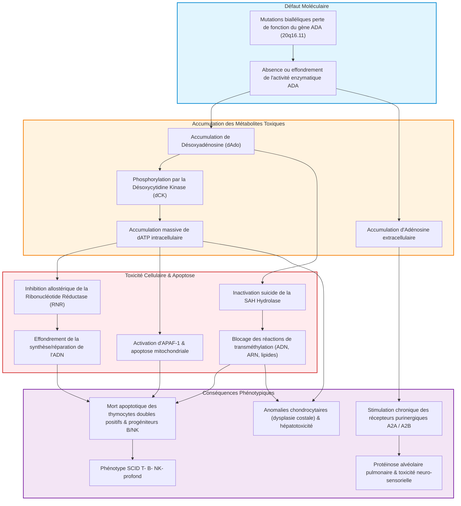
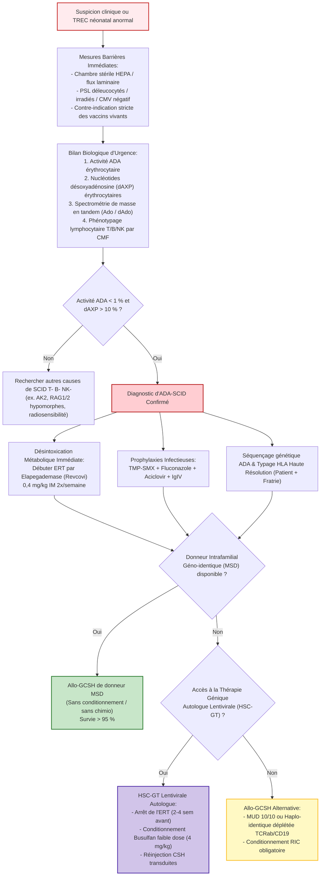

# Fiche #011 — Déficit en adénosine désaminase (ADA-SCID)

> [!IMPORTANT]
> **Semaine 2 — Jour 11** | Curateur : Protocole Atlas IUIS 2024.  
> Entité : **Déficit en adénosine désaminase** (*Adenosine Deaminase Deficiency*, ADA-SCID). Classification IUIS : **Table I.2** (Déficits immunitaires combinés avec anomalies syndromiques ou extra-immunologiques associées).

---

## 0. Carte d'identité IUIS 2024

| Paramètre | Caractéristique |
| :--- | :--- |
| **Gène affecté** | ***ADA*** (locus 20q16.11 / cytogénétique 20q13.12) |
| **Transmission** | Autosomique récessive (AR) |
| **OMIM** | **#102700** (forme sévère SCID), **#608958** |
| **Classification IUIS 2024** | **Table I.2** (Déficits de l'immunité cellulaire et humorale avec anomalies syndromiques associées) |
| **Phénotype immunologique** | Lymphopénie T⁻ B⁻ NK⁻ profonde (forme précoce) ou immunodéficience combinée T^(dim) B^(dim) NK^(dim) progressive (forme retardée) |
| **Profil métabolique** | Activité enzymatique ADA érythrocytaire effondrée (< 1 %), accumulation de désoxyadénosine (dAdo) et de nucléotides désoxyadénosines (dAXP érythrocytaires > 10–50 % des nucléotides adényliques totaux) |
| **Atteintes extra-immunes** | Dysplasie osseuse chondro-costale (« cuillère » costale), surdité neurosensorielle, retard neurodéveloppemental/troubles du spectre autistique, protéinose alvéolaire pulmonaire (PAP), cytolyse hépatique, dermatofibrosarcome protubérant (*DFSP*) |

---

## 1. TL;DR (Synthèse exécutive)

> [!TIP]
> **Synthèse diagnostique et thérapeutique :**  
> Le déficit en adénosine désaminase (ADA-SCID) représente ~10–15 % des cas de SCID et constitue un trouble métabolique systémique de la voie de sauvetage des purines. L'absence d'ADA induit une accumulation toxique de désoxyadénosine et de dATP, bloquant la ribonucléotide réductase et la S-adénosylhomocystéine hydrolase, déclenchant l'apoptose massive des progéniteurs lymphoïdes (phénotype T⁻ B⁻ NK⁻). Au-delà du déficit immunitaire combiné sévère, le tableau est multisystémique (atteintes osseuse, pulmonaire, neurocognitive et auditive). Le dépistage néonatal par TREC identifie la majorité des formes précoces, mais les formes retardées (*delayed-onset*) peuvent échapper au test et nécessitent la détection métabolique du ratio dAXP / activité ADA. La prise en charge urgente repose sur la désintoxication par enzymothérapie substitutive pégylée (elapegademase-lvlr). Les traitements curatifs reposent à parité sur la greffe de cellules souches hématopoïétiques (CSH d'un donneur géno-identique intrafamilial non conditionnée) et la thérapie génique autologue par vecteur lentiviral avec conditionnement non myéloablatif (busulfan).

---

## 2. Contexte historique

- **1972** : Eloise Giblett et ses collègues découvrent fortuitement l'absence d'activité adénosine désaminase chez deux fillettes non apparentées présentant un déficit immunitaire combiné sévère, établissant ainsi le tout premier lien causal entre un déficit enzymatique métabolique monogénique et une anomalie du développement lymphoïde humain.
- **1986–1987** : Clonage et séquençage de l'ADNc du gène *ADA*. Michael S. Hershfield et son équipe développent la première enzymothérapie substitutive stabilisée : l'adénosine désaminase bovine conjuguée au polyéthylène glycol (PEG-ADA, pegademase bovine / *Adagen*).
- **1990** : Michael Blaese, W. French Anderson et Kenneth Culver réalisent la toute première tentative historique d'essai clinique de thérapie génique humaine à l'aide de lymphocytes T périphériques autologues transduits par un vecteur gamma-rétroviral chez Ashanti DeSilva.
- **2002** : Percée de l'équipe de Milan (Alessandro Aiuti, Maria Grazia Roncarolo) démontrant la nécessité d'un conditionnement cytoréducteur non myéloablatif (faible dose de busulfan) et de l'interruption de l'enzymothérapie substitutive pour permettre la prise de greffe stable de CSH autologues modifiées par vecteur gamma-rétroviral. Ce protocole a abouti à l'autorisation de mise sur le marché européenne de *Strimvelis* en 2016.
- **2018–2021** : Autorisation de l'elapegademase-lvlr (*Revcovi*, ADA humaine recombinante pégylée issue d'expression chez *E. coli*), remplaçant l'Adagen. Donald Kohn (UCLA) et Claire Booth (GOSH, Londres) publient en 2021 l'efficacité et l'innocuité à 100 % de survie globale de la thérapie génique lentivirale autologue sans mutagenèse insertionnelle leucémogène.

---

## 3. Épidémiologie & Données de registres

- **Incidence globale :** Estimée entre 1/200 000 et 1/1 000 000 de naissances vivantes. L'ADA-SCID représente environ 10 à 15 % de l'ensemble des cas de SCID dans les cohortes occidentales.
- **Données PIDTC (Amérique du Nord, cohorte de 2022) :**
  - Dans la grande cohorte nord-américaine (PIDTC 6901) portant sur 109 patients atteints d'ADA-SCID traités sur 35 ans (1982–2017) : la survie globale (OS) à 2 ans après greffe allogénique de cellules souches hématopoïétiques (allo-GCSH) avec donneur intrafamilial géno-identique (MSD) atteint **96 %**, comparable aux **100 %** de survie observés sous thérapie génique (TG).
  - La survie après greffe de donneur non apparenté compatible (MUD) s'est nettement améliorée dans l'ère moderne (> 2010), atteignant ~83–88 % grâce aux régimes de conditionnement à toxicité réduite (RIC).
- **Données SCETIDE & CEREDIH (Europe / France) :**
  - Survie globale après allo-GCSH supérieure à 85 % dans la cohorte contemporaine (2006–2018), soulignant la supériorité pronostique d'un diagnostic pré-symptomatique et d'une prise en charge précoce des atteintes d'organes.
- **Données USIDNET & Registres de dépistage néonatal (NBS) :**
  - Le dépistage par quantification des TREC (*T-cell Receptor Excision Circles*) identifie 80–85 % des patients (formes sévères néonatales).
  - **Alerte épidémiologique majeure :** Entre 15 et 20 % des déficits en ADA présentent un début différé (*delayed-onset* : 6 mois à plusieurs années de vie) ou tardif (*late-onset* : adolescence, adulte). Ces formes hypomorphes peuvent conserver un taux de TREC normal à la naissance, échappant ainsi au dépistage systématique par PCR TREC standard.

---

## 4. Physiopathologie & Génétique moléculaire

### 4.1. Voie biochimique et cascades de toxicité métabolique
L'adénosine désaminase (EC 3.5.4.4) est une enzyme ubiquitaire intracellulaire du métabolisme de sauvetage des purines catalysant la désamination irréversible de l'adénosine en inosine, et de la 2'-désoxyadénosine (dAdo) en 2'-désoxyinosine.

```
                    Voie métabolique de sauvetage des purines
                    
                    Adénosine ──────[ ADA ]──────> Inosine
                        │                            │
                        ▼                            ▼
                 2'-Désoxyadénosine ──[ ADA ]──> 2'-Désoxyinosine
                        │
                        │ (Phosphorylation par la Désoxycytidine Kinase / dCK)
                        ▼
                     dAMP ──> dADP ──> dATP (Accumulation toxique)
```

En l'absence d'activité ADA fonctionnelle, deux voies toxiques synergiques s'activent :

1. **Piégeage et phosphorylation de la 2'-désoxyadénosine (dAdo) :**
   - La dAdo extracellulaire et intracellulaire est phosphorylée en désoxyadénosine monophosphate (dAMP) par la **désoxycytidine kinase (dCK)**, une enzyme fortement exprimée dans les précurseurs lymphoïdes immatures du thymus et de la moelle osseuse.
   - Le métabolite triphosphate **dATP** s'accumule massivement au sein du compartiment érythrocytaire et lymphocytaire.
   - Le dATP exerce une inhibition allostérique puissante sur la **ribonucléotide réductase (RNR)**, bloquant la conversion des ribonucléosides diphosphates en désoxyribonucléosides diphosphates. Il en résulte un effondrement des pools de désoxycytidine triphosphate (dCTP), induisant un arrêt de la synthèse et de la réplication de l'ADN.
   - Le dATP active directement le facteur pro-apoptotique **APAF-1**, induisant le relargage du cytochrome c mitochondrial et le clivage des caspases (voie intrinsèque de l'apoptose lymphocytaire).
   - La dAdo entraîne des cassures simple-brin de l'ADN, activant de façon surabondante la poly(ADP-ribose) polymérase-1 (PARP-1), aboutissant à l'épuisement cellulaire en NAD⁺ et ATP.

2. **Inhibition de la S-adénosylhomocystéine hydrolase (SAH hydrolase) :**
   - L'excès de dAdo inactive par suicide enzymatique la SAH hydrolase.
   - L'élévation du rapport intracellulaire S-adénosylhomocystéine / S-adénosylméthionine (SAH / SAM) bloque toutes les transméthylations cellulaires dépendantes de la SAM (méthylation de l'ADN, des ARN messagers, des histones et des phospholipides membranaires).

3. **Toxicité dépendante des récepteurs membranaires à l'adénosine (A2A / A2B) :**
   - L'adénosine extracellulaire non métabolisée stimule de manière chronique les récepteurs purinergiques couplés à la protéine Gs, augmentant l'AMP cyclique (AMPc) intracellulaire.
   - Ce mécanisme participe à la tolérance immunitaire aberrante, à l'atteinte bronchique/alvéolaire (surproduction de surfactant et développement de protéinose alvéolaire pulmonaire), aux anomalies vasculaires et osseuses, et à la neurotoxicité directe.

### 4.2. Schéma 1 : Mécanisme physiopathologique du déficit en ADA



---

## 5. Présentation clinique, Pathogènes & Phénotype immunologique

### 5.1. Spectre clinique selon l'âge d'apparition

| Forme | Âge de début | Particularités cliniques |
| :--- | :--- | :--- |
| **Forme précoce classique (ADA-SCID)** (~80 %) | < 3 mois | Cassure pondérale sévère, diarrhée chronique réfractaire, muguet buccal résistant, pneumopathies interstitielles invasives, absence d'ombre thymique, chapelet costal caractéristique. |
| **Forme retardée (*delayed-onset*)** (~15 %) | 6 mois à 5 ans | Infections respiratoires récurrentes (otites, sinusites, bronchectasies), verrues cutanées étendues à HPV, manifestations auto-immunes (cytopénies, thyroïdite), lymphopénie progressive. TREC néonatal parfois normal ! |
| **Forme tardive (*late-onset*)** (~5 %) | Adolescence / Âge adulte | Bronchopneumopathies chroniques, auto-immunité systémique, lymphopénie T CD4 progressive mimant un déficit immunitaire commun variable (DICV / CVID), splénomégalie. |
| **Déficit partiel en ADA** (bénin) | Tout âge | Activité ADA effondrée dans les hématies isolées mais normale/résiduelle dans les lymphocytes et leucocytes. Aucune anomalie immunologique ni clinique (variant bénin de laboratoire). |

### 5.2. Spectre infectieux
- **Opportunistes majeurs :** *Pneumocystis jirovecii*, *Cytomegalovirus* (CMV), *Epstein-Barr virus* (EBV), *Adenovirus*, herpès simplex virus (HSV), candidose cutanéo-muqueuse systémique.
- **Microorganismes bactériens :** *Pseudomonas aeruginosa*, *Streptococcus pneumoniae*, *Haemophilus influenzae*, entérobactéries.
- **Accidents vaccinaux :** Dissémination systémique du BCG (BCGite généralisée) si vaccination néonatale, diarrhée prolongée après rotavirus vivant atténué.

### 5.3. Signes extra-immuns caractéristiques de l'ADA-SCID
1. **Atteintes squelettiques :** Dysplasie chondro-costale avec évasement et concavité des extrémités antérieures des côtes (aspect en « cuillère » ou « raquette » à la radiographie de thorax), protubérances chondro-costales mimant un rachitisme sans anomalie phospho-calcique, pléthore vertébrale.
2. **Atteintes neurologiques et neurosensorielles :** Surdité neurosensorielle bilatérale (~50 % des cas), nystagmus, retard d'acquisition motrice, tremblements des extrémités, retard cognitif, prévalence accrue de troubles du spectre autistique ou de TDAH (toxicité de la dAdo sur le système nerveux central en développement).
3. **Atteinte pulmonaire non infectieuse :** **Protéinose alvéolaire pulmonaire (PAP)** secondaire au dysfonctionnement des macrophages alvéolaires intoxiqués par l'adénosine et l'activation d'A2BR.
4. **Atteinte hépatique :** Cytolyse hépatique chronique avec cholestase, survenue possible d'insuffisance hépato-cellulaire aiguë sous stress métabolique.
5. **Oncologie cutanée :** Risque spécifique très élevé de **dermatofibrosarcome de Darier-Ferrand** (*Dermatofibrosarcoma protuberans*, DFSP), parfois multicentrique.

### 5.4. Profil immunologique au laboratoire
- **Hémogramme :** Lymphopénie absolue extrême dès la naissance dans les formes classiques (souvent lymphocytes totaux < 500 /µL, neutrophiles initialement normaux puis neutropénie progressive possible).
- **Sous-populations lymphocytaires (CMF) :**
  - T⁻ (CD3⁺ < 300 /µL, CD4⁺ et CD8⁺ effondrés).
  - B⁻ (CD19⁺ < 50 /µL).
  - NK⁻ (CD16⁺ CD56⁺ < 50 /µL).
- **Dosage pondéral des immunoglobulines :** Agammaglobulinémie ou hypogammaglobulinémie profonde après clairance des IgG maternelles. Absence totale de production d'anticorps spécifiques post-vaccinaux.
- **Prolifération lymphocytaire (LPT aux mitogènes PHA/anti-CD3) :** Absente ou < 10 % des témoins.

---

## 6. Complications à long terme & Défis non résolus

1. **Persistance des séquelles neurodéveloppementales :** Même après correction immunologique complète par allo-GCSH ou thérapie génique, la surdité neurosensorielle et les troubles des apprentissages/cognitifs peuvent persister, probablement en raison des dommages irréversibles subis par les oligodendrocytes et la microglie in utero et en période néonatale.
2. **Protéinose alvéolaire pulmonaire persistante ou récurrente :** La PAP peut compromettre le sevrage respiratoire et nécessite une clairance métabolique complète et précoce sous enzymothérapie pour régresser sans fibrose interstitielle secondaire.
3. **Surveillance oncologique stricte :**
   - Développement de DFSP cutanés imposant une inspection dermatologique corps entier annuelle.
   - **Risque d'oncogenèse insertionnelle après thérapie génique rétrovirale :** Bien que l'ADA-SCID ait longtemps été considéré comme préservé du risque de leucémogenèse par rapport au SCID-X1, un cas de leucémie aiguë lymphoblastique T (LAL-T) médiée par l'insertion rétrovirale proximale de *LMO2* a été rapporté chez un patient traité par *Strimvelis* (Cesana et al., *Nat Commun* 2024), imposant un suivi clonal par NGS/LAM-PCR.
4. **Auto-immunité post-thérapeutique :** Anémies hémolytiques auto-immunes (AHAI) à Coombs positif, thrombopénies immunitaires (PTI) et entéropathies auto-immunes en cas de reconstitution T thymique oligoclonale ou de chimérisme partiel instable.

---

## 7. Avenues thérapeutiques

### 7.1. Mesures symptomatiques d'urgence dès la suspicion
- Isolement protecteur immédiat en flux laminaire ou chambre à pression positive sous filtration HEPA.
- **Proscription formelle de tout vaccin vivant atténué** (BCG, ROR, Rotavirus, Polio oral, Varicelle, Fièvre jaune).
- Administration exclusive de **produits sanguins labiles phénotypés, déleucocytés, irradiés (25–30 Gy) et séronégatifs pour le CMV** (prévention absolue de la GVHD post-transfusionnelle mortelle).
- Antibioprophylaxie : Triméthoprime-sulfaméthoxazole (TMP-SMX, 5 mg/kg/j de TMP en 3 prises hebdomadaires) contre *Pneumocystis jirovecii*.
- Prophylaxies antifongique (Fluconazole) et antivirale (Aciclovir ou Valaciclovir).
- Traitement substitutif par immunoglobulines intraveineuses (IgIV, 0,4–0,6 g/kg toutes les 3–4 semaines) ou sous-cutanées (IgSC).

### 7.2. Traitement d'induction et de pontage : Enzymothérapie substitutive (ERT)
- **Molécule :** **Elapegademase-lvlr (*Revcovi*)**, protéine recombinante humaine formulée avec du polyéthylène glycol (remplaçant le pegademase bovine *Adagen*).
- **Posologie :** 0,4 mg/kg deux fois par semaine par voie intramusculaire (IM).
- **Rôle :** Désintoxication métabolique rapide en 2 à 4 semaines (chute des dAXP érythrocytaires, normalisation de la SAH hydrolase). L'ERT induit une remontée partielle des lymphocytes T et permet la stabilisation infectieuse, pulmonaire (résolution de la PAP) et nutritionnelle du nourrisson.
- **Statut :** Thérapie de transition (*bridging*) avant traitement curatif définitif. L'ERT prolongée sur plusieurs années expose à un déclin immunologique secondaire progressif (épuisement thymique, anticorps neutralisants anti-ADA) et n'est pas considérée comme une solution curative de première intention.

### 7.3. Traitements curatifs définitifs

```
              ┌──────────────────────────────────────────────┐
              │           DIAGNOSTIC D'ADA-SCID              │
              └──────────────────────┬───────────────────────┘
                                     │
                        Enzymothérapie (ERT) immédiate
                        Bilan HLA fratrie & famille
                                     │
            ┌────────────────────────┴────────────────────────┐
            ▼                                                 ▼
   Donneur intrafamilial identifié                 Absence de donneur MSD / MFD
    (MSD / MFD géno-identique 10/10)                          │
            │                                 ┌───────────────┴───────────────┐
            ▼                                 ▼                               ▼
    Greffe allogénique CSH             Thérapie Génique                Greffe allogénique CSH
     (allo-GCSH non conditionnée)      Autologue CSH (LV-ADA)          (MUD 10/10 ou Haplo-alpha/beta)
     Survie globale > 95 %             (avec arrêt ERT + busulfan)      (avec conditionnement RIC/MAC)
```

1. **Greffe allogénique de CSH (allo-GCSH) :**
   - **Donneur géno-identique intrafamilial (MSD / MFD) :** Premier choix standard. Réalisable **sans conditionnement myéloablatif** et sans sérothérapie. Survie globale excellente (> 95 %) avec prise de greffe T stable.
   - **Donneurs alternatifs (MUD 10/10, sang de cordon, donneur haplo-identique déplété en lymphocytes T TCRαβ⁺/CD19⁺) :** Nécessitent un conditionnement à toxicité réduite (ex. Busulfan avec ciblage pharmacocinétique AUC ~45–65 mg*h/L ou Tréosulfan + Fludarabine) pour assurer la prise myéloïde indispensable à la détoxification endogène continue.
2. **Thérapie génique autologue par CSH (HSC-GT) :**
   - Recommandée au même niveau de priorité que l'allo-GCSH MSD si disponible (ou en premier choix en l'absence de MSD).
   - **Vecteur lentiviral (*LV-ADA*, ex. elivaldogene autotemcel/vecteurs d'essais UCLA/GOSH) :** Utilise le promoteur de l'élongation translationnelle humaine EF1α (forme raccourcie EFS).
   - **Procédure :** Mobilisation ou prélèvement médullaire de CSH autologues CD34⁺, transduction ex vivo, réinjection après un conditionnement non myéloablatif à faible dose de **Busulfan (4 mg/kg IV en dose unique, AUC ciblée ~20 mg\*h/L)** pour créer une niche médullaire.
   - **Condition absolue :** **Arrêt complet de l'ERT (Revcovi)** 2 à 4 semaines avant le conditionnement pour créer une pression de sélection positive in vivo en faveur des cellules transduites exprimant l'ADA endogène.
   - **Résultats :** 100 % de survie globale, reconstitution immunitaire T et B complète, indépendance aux IgIV chez > 90 % des patients, absence d'insertions clonales anormales dans les séries lentivirales à long terme.

---

## 8. Section pratique (Bedside, Guidelines & Schéma 2)

### 8.1. Schéma 2 : Algorithme diagnostique et de prise en charge urgente bedside



### 8.2. Tableau de diagnostic différentiel

| Étiologie | Phénotype CMF | Atteintes syndromiques distinctives | Test clé de discrimination |
| :--- | :--- | :--- | :--- |
| **Déficit en ADA** (*ADA*) | T⁻ B⁻ NK⁻ (ou T^(dim) B^(dim) NK^(dim)) | Chapelet costal radiologique, PAP, toxicité neurologique/surdité, DFSP | Activité ADA érythrocytaire < 1 %, dAXP érythrocytaires élevés (> 10 %) |
| **Dysgénésie réticulaire** (*AK2*) | T⁻ B⁻ NK⁻ | Neutropénie congénitale agranulocytaire sévère, surdité neurosensorielle bilatérale | Mutation *AK2*, absence totale de myélopoïèse à la moelle |
| **Déficits V(D)J** (*RAG1*, *RAG2*, *DCLRE1C*) | T⁻ B⁻ NK⁺ | Absence d'atteinte squelettique/neurologique métabolique, radiosensibilité cellulaire (*Artemis*) | Activité ADA normale, cellules NK préservées, test de cassures chromosomiques (*Artemis*) |
| **Déficit en chaîne gamma commune** (*IL2RG*) | T⁻ B⁺ NK⁻ | Garçons uniquement (transmission liée à l'X), absence de dysplasie osseuse | Lymphocytes B présents mais non fonctionnels, mutation *IL2RG* |
| **Déficit en PNP** (*PNP*) | T⁻ B⁺/⁻ NK⁺/⁻ | Neuropathie, ataxie spinocérébelleuse, hypouricémie sévère (acide urique effondré) | Acide urique plasmatique indétectable, accumulation d'inosine/guanosine |
| **Athymie congénitale** (*FOXN1*, DiGeorge) | T⁻ B⁺ NK⁺ | Dysmorphie faciale, hypoparathyroïdie/hypocalcémie, cardiopathie conotroncale (*TBX1*), alopécie totale (*FOXN1*) | Activité ADA normale, taux de calcium/PTH, FISH 22q11.2 |

### 8.3. Perles cliniques (Bedside Pearls)

1. **Le piège du TREC faussement rassurant :** Ne jamais écarter formellement un déficit en ADA devant une lymphopénie chez un nourrisson ou un jeune enfant au motif que le dépistage néonatal TREC était négatif à la naissance. Les mutations faux-sens hypomorphes (*delayed-onset ADA*) permettent un développement thymique initial suffisant pour négativer le dépistage par TREC avant que l'accumulation progressive de métabolites toxiques ne détruise la descendance lymphoïde.
2. **La radiographie du thorax est diagnostique deux fois :** Elle recherche à la fois les opacités alvéolaires d'une pneumopathie à *P. jirovecii* ou d'une protéinose alvéolaire pulmonaire, mais surtout les anomalies squelettiques osseuses pathognomoniques : un évasement antérieur des côtes en « coupe de champagne » ou en « spatule » et une absence d'ombre thymique.
3. **Le ratio dAXP est le marqueur d'activité biologique suprême :** L'accumulation de désoxyadénosine nucléotides (dAXP) rapportée au total des nucléotides adényliques dans les globules rouges lysés est le biomarqueur d'intoxication de référence (> 10 % chez les non traités ; < 1 % sous enzymothérapie efficace).
4. **Interdiction de l'ERT pendant la thérapie génique :** L'elapegademase (*Revcovi*) doit obligatoirement être interrompue 2 à 4 semaines avant le conditionnement au busulfan et l'injection de CSH modifiées par thérapie génique. Le maintien de l'ERT élimine l'avantage sélectif vital dont ont besoin les progéniteurs corrigés exprimant l'ADA pour repeupler le thymus et la moelle osseuse face aux précurseurs non transduits.
5. **Irradiation systématique des PSL au moindre doute :** Toute transfusion de culots globulaires ou plaquettaires non irradiés chez un patient ADA-SCID peut déclencher une maladie du greffon contre l'hôte post-transfusionnelle (ta-GVHD) fatale en 2 à 3 semaines.
6. **Le diagnostic différentiel métabolique de l'acide urique :** Devant un SCID associé à une atteinte neurologique centrale, toujours doser l'acide urique plasmatique. Une hypouricémie majeure oriente vers un déficit en purine nucléoside phosphorylase (PNP), tandis que l'acide urique est normal ou modérément diminué dans l'ADA-SCID.

---

## 9. Nouveautés & Littérature récente (2022–2026)

- **Survie et devenir à long terme dans l'ère moderne (Étude PIDTC 2022) :** L'analyse multicentrique sur 109 patients atteints d'ADA-SCID a démontré que la survie globale à 2 ans post-greffe a progressé de 65 % (1982–2000) à **89 %** (2010–2017). Les greffes géno-identiques intrafamiliales non conditionnées et la thérapie génique autologue atteignent respectivement **96 %** et **100 %** de survie globale, consolidant ces deux modalités comme approches de référence de première ligne.
- **Mise à jour des Recommandations Internationales de Prise en Charge (Grunebaum et al., 2023) :** Consensus international intégrant formellement l'elapegademase-lvlr comme agent de pontage universel précoce et positionnant la thérapie génique autologue par CSH transduites par vecteur lentiviral sur le même plan que l'allo-GCSH avec donneur MSD/MFD.
- **Dépistage néonatal étendu par spectrométrie de masse en tandem (MS/MS) (2022–2025) :** Mise en œuvre pilote et validation d'un test de dépistage néonatal de première intention couplant la recherche métabolique directe de dAdo/Ado par MS/MS sur goutte de sang séché (Guthrie) à l'analyse par TREC, permettant de rattraper 100 % des formes retardées et hypomorphes qui échappent classiquement au test TREC.
- **Vigilance oncologique et leçons de la thérapie génique rétrovirale (Cesana et al., Migliavacca et al., 2024) :** Publication du premier cas documenté de leucémie aiguë lymphoblastique T développé 4,7 ans après traitement par thérapie génique rétrovirale (*Strimvelis*), consécutif à une mutagenèse insertionnelle au locus *LMO2*, confirmant la nécessité de transition définitive vers des plateformes lentivirales auto-inactivantes (SIN-LV) ou l'édition génomique ciblée.

---

## 10. Références vérifiées

1. **Cuvelier GDE, Logan BR, Prockop SE, Buckley RH, Kuo CY, Griffith LM, et al.** Outcomes following treatment for ADA-deficient severe combined immunodeficiency: a report from the PIDTC. *Blood*. 2022 Aug 18;140(7):685-705. doi: 10.1182/blood.2022016196. **PMID: 35671392**.
2. **Grunebaum E, Booth C, Cuvelier GDE, Loves R, Aiuti A, Kohn DB.** Updated Management Guidelines for Adenosine Deaminase Deficiency. *J Allergy Clin Immunol Pract*. 2023 Jun;11(6):1665-1675. doi: 10.1016/j.jaip.2023.01.032. **PMID: 36736952**.
3. **Migliavacca M, Barzaghi F, Fossati C, Rancoita PMV, Gabaldo M, Dionisio F, et al.** Long-term and real-world safety and efficacy of retroviral gene therapy for adenosine deaminase deficiency. *Nat Med*. 2024 Feb;30(2):488-497. doi: 10.1038/s41591-023-02789-4. **PMID: 38355973**.
4. **Cesana D, Cicalese MP, Calabria A, Merli P, Caruso R, Volpin M, et al.** A case of T-cell acute lymphoblastic leukemia in retroviral gene therapy for ADA-SCID. *Nat Commun*. 2024 Apr 30;15(1):3662. doi: 10.1038/s41467-024-47866-5. **PMID: 38688902**.
5. **Kreins AY, Velasco HF, Cheong KN, Rao K, Veys P, Worth A, et al.** Long-Term Immune Recovery After Hematopoietic Stem Cell Transplantation for ADA Deficiency: a Single-Center Experience. *J Clin Immunol*. 2022 Jan;42(1):94-107. doi: 10.1007/s10875-021-01145-w. **PMID: 34654999**.