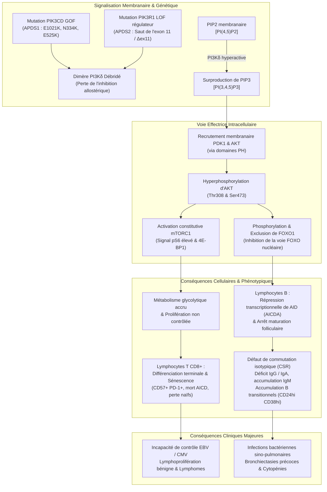
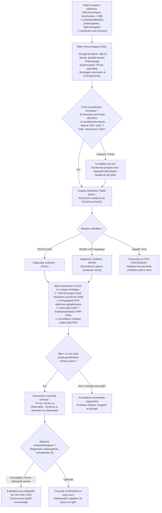

# Fiche #012 — Syndrome PI3Kδ activé (APDS1 / APDS2)

> [!IMPORTANT]
> **Classification IUIS 2024** | Semaine 2 : Déficits de l'immunité adaptative | Jour 12  
> **Gènes associés** : *PIK3CD* (APDS1), *PIK3R1* (APDS2) — *Locus* : 1p36.22 / 5q13.1  
> **Table IUIS 2024** : **III.3** (Déficits immunitaires à prédominance humorale avec réduction sévère d'au moins 2 isotypes d'immunoglobulines, cellules B normales ou réduites, phénotype DICV)

---

## 0. Carte d'identité IUIS 2024

| Paramètre | Caractéristique clinique / Biologique |
| :--- | :--- |
| **Nom de la pathologie** | Syndrome PI3Kδ activé (APDS1 / APDS2) (*Activated PI3K-delta Syndrome*) |
| **Sous-types moléculaires** | **APDS1** : variants gains de fonction hétérozygotes de *PIK3CD*<br>**APDS2** : variants perte de fonction hétérozygotes régulateurs de *PIK3R1* |
| **Code OMIM** | APDS1 : #615513 ; APDS2 : #616005 |
| **Mode de transmission** | Autosomique dominant (AD) |
| **Pénétrance** | Incomplète et expressivité intra-familiale très variable |
| **Protéines mutées** | **p110δ** (sous-unité catalytique) et **p85α/p55α/p50α** (sous-unités régulatrices) de la phosphoinositide 3-kinase de classe IA |
| **Voie de signalisation** | Hyperactivation constitutive de l'axe PI3Kδ / PIP3 / AKT / mTORC1 / S6K |
| **Phénotype B** | Lymphopénie B progressive, effondrement des B mémoires commutés (CD19+CD27+IgD-), hyperplasie des B transitionnels (CD19+CD24^hiCD38^hi), défaut de commutation de classe (CSR) |
| **Phénotype T** | Inversion du ratio CD4/CD8, déplétion sévère des T CD4+ naïfs (CD4+CD45RA+CCR7+), expansion massive de CD8+ mémoire effecteurs sénescents/épuisés (CD8+CD57+PD-1+CD45RO+) |
| **Phénotype humoral** | Hyper-IgM (ou IgM normale haute), effondrement de l'IgG et/ou de l'IgA (pseudo-HIGM / phénotype DICV), défaut de réponse vaccinale polysaccharidique |

---

## 1. TL;DR (Synthèse exécutive)

> [!TIP]
> L'**APDS** est un déficit immunitaire combiné de transmission autosomique dominante associant immunodéficience et dysrégulation lymphoproliférative. Il résulte d'une hyperactivation constitutive de l'isoforme PI3Kδ leuco-spécifique (GOF de *PIK3CD* ou altération inhibitrice de *PIK3R1*) surstimulant la voie AKT/mTOR. La triade pathognomonique associe **infections sino-pulmonaires bactériennes récurrentes avec bronchiectasies précoces**, **lymphoprolifération non maligne chronique** (adénopathies florides, organomégalie, hyperplasie nodulaire lymphoïde) et **infections virales chroniques incontrôlées à Herpesviridae (EBV, CMV)**. Le profil humoral mime un syndrome d'hyper-IgM ou un DICV atypique (IgM normale ou haute, IgG/IgA effondrées, B mémoires bas, B transitionnels hauts, sénescence T CD8+ CD57+). L'avènement des thérapies de précision a transformé le pronostic : le **léniolisib** (inhibiteur oral sélectif de PI3Kδ approuvé en 2023) offre un contrôle ciblé de l'axe métabolique et de la lymphoprolifération.

---

## 2. Contexte historique

L'histoire de l'APDS illustre le rôle de la génomique de nouvelle génération dans la redéfinition des déficits immunitaires héréditaires :
- **2013** : Deux équipes identifient de manière indépendante des variants hétérozygotes faux-sens dans le gène codant la sous-unité catalytique p110δ (*PIK3CD*) chez des patients étiquetés à tort « hyper-IgM syndrome atypique », « DICV précoce » ou « ALPS-like » :
  - L'équipe du *National Institutes of Health* (Lucas et al.) introduit l'acronyme **PASLI** (*p110δ-activating mutation causing senescent T cells, lymphadenopathy, and immunodeficiency*).
  - L'équipe de Cambridge (Angulo et al.) propose l'appellation **APDS** (*Activated PI3K-Delta Syndrome*).
- **2014** : Lucas et al. et Deau et al. découvrent que des délétions et mutations des sites d'épissage du gène *PIK3R1* (sous-unité régulatrice p85α) mènent au saut de l'exon 11 (*exon-skipping*), levant le frein physiologique sur p110δ et produisant un phénotype superposable, nommé **APDS2**.
- **2017–2023** : Élucidation du mécanisme physiopathologique liant signalisation lipidique et sénescence réplicative des lymphocytes T. Développement du léniolisib (CDZ173), première petite molécule inhibitrice sélective de PI3Kδ, validée par essai clinique international de phase 3 (Rao et al., 2023) et approuvée par la FDA en mars 2023.

---

## 3. Épidémiologie & Données de registres

L'APDS est une maladie ultra-rare mais sous-diagnostiquée :
- **Prévalence globale** : Estimée entre 1 et 2 pour 1 000 000 d'habitants. Plus de 350 à 400 patients sont décrits dans la littérature mondiale, avec une répartition d'environ 70–75 % d'APDS1 (*PIK3CD*) et 25–30 % d'APDS2 (*PIK3R1*).
- **Délai diagnostique (Registres ESID & USIDNET)** : L'âge médian d'apparition des premiers symptômes infectieux ou lymphoprolifératifs se situe entre 1 et 2 ans, mais l'âge médian au diagnostic génétique est de 12 ans, marquant une errance diagnostique moyenne de 7 à 10 ans.
- **Données de mortalité et de morbidité (ESID Registry / CEREDIH)** :
  - **Atteinte respiratoire** : Plus de 50 à 60 % des patients présentent des bronchectasies (DDB) constituées dès la deuxième décennie de vie par surinfections bactériennes récidivantes.
  - **Lymphoprolifération** : Manifeste chez > 70 % des individus (adénopathies chroniques diffuses, splénomégalie volumineuse).
  - **Risque d'hémopathie maligne** : Risque cumulé de lymphome non hodgkinien ou hodgkinien de 12 à 15 % dès l'adolescence ou l'âge adulte jeune.
- **Consortium international de transplantation (PIDTC / EBMT / ESID)** : Les registres compilés montrent qu'environ 15 à 20 % des patients sévères ont recours à une allogreffe de cellules souches hématopoïétiques (allo-CSH), avec des défis spécifiques liés au rejet de greffe et aux infections post-greffe.

---

## 4. Physiopathologie, Génétique moléculaire & Schéma 1

### Génétique moléculaire & Hétérodimère PI3K de classe IA
L'enzyme PI3K de classe IA est un hétérodimère obligatoire composé :
1. D'une **sous-unité catalytique p110δ** (codée par *PIK3CD*), dont l'expression est restreinte aux cellules hématopoïétiques.
2. D'une **sous-unité régulatrice p85α** (codée par *PIK3R1*), exprimée de manière ubiquitaire, qui stabilise p110δ et exerce une inhibition allostérique à l'état de repos via ses domaines SH2.

- **Variants de *PIK3CD* (APDS1)** : Les mutations gain de fonction se regroupent au niveau des interfaces fonctionnelles de p110δ. La mutation **c.3061G>A (p.Glu1021Lys / E1021K)** représente plus de 50 % des allèles mutants (domaine kinase C-terminal) ; d'autres mutations prédominent aux résidus E525K (domaine hélicoidal) et N334K (domaine C2). Ces anomalies altèrent la répression exercée par p85α et augmentent l'affinité de fixation aux membranes riches en substrat.
- **Variants de *PIK3R1* (APDS2)** : Il s'agit quasi exclusivement de mutations hétérozygotes touchant les sites donneurs/accepteurs d'épissage des introns 10 et 11, provoquant le **saut de l'exon 11** (*Δex11*, perte des acides aminés 434 à 475 dans le domaine iSH2 de p85α). La protéine tronquée conserve sa capacité d'assemblage avec p110δ mais perd sa capacité d'inhibition basale, débridant l'activité enzymatique.

### Cascades métaboliques et dérèglement lymphocytaire
1. **Surproduction de PIP3** : L'hétérodimère muté phosphoryle le phosphatidylinositol-4,5-bisphosphate [PI(4,5)P2] en phosphatidylinositol-3,4,5-trisphosphate [PI(3,4,5)P3] à un taux supranormal.
2. **Hyperactivation AKT / mTORC1** : Le PIP3 recrute à la membrane plasmique AKT et PDK1 via leurs domaines PH. La phosphorylation d'AKT (Thr308 par PDK1, Ser473 par mTORC2) hyperactive le complexe **mTORC1** (mesuré par l'hyperphosphorylation de la protéine ribosomale **S6** / pS6 et de 4E-BP1).
3. **Inhibition de FOXO1** : AKT phosphoryle les facteurs de transcription de la famille FOXO (FOXO1/FOXO3), provoquant leur séquestration cytosolique et leur dégradation protéasomale.
   - *Dans le lymphocyte B* : L'effondrement nucléaire de FOXO1 inhibe la transcription du gène *AICDA* (Activation-Induced Cytidine Deaminase). Il en résulte une **incapacité de commutation isotypique (CSR)** et de maturation d'affinité, induisant le déficit en IgG/IgA avec accumulation d'IgM non mutées. Les cellules B accumulent des formes immatures/transitionnelles et présentent un bloc de différenciation en B mémoires commutés.
   - *Dans le lymphocyte T* : L'hyperactivation de mTORC1 accélère le métabolisme glycolytique, forçant les T CD8+ à une différenciation terminale précipitée. Ces lymphocytes développent un phénotype de **sénescence réplicative prématurée** (CD8+CD57+CD28-), un épuisement immunitaire (expression de PD-1, TIM-3) et une susceptibilité accrue à l'apoptose induite par restimulation (AICD). Ce dysfonctionnement empêche l'élimination des virus persistants (EBV, CMV).



---

## 5. Présentation clinique, Pathogènes & Phénotype immunologique

### Manifestations cliniques cardinales
- **Infections respiratoires récurrentes (95 %)** : Pneumopathies à répétition, otites moyennes suppurées chroniques, sinusites récidivantes. Les bronchectasies (DDB) peuvent être précoces dès l'âge de 5 ans.
- **Lymphoprolifération non maligne (75–85 %)** :
  - Polyadénopathies chroniques fermes, indolores et généralisées.
  - Splénomégalie volumineuse (parfois compliquée d'hypersplénisme) et hépatomégalie.
  - **Hyperplasie nodulaire lymphoïde (HNL)** touchant les voies aérodigestives : hypertrophie adéno-amygdalienne massive imposant des amygdalectomies itératives, obstruction des voies aériennes supérieures, et HNL gastro-intestinale pouvant déclencher des invaginations intestinales aiguës récidivantes.
- **Auto-immunité et dysrégulation (30–40 %)** :
  - Cytopénies auto-immunes au premier plan : anémie hémolytique auto-immune (AHAI), thrombopénie immunologique (PTI), ou syndrome d'Evans.
  - Entéropathie auto-immune mimant une maladie de Crohn ou une maladie cœliaque (diarrhée chronique, atrophie villositaire, malabsorption).
  - Glomérulonéphrite auto-immune, polyarthrite, thyroïdite.
- **Particularités spécifiques de l'APDS2 (*PIK3R1*)** :
  - **Retard staturo-pondéral prononcé** (petite taille < -2 DS dès la petite enfance).
  - Dysmorphie cranio-faciale, microcéphalie modérée.
  - Spectre de chevauchement avec le **syndrome SHORT** (*Short stature, Hyperextensibility, Ocular depression, Rieger anomaly, Teething delay*), causé par d'autres variants de *PIK3R1*.

### Spectre microbiologique
- **Bactéries encapsulées** : *Streptococcus pneumoniae*, *Haemophilus influenzae*, *Moraxella catarrhalis*, *Pseudomonas aeruginosa* (colonisation sur DDB).
- **Herpesviridae (déficit de contrôle cytotoxique T/NK)** :
  - **EBV** : Mononucléose infectieuse prolongée, virémie EBV chronique non contrôlée, lymphoprolifération induite par l'EBV, risque élevé de transformation maligne.
  - **CMV** : Virémie chronique, pneumopathies, ulcères digestifs.
  - **VZV, HSV, HHV-6** : Zona disséminé, encéphalites herpétiques.
- **Autres opportunistes** : Condylomatose cutanéo-muqueuse extensive (HPV), molluscum contagiosum géant, candidose cutanéo-muqueuse, cas occasionnels de *Pneumocystis jirovecii* ou de cryptosporidiose digestive.

### Exploration phénotypique & Immunologie biologique
- **Profil sérologique** :
  - **IgM** : Élevée (dans 50–60 % des cas) ou normale haute.
  - **IgG et IgA** : Effondrées ou sévèrement diminuées (isolement possible d'une hypogammaglobulinémie IgG globale ou d'un déficit sélectif en sous-classes IgG2/IgG4).
  - Titres d'anticorps post-vaccinaux (tétanos, pneumocoque) indétectables ou rapidement décroissants.
- **Cytométrie en flux lymphocytaire (Empreinte cellulaire caractéristique)** :
  - **Compartiment B** : Cellules B circulantes CD19+ normales ou diminuées. Effondrement quasi-total des B mémoires commutés (CD19+CD27+IgD-) et B mémoires non commutés (CD19+CD27+IgD+). Expansion massive des B transitionnels immatures (CD19+CD24^hiCD38^hi / IgM^hiCD10+).
  - **Compartiment T** : T CD4+ diminués en valeur absolue ; ratio CD4/CD8 inversé (< 0,8 voire < 0,4). Déplétion marquée des T CD4+ naïfs (CD45RA+CCR7+). Expansion majeure des lymphocytes T CD8+ mémoires effecteurs sénescents expriment **CD57**, **CD45RO** et **PD-1**, avec perte de CD27 et CD28.
  - **Biologie fonctionnelle** : Test de phosphorylation de la protéine S6 (pS6) par cytométrie en flux (*phosflow*) sur lymphocytes T/B après stimulation modérée par TCR ou BCR : montre une hyperactivation du signal basal et post-stimulation, inhibable *in vitro* par des inhibiteurs sélectifs de PI3Kδ ou de mTOR.

---

## 6. Complications à long terme & Défis non résolus

### 1. Risque oncologique et hémopathies malignes
Le risque oncologique dans l'APDS est dominé par les lymphomes B, survenant chez 12 à 15 % des patients, avec un âge moyen de survenue autour de 18–25 ans :
- **Sous-types histologiques** : Lymphome diffus à grandes cellules B (DLBCL), Lymphome de Hodgkin (LH), Lymphome de Burkitt, et formes rares de lymphomes de la zone marginale (MALT).
- **Association virologique** : Une proportion majeure de ces proliférations est EBV-dépendante, mais des proliférations EBV-négatives surviennent également du fait de la dérégulation intrinsèque de la kinase proto-oncogène p110δ.
- **Difficulté diagnostique** : La distinction histologique entre une hyperplasie nodulaire lymphoïde réactionnelle (avec centres germinatifs géants et proliférations plasmocytaires florides) et un lymphome B de bas grade représente un défi anatomopathologique permanent.

### 2. Dégradation pulmonaire progressive
L'installation de dilatations des bronches (DDB) bilatérales cylindriques ou kystiques est progressive et peut s'installer dès l'enfance malgré une prise en charge substitutive en immunoglobulines. Cette atteinte expose à l'insuffisance respiratoire chronique obstructive, aux colonisations par *Pseudomonas* et mycobactéries non tuberculeuses, et aux hémoptysies.

### 3. Entéropathie réfractaire et malabsorption
L'atteinte intestinale évolue fréquemment vers une atrophie villositaire sévère, réfractaire aux régimes sans gluten et aux corticoïdes, combinant inflammation cytotoxique auto-immune et infiltration par hyperplasie folliculaire lymphoïde de la lamina propria.

### 4. Dilemmes thérapeutiques non résolus
- Quelle est la durée optimale des thérapies ciblées (léniolisib) ? Un traitement débuté dans l'enfance permet-il de prévenir définitivement le remodelage bronchique et le lymphome ?
- Quel statut conférer aux variants de signification inconnue (VUS) de *PIK3CD* et *PIK3R1* identifiés lors de séquençages NGS à haut débit, en l'absence de plateforme de cytométrie phosphoflow pS6 validée ?

---

## 7. Avenues thérapeutiques

```
                     ┌──────────────────────────────────────────────┐
                     │          Prise en charge de l'APDS           │
                     └──────────────────────┬───────────────────────┘
                                            │
        ┌───────────────────────────────────┼───────────────────────────────────┐
        ▼                                   ▼                                   ▼
┌───────────────────────┐       ┌───────────────────────┐       ┌───────────────────────┐
│  Thérapie ciblée      │       │  Mesures de support   │       │ Traitement curatif    │
│  - Léniolisib (Joenja)│       │  - IgRT (IV / SC)     │       │ - Allogreffe de CSH   │
│  - Sirolimus (mTORi)  │       │  - TMP-SMX, Macrolide │       │   (indication ciblée  │
│                       │       │  - Prophylaxie antivir│       │    formes réfractaires)│
└───────────────────────┘       └───────────────────────┘       └───────────────────────┘
```

### 1. Thérapie ciblée de précision : Léniolisib (Joenja®)
- **Mécanisme** : Inhibiteur oral puissant, sélectif de l'isoforme PI3Kδ (CI50 = 11 nM, sélectivité > 20 à 200 fois supérieure vis-à-vis des isoformes α, β et γ).
- **Données cliniques pivots (Phase III, Rao et al. *Blood* 2023 ; Extension long terme *JACI* 2024)** :
  - Réduction statistiquement significative de la taille des adénopathies cibles index (somme des diamètres perpendiculaires, SPD).
  - Régression de la splénomégalie.
  - Normalisation des sous-populations lymphocytaires (augmentation majeure du pourcentage de B naïfs, réduction des T CD8+ sénescents et des B transitionnels).
  - Réduction spectaculaire des taux sériques d'IgM pathologiques.
- **Autorisation de mise sur le marché** : Approuvé par la FDA (mars 2023) pour les patients de 12 ans et plus, à la posologie de **70 mg par voie orale, deux fois par jour**. En cours d'évaluation chez l'enfant de moins de 12 ans et auprès de l'EMA.

### 2. Inhibiteurs de la voie mTOR (Sirolimus / Rapamycine)
- Utilisé historiquement pour inhiber l'hyperactivation en aval de mTORC1.
- **Efficacité** : Réduction substantielle de la lymphoprolifération bénigne (adénopathies, splénomégalie) et contrôle des cytopénies auto-immunes.
- **Limites** : Faible efficacité sur la restauration humorale (pas de correction du CSR ni des réponses vaccinales), taux résiduel cible étroit (4–8 ng/mL), toxicité fréquente (aphtose invalidante, hypertriglycéridémie, néphrotoxicité, pneumopathie interstitielle médicamenteuse).

### 3. Traitements substitutifs et prophylaxies anti-infectieuses
- **Immunoglobulines de substitution (IgRT)** : Par voie intraveineuse (IgIV) ou sous-cutanée (IgSC) à dose initiale de 0,4 à 0,6 g/kg toutes les 3 à 4 semaines, ajustée pour maintenir un taux résiduel d'IgG > 7–8 g/L (ou > 8–9 g/L en présence de bronchectasies).
- **Antibioprophylaxie** : Cotrimoxazole (TMP-SMX, 5 mg/kg/j de triméthoprime 3 jours par semaine) pour la prévention de *Pneumocystis jirovecii* et des surinfections ORL/bronchiques. Azithromycine au long cours (250–500 mg 3 fois par semaine) pour ses propriétés immunomodulatrices et protectrices pulmonaires.
- **Prophylaxie antivirale** : Valaciclovir en cas de poussées récurrentes d'infections à HSV/VZV ou de charges virales sanguines EBV/CMV chroniques fluctuantes.

### 4. Allogreffe de cellules souches hématopoïétiques (Allo-CSH)
- **Indications** : Réservée aux phénotypes sévères résistant aux inhibiteurs ciblés : cytopénies auto-immunes réfractaires menaçant le pronostic vital, lymphoprolifération incontrôlable, atteinte pulmonaire progressive sous traitement, ou transformation lymphomateuse.
- **Résultats de l'étude multicentrique internationale (Dimitrova et al., *JACI* 2022)** :
  - Évaluation de 57 patients greffés dans le monde.
  - **Survie globale (OS)** à 2 ans : 86 % ; survie sans événement (EFS) : 68 %.
  - **Défis majeurs** : Risque important d'échec de prise de greffe / rejet primaire ou secondaire (survenant chez 12 à 15 % des receveurs, corrélé à un microenvironnement hyper-inflammatoire et à la persistance de cellules NK hôtes) nécessitant fréquemment une seconde transplantation.
  - Régression des manifestations hématologiques, infectieuses et lymphoprolifératives chez les patients ayant un chimérisme donneur stable.

---

## 8. Section pratique (Bedside, Guidelines & Schéma 2)

### Algorithme diagnostique et de décision thérapeutique



### Diagnostic différentiel

| Entité clinique | Gène(s) / Étiologie | Clinique différentielle | Particularités biologiques discriminantes |
| :--- | :--- | :--- | :--- |
| **Syndrome lymphoprolifératif auto-immun (ALPS)** | *FAS*, *FASLG*, *CASP10* | Lymphoprolifération massive, cytopénies auto-immunes, absence habituelle de DDB et d'infections bactériennes sévères | Élévation majeure des cellules T double-négatives TCRαβ+CD4-CD8- (> 1,5–2 %), vitamine B12 et Fas-ligand soluble très élevés ; gammaglobulines normales ou polyclonales élevées |
| **Syndrome d'hyper-IgM lié à l'X (X-HIGM)** | *CD40LG* (Xq26) | Début précoce, infections bactériennes sévères, pneumonie à *Pneumocystis*, cryptosporidiose et cholangite sclérosante | Absence d'expression de CD40L sur les T activés, absence de B transitionnels proéminents, pas d'adénopathies chroniques florides (tissu lymphoïde hypoplasique) |
| **Déficit immunitaire commun variable (DICV standard)** | Polygénique (*TNFRSF13B*, etc.) | Infections bactériennes, début souvent plus tardif (adulte jeune), bronchectasies | Pas d'expansion constante des CD8+CD57+ sénescents, pas d'hyper-IgM typique, pas de réponse au léniolisib |
| **Déficit en CTLA-4 / LRBA** | *CTLA4*, *LRBA* | Entéropathie sévère type Crohn, infiltrats lymphocytaires d'organes cibles (poumon, foie, SNC) | Baisse de CTLA-4 intracellulaire en cytométrie de flux, réponse spécifique aux agonistes CTLA-4-Ig (Abatacept) |

### 6 Perles cliniques (Bedside Pearls)

1. **Le piège de la fausse mononucléose infectieuse traînante** : Devant un tableau de mononucléose infectieuse sévère chez un enfant, avec virémie EBV persistante au-delà de 8 à 12 semaines associée à des adénopathies cervicales massives persistantes, le réflexe APDS doit être immédiat.
2. **L'indice de l'amygdalectomie récidivante** : Des antécédents d'adénoïdectomies ou d'amygdalectomies itératives dues à des repousses lymphoïdes volumineuses obstructives chez un enfant faisant des bronchites récidivantes sont très évocateurs d'APDS (hyperplasie nodulaire lymphoïde).
3. **IgM élevée ou normale haute avec IgG/IgA basses = Évoquer l'APDS avant le DICV** : Ce patron de pseudo-hyper-IgM couplé à une organomégalie doit orienter directement vers l'analyse de *PIK3CD*/*PIK3R1*. Attention : une IgM normale n'élimine absolument pas le diagnostic.
4. **Attention à la biopsie ganglionnaire faussement rassurante** : Les biopsies ganglionnaires dans l'APDS montrent typiquement une hyperplasie folliculaire atypique massive avec atténuation des zones du manteau, facilement confondue avec un lymphome malin ou au contraire banalisée comme « adénite réactionnelle ». Toute discordance impose une relecture en anatomopathologie experte.
5. **Surveillance scanographique thoracique systématique** : Dès le diagnostic génétique posé, même chez un patient asymptomatique sur le plan pulmonaire, un scanner thoracique haute résolution à faible dose s'impose pour rechercher des bronchectasies débutantes infracliniques.
6. **Le repère phénotypique APDS2** : Face à une suspicion d'APDS chez un patient présentant un retard de croissance staturo-pondéral net (< -2 DS) et/ou une microcéphalie, cibler prioritairement l'analyse du saut de l'exon 11 de *PIK3R1*.

---

## 9. Nouveautés & Littérature récente (2022–2026)

- **Approbation de thérapie ciblée de précision (Léniolisib)** :
  - L'essai clinique de phase 3 international randomisé contre placebo mené par Rao et al. (*Blood*, 2023) a démontré l'efficacité du léniolisib sur la réduction volumétrique des adénopathies (-40 % en 12 semaines) et la restauration des populations de lymphocytes B naïfs chez 31 patients âgés de 12 ans et plus.
  - L'étude d'extension en ouvert à long terme (Rao et al., *J Allergy Clin Immunol*, 2024) a confirmé un profil de tolérance favorable et une efficacité prolongée sur plus de 2 ans, documentant une diminution des taux d'infections et une réduction durable du recours aux immunoglobulines substitutives.
- **Mise au point sur la greffe allogénique (Allo-CSH)** :
  - L'étude rétrospective internationale la plus vaste à ce jour (Dimitrova et al., *J Allergy Clin Immunol*, 2022) portant sur 57 patients greffés dans 18 centres a établi des recommandations sur le conditionnement : les régimes d'intensité réduite contenant du busulfan ou du tréosulfan avec sérothérapie (ATG/Alemtuzumab) réduisent la mortalité toxique, mais le taux de rejet reste une préoccupation majeure nécessitant un monitoring rapproché du chimérisme hématopoïétique.
- **Avancées diagnostiques & Recommandations de consensus** :
  - La revue de synthèse de Vanselow et al. (*Frontiers in Immunology*, 2023) et les consensus européens mettent l'accent sur la standardisation des panels de cytométrie (détection de pS6) pour reclassifier les nombreux variants d'incertitude fonctionnelle (VUS) de *PIK3CD* découverts par séquençage génomique.
- **Thérapie génique et édition du génome** :
  - Des études précliniques d'édition génique par CRISPR-Cas9 ciblant spécifiquement la correction de la mutation dominante E1021K de *PIK3CD* dans les cellules souches hématopoïétiques autologues ouvrent la voie à des approches curatives exemptes de réaction du greffon contre l'hôte (GVHD).

---

## 10. Références vérifiées

1. **Rao VK, Webster S, Šedivá A, Plebani A, Schuetz C, Shcherbina A, et al.** A randomized, placebo-controlled phase 3 trial of the PI3Kδ inhibitor leniolisib for activated PI3Kδ syndrome. *Blood*. 2023 Mar 2;141(9):971-983. doi: 10.1182/blood.2022018546. [PMID: 36399712] | [PMCID: PMC10163280].
2. **Rao VK, Kulm E, Šedivá A, Plebani A, Schuetz C, Shcherbina A, et al.** Interim analysis: Open-label extension study of leniolisib for patients with APDS. *J Allergy Clin Immunol*. 2024 Jan;153(1):265-274.e9. doi: 10.1016/j.jaci.2023.09.032. [PMID: 37797893] | [PMCID: PMC10841669].
3. **Dimitrova D, Nademi Z, Maccari ME, Ehl S, Uzel G, Tomoda T, Okano T, Imai K, et al.** International retrospective study of allogeneic hematopoietic cell transplantation for activated PI3K-delta syndrome. *J Allergy Clin Immunol*. 2022 Jan;149(1):410-421.e7. doi: 10.1016/j.jaci.2021.04.036. [PMID: 34033842] | [PMCID: PMC8611111].
4. **Vanselow S, Wahn V, Schuetz C.** Activated PI3Kδ syndrome - reviewing challenges in diagnosis and treatment. *Front Immunol*. 2023 Jul 20;14:1208567. doi: 10.3389/fimmu.2023.1208567. [PMID: 37600808] | [PMCID: PMC10432830].
5. **Duggan S, Al-Salama ZT.** Leniolisib: First Approval. *Drugs*. 2023 Jul;83(10):943-948. doi: 10.1007/s40265-023-01894-4. [PMID: 37256490].